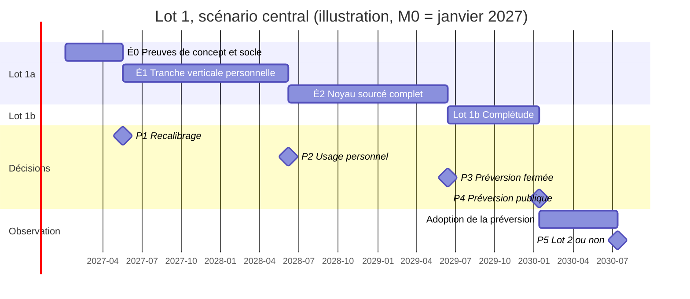

# Roadmap — Plateforme Open Source de Veille et de Diffusion IA

| Champ | Valeur |
|---|---|
| Document | `ROADMAP.md` |
| Version | 0.1 (brouillon pour validation) |
| Date | 2026-10-11 |
| Statut | À valider par Joël |
| Phase | Conception — aucun code |
| Documents d'entrée | `FUNCTIONAL_ANALYSIS.md` v0.2 (validée, D1 à D13), `ARCHITECTURE.md` v0.1 (approuvée, DA1 à DA10), `TECH_CHOICES.md` v1.0 (validé, DT1 à DT14), `TECH_CHOICES_REVIEW.md` v1.0, `RISKS.md` v1.0 (validé, DR1 à DR9, réponse à Q-R1) |
| Document suivant | Aucun : la validation de ce document clôt la phase de conception et autorise le premier code (point de décision P0) |

**Historique**

| Version | Date | Changements |
|---|---|---|
| 0.1 | 2026-10-11 | Première version : modèle de capacité issu de Q-R1, estimation en heures de chaque jalon, découpage du lot 1a en trois étapes, preuves de concept S1 à S7 chiffrées, chantiers non techniques, points de décision, critères d'arrêt, réductions de périmètre préparées, décisions DRM1 à DRM7 |

> Cette roadmap part d'une hypothèse **prudente** et la prend au sérieux : **un développeur, 15 à 20 heures par semaine, sans contributeur ni financement**. Elle dit ce que cette capacité permet de livrer, dans quel ordre, et ce qui se passe quand la réalité s'écarte du plan. Les contributions et financements éventuels sont traités comme des **accélérateurs** (§12) : ils raccourcissent le plan quand ils se concrétisent, ils n'y figurent jamais comme des hypothèses.
>
> Elle ne remet en cause aucune décision validée. Quand la capacité rend une décision intenable dans un délai raisonnable, elle le dit et propose une **décision de roadmap** (§15), jamais un retrait silencieux.
>
> Elle remplace les valeurs indicatives du §8.5 de `RISKS.md`, comme le prévoit sa version 1.0.

---

## Sommaire

1. [Synthèse](#1-synthèse)
2. [Hypothèse de capacité et modèle de calcul](#2-hypothèse-de-capacité-et-modèle-de-calcul)
3. [Principes de planification](#3-principes-de-planification)
4. [Vue d'ensemble des jalons](#4-vue-densemble-des-jalons)
5. [Lot 1a — Noyau sourcé](#5-lot-1a--noyau-sourcé)
6. [Lot 1b et diffusion](#6-lot-1b-et-diffusion)
7. [Lots 2, 3 et 4 : horizon conditionnel](#7-lots-2-3-et-4--horizon-conditionnel)
8. [Chantiers non techniques](#8-chantiers-non-techniques)
9. [Points de décision](#9-points-de-décision)
10. [Critères d'arrêt](#10-critères-darrêt)
11. [Réductions de périmètre préparées](#11-réductions-de-périmètre-préparées)
12. [Accélérateurs](#12-accélérateurs)
13. [Suivi et indicateurs](#13-suivi-et-indicateurs)
14. [Lecture critique](#14-lecture-critique)
15. [Décisions à valider](#15-décisions-à-valider)
16. [Annexes](#16-annexes)

---

## 1. Synthèse

### 1.1 Le constat

À la capacité retenue, le temps réellement disponible pour écrire des fonctions est d'environ **43 à 58 heures par mois** avant la première version publique (§2.2). Le lot 1, seul, représente **1 440 à 2 210 heures** de travail estimé (§5, §6). Les quatre lots validés en représentent **4 000 à 6 500**.

| Horizon | Effort estimé | Durée, scénario central | Fourchette (optimiste à prudent) |
|---|---|---|---|
| Fin des preuves de concept (É0) | 180 à 260 h | **4 à 5 mois** | 3 à 6 mois |
| Premier usage réel par le mainteneur (fin d'É1) | + 520 à 760 h | **17 mois** | 12 à 24 mois |
| Préversion fermée, testeurs invités (fin du lot 1a) | + 470 à 755 h | **29 mois** | 20 à 41 mois |
| Préversion publique (fin du lot 1b) | + 270 à 435 h | **36 mois** | 25 à 51 mois |
| Lot 2 terminé, s'il est engagé (après 6 mois d'observation) | + 1 200 à 1 900 h | **≈ 7 ans** | 5 à 10 ans |
| Périmètre complet (lots 1 à 4) | 4 040 à 6 460 h | **≈ 11 ans** | 8 à 16 ans |

Durées comptées depuis **M0**, premier jour de code autorisé. Le scénario central est la base de planification (DRM1).

### 1.2 Ce que la roadmap engage, et ce qu'elle n'engage pas

- **Engagé** : le **lot 1**, ordonné en quatre jalons (É0, É1, É2, lot 1b) qui livrent chacun une valeur vérifiable, avec une **préversion fermée** à la fin du lot 1a et une **préversion publique** à la fin du lot 1b (DRM2, DRM4).
- **Conditionnel** : le **lot 2**, engagé seulement si la préversion publique trouve des utilisateurs (critère CA8, §10).
- **Non planifié** : les **lots 3 et 4**. À la capacité de base, ils commenceraient dans cinq à dix ans ; les dater serait une fiction. Ils restent dans la vision du produit et redeviennent planifiables si la capacité change (§12) (DRM3).

### 1.3 Les cinq règles qui tiennent le plan

1. **Le glissement est absorbé par le périmètre, puis par le calendrier, jamais par la qualité ni par les heures** (DRM6). Les protections « invisibles » (isolation, PDP, ASVS, idempotence, instantanés, tests) ne sont jamais reportées pour tenir une date (§11.1).
2. **Le plafond de 20 heures par semaine est une limite, pas une cible à dépasser en fin de jalon** (R-O05).
3. **Les preuves de concept ont une durée maximale et le droit de contredire les documents** (§5.1).
4. **Les réductions de périmètre sont préparées à l'avance et appliquées dans l'ordre** quand un critère se déclenche, sans nouveau débat (§11, DRM5).
5. **Le plan est recalibré à chaque point de décision** sur les heures réellement mesurées (§9). Le recalibrage de P1, à la fin des preuves de concept, est le moment le plus important de cette roadmap.

### 1.4 Le verdict franc

Le projet est **faisable** à cette capacité **s'il se limite au lot 1 pendant trois ans environ**, et s'il accepte que la **préversion sans audit** soit le scénario de référence (R-O09, désormais critique). Il **n'est pas faisable** dans son périmètre complet à cette capacité : ce n'est pas un défaut de la conception, c'est l'arithmétique d'une personne à mi-temps face à un produit de rédaction. La roadmap en tire les conséquences plutôt que de les reporter.

Le plus grand danger n'est pas technique : c'est d'avancer **dix-sept mois sans utilisateur**, puis trente sans utilisateur externe. La tranche personnelle É1, la préversion fermée et les critères d'usage (CA7, CA8) existent pour qu'un projet qui ne sert à personne s'en aperçoive tôt.

---

## 2. Hypothèse de capacité et modèle de calcul

### 2.1 Hypothèse retenue (réponse à Q-R1)

| Paramètre | Valeur | Statut |
|---|---|---|
| Personnes | **1 développeur principal**, qui tient aussi tous les rôles du §1.4 de `RISKS.md` (mainteneur, sécurité, qualité IA, connecteurs) | Ferme |
| Temps brut | **15 à 20 heures par semaine** | Ferme ; 20 h est un plafond (DRM6) |
| Semaines actives | **46 par an** (congés, maladie, imprévus de la vie : 6 semaines) | Hypothèse de calcul |
| Contributeurs réguliers | **Aucun** | Ferme |
| Financement | **Aucun** | Ferme |
| Contributions, financements | **Accélérateurs**, intégrés au plan seulement une fois concrétisés (§12) | Ferme |

### 2.2 Du temps brut au temps de fonctions

Toutes les heures ne produisent pas des fonctions. Le modèle distingue trois usages du temps :

| Usage | Avant la préversion publique | Après la préversion publique | Contenu |
|---|---|---|---|
| **Fonctions** (code, tests, documentation de la fonction) | **75 %** | **55 %** | Ce que les estimations des §5 à §7 mesurent |
| **Entretien** | 10 % | 20 % | Mises à jour de dépendances, intégration continue, correctifs, petites refontes |
| **Projet** | 15 % | 25 % | Revues du registre, financement, juridique, gouvernance, sécurité (processus), support, communauté |

| Par mois (46 semaines / 12) | 15 h/sem. | 20 h/sem. | Central |
|---|---|---|---|
| Temps brut | 57,5 h | 76,7 h | 67 h |
| **Fonctions, avant préversion publique** | **43 h** | **58 h** | **50 h** |
| Fonctions, après préversion publique | 32 h | 42 h | 37 h |

Une année avant la préversion apporte donc **environ 520 à 690 heures de fonctions**, soit l'équivalent de **trois à quatre mois à temps plein**. C'est le chiffre à garder en tête pour lire tout le reste.

### 2.3 Trois scénarios

| Scénario | Effort | Capacité | Usage |
|---|---|---|---|
| **Optimiste** | Borne basse | 20 h/sem. | Ce qui arrive si tout se passe bien ; ne sert jamais à promettre |
| **Central** | Milieu de la fourchette | 17,5 h/sem. | **Durée visée** de chaque jalon (DRM1) |
| **Prudent** | Borne haute | 15 h/sem. | Ordre de grandeur des seuils de réduction (§10) |

### 2.4 Statut des estimations

Les heures de cette roadmap sont des **estimations de conception, non mesurées**. Elles supposent un développeur expérimenté en Python et en React, qui utilise couramment des assistants de programmation, et elles incluent tests et documentation de chaque fonction. Elles n'incluent ni une refonte imposée par une preuve de concept, ni le support d'utilisateurs avant la préversion.

Une erreur d'un facteur 1,5 dans un sens ou dans l'autre est plausible. D'où :

| Vélocité réelle mesurée à P1 | Préversion publique (scénario central) |
|---|---|
| 0,75 × l'estimation (plus lent) | ≈ 48 mois |
| 1 × | ≈ 36 mois |
| 1,5 × (plus rapide, par exemple grâce aux assistants de programmation) | ≈ 24 mois |

Les assistants de programmation accélèrent l'écriture du code ; ils n'accélèrent guère ce qui borne ce projet : la revue de sécurité des parcours de compte, les essais sur de vrais hébergements WordPress, les tests d'utilisabilité, les questions juridiques. C'est pourquoi la base reste à 1 ×, et la mesure à P1 tranche.

---

## 3. Principes de planification

| ID | Principe | Source |
|---|---|---|
| **PP1** | Aucune date absolue avant M0 ; les jalons sont exprimés en mois depuis M0, puis convertis en dates à P0 | — |
| **PP2** | Chaque jalon livre une **valeur vérifiable** par quelqu'un d'autre que la personne qui l'a construite, sauf É0 (preuves) | R-O08, R-P06 |
| **PP3** | Un jalon n'est atteint que lorsque **tous** ses critères de sortie sont verts ; un critère non atteint n'est pas « reporté », il retient le jalon | RISKS §10.2 |
| **PP4** | Ce qui est **coûteux à ajouter plus tard** est livré en premier ; ce qui est **coûteux seulement à faire** est livré quand il sert | RISKS §4.1, M-01 |
| **PP5** | Le glissement est absorbé par le périmètre (§11), puis par le calendrier ; jamais par la qualité, jamais par des heures au-delà du plafond | DRM6 |
| **PP6** | Une preuve de concept a une question, un critère chiffré, une durée maximale ; à l'échéance elle conclut, même négativement, et peut contredire un document validé | RISKS §8.1, R-O15 |
| **PP7** | Les mécanismes de sûreté de l'automatisation sont livrés **avant ou avec** les automatisations qu'ils protègent | FA §14 |
| **PP8** | Un accélérateur ne modifie le plan qu'au point de décision qui suit sa **concrétisation** (contrat signé, contributeur actif depuis trois mois) | Q-R1 |
| **PP9** | Les documents de conception sont une **base d'hypothèses** : ils sont mis à jour par décisions courtes (ADR dans le dépôt) aux points de décision, pas réécrits | R-O15 |

---

## 4. Vue d'ensemble des jalons

### 4.1 Tableau des jalons

| Jalon | Objet | Effort | Durée visée (centrale) | Cumul depuis M0 (opt. / central / prudent) | Valeur vérifiable | Point de décision |
|---|---|---|---|---|---|---|
| **É0** | Preuves de concept S1 à S7 et socle | 180 à 260 h | 4,4 mois | 3 / **4,4** / 6 mois | Rapports S1 à S7 ; documents corrigés ; vélocité mesurée | **P1** |
| **É1** | Tranche verticale personnelle | 520 à 760 h | 12,7 mois | 12 / **17** / 24 mois | Le mainteneur rédige ses propres articles sourcés avec l'outil | **P2** |
| **É2** | Noyau sourcé complet (fin du lot 1a) | 470 à 755 h | 12,2 mois | 20 / **29** / 41 mois | Des testeurs invités installent l'outil et publient vers WordPress | **P3** : préversion fermée |
| **Lot 1b** | Complétude du lot 1 | 270 à 435 h | 7,0 mois | 25 / **36** / 51 mois | Préversion publique ; test d'utilisabilité à 5 personnes | **P4** : préversion publique |
| Observation | Adoption de la préversion | — | 6 mois | **42** mois | Utilisateurs réguliers externes | **P5** : lot 2 ou non |

### 4.2 Diagramme du scénario central

Illustration avec M0 fixé au 4 janvier 2027 ; les dates réelles seront fixées à P0.

| Point | Date illustrative (central) |
|---|---|
| P1 | mi-mai 2027 |
| P2 | début juin 2028 |
| P3 | mi-juin 2029 |
| P4 | mi-janvier 2030 |
| P5 | mi-juillet 2030 |

### 4.3 Répartition de l'effort du lot 1

| Bloc | Heures (central) | Part (arrondie) |
|---|---|---|
| Preuves de concept et socle | 220 | 12 % |
| Sûreté : identité, isolation, tâches, PDP, audit, secrets | 300 | 16 % |
| Collecte, veille, passerelle IA, rédaction | 315 | 17 % |
| Garde-fous, validation, traçabilité, rendu, export | 300 | 16 % |
| Interface et API | 200 | 11 % |
| Publication (WordPress, Ghost) | 170 | 9 % |
| Exploitation : sauvegarde, migrations, installation, santé, préparation des versions | 195 | 11 % |
| Utilisabilité et corrections issues de l'usage | 125 | 7 % |
| **Total** | **1 825** | **100 %** |

Les preuves de concept représentent environ 12 % du lot 1, sous le seuil de 15 % qui signale un dérapage (RISKS §4.1). Près d'un tiers du lot est consacré à la sûreté, aux garde-fous et à la traçabilité : c'est le prix de la promesse du produit, et c'est la part qu'il ne faut pas comprimer.

---

## 5. Lot 1a — Noyau sourcé

Le lot 1a reprend le contenu décidé par DR1 (« noyau sourcé » avec WordPress seul et interface française) et l'ordonne en trois étapes (DRM2). Rien n'est retiré du lot 1a ; seul l'ordre change, pour qu'un usage réel commence avant la fin du lot.

### 5.1 É0 — Preuves de concept et socle

**Objet.** Vérifier les sept hypothèses les plus fragiles avant d'écrire le code qui en dépend, mettre en place le socle commun et **mesurer la vélocité réelle**.

**Ordre.** S6 (le squelette sert aux autres), puis S1 et S2 (base et file), S3, S5, S4, enfin S7 (qui réutilise le format de S3 et le squelette de S6).

| ID | Question écrite | Critère de réussite (seuils proposés, ajustables au lancement de la preuve, jamais après) | Durée max. | Si échec |
|---|---|---|---|---|
| **S6** Squelette de livraison | Une image unique multirôle, Compose, Caddy et l'interface statique s'installent-ils simplement ? Les secrets peuvent-ils être déchiffrables par le worker seul (DR6) ? | Installation sur VPS vierge 2 vCPU / 4 Go en **≤ 15 min** en suivant la documentation ; mise à jour avec migration et retour arrière documenté ; un test montre que le **processus API ne peut pas déchiffrer** un secret chiffré par clé publique | 24 h | DR6 retombe sur ADR-11 tel quel (clé partagée), risque R-S03 recoté ; révision de TC-13 soumise à Joël |
| **S1** Charge PostgreSQL et RLS | Le profil solo tient-il avec la RLS forcée ? | Jeu synthétique : 200 sources, 100 000 éléments, 300 000 passages vectorisés, 2 000 articles. Mémoire de la pile **≤ 3,4 Go** en charge ; **p95 < 300 ms** sur les cinq lectures principales (flux de tri, recherche plein texte, recherche vectorielle top 20, bibliothèque, détail d'article) ; surcoût de la RLS **≤ 20 %** ; test « requête sans contexte = zéro ligne » vert ; rôles applicatif, propriétaire et migration séparés (M-12) | 24 h | Leviers ordonnés de TC §8.4 ; seuils du §8.5 révisés ; profil solo porté à 6 Go si nécessaire, soumis à Joël |
| **S2** File de tâches | Procrastinate tient-il les garanties attendues ? DBOS fait-il mieux ? | Tâche enfilée dans la transaction SQLAlchemy : annulation de la transaction ⇒ **0 tâche** (100 essais sur 100) ; 1 000 tâches avec arrêts brutaux aléatoires du worker : **0 perte**, **0 double effet** pour les tâches à clé d'idempotence, reprise **≤ 5 min** ; annulation ciblée ; fonctionnement avec connexions soumises à la RLS (`SET LOCAL`, V8) | 24 h | DBOS ; module interne seulement si les deux échouent (TC-06) |
| **S3** Format de document et éditeur | Le format « Document plateforme v1 » survit-il aux allers-retours réels ? | Corpus de 30 documents (dont 10 collés depuis Word et Google Docs, 10 sorties IA en Markdown restreint) : aller-retour JSON → HTML → WordPress et Ghost **sans perte** des éléments obligatoires (bloc Sources, mention IA, liens, titres, citations) sur **100 %** du corpus ; rendu Python et rendu de l'éditeur **concordants** sur 100 % après normalisation ; décision Tiptap contre BlockNote écrite | 32 h | Révision de TC-07 soumise à Joël avant tout code de rédaction |
| **S5** Similarité et embeddings | Le modèle d'embeddings local tient-il en mémoire et voit-il les traductions ? | Corpus sous licence libre (réutilisé par M-14) de 200 paires source / texte dérivé FR et EN : 50 traductions, 50 paraphrases proches, 100 textes indépendants sur le même sujet. Modèle **≤ 500 Mo** de mémoire ; volume quotidien solo (2 000 éléments) vectorisé en **≤ 30 min** de CPU sur 2 vCPU ; aux seuils retenus, **≥ 90 %** des quasi-copies et des traductions détectées avec **≤ 5 %** de faux positifs ; seuils inter-langues calibrés (DR4) | 32 h | Modèle plus gros hors profil solo, ou similarité inter-langues en alerte seulement : **DR4 serait alors remis en cause**, ce qui doit être soumis à Joël |
| **S4** Passerelle IA | L'usage « rédaction » fonctionne-t-il sur des fournisseurs variés ? | Quatre fournisseurs dont un local (Ollama), un par protocole compatible (Groq ou OpenRouter) et Anthropic en natif ; 50 briefs par fournisseur : **≥ 95 %** de sorties structurées valides après au plus une réparation pour les profils déclarés « testés » ; budget à réservation **jamais dépassé** sur 200 appels concurrents ; replis corrects sur erreurs 429 et 5xx simulées | 24 h | Profils non conformes marqués « non testés » ; révision de TC-08 si l'adaptateur générique échoue |
| **S7** Connecteurs CMS | La publication sans doublon est-elle possible sur WordPress et Ghost ? Avec quels droits ? | WordPress sur trois configurations (auto-hébergé récent, hébergement mutualisé avec extension de sécurité, version majeure précédente) et Ghost auto-hébergé : 100 publications avec pannes injectées (délai dépassé après envoi, coupure) ⇒ **0 doublon** ; **≥ 95 %** rapprochées automatiquement, le reste en état « inconnu » présenté à l'humain, **jamais republié à l'aveugle** ; V1 à V3 (RISKS §11.2) vérifiés ; décision sur une extension WordPress compagnon facultative ; confirmation ou inversion de « WordPress d'abord » (DR1) | 40 h | Rapprochement heuristique documenté et signalé à l'utilisateur ; ou extension compagnon ; ou inversion vers Ghost d'abord ; choix soumis à Joël |

**Durées maximales cumulées : 200 h.** Le volet de S4 « appels de Pydantic AI routés par la passerelle » (TC §25) ne sert qu'au lot 3 : il est **reporté à l'entrée du lot 3** (DRM2).

**Socle (40 à 60 h)**, en parallèle de S6 : dépôt public sous AGPL-3.0 avec DCO dès le premier commit (DR8, DRM7), intégration continue avec typage strict et `import-linter` bloquant (RISKS §6), liste de contrôle ASVS niveau 2 versionnée (RISKS §8.4), modèle d'ADR, gabarit de rapport de preuve de concept, journal de temps par domaine (§13.2).

**Critères de sortie d'É0.**

- S1 à S7 conclues, chacune avec un rapport (`docs/spikes/Sx.md`) : question, protocole, mesures, conclusion, conséquences sur les documents.
- Toute contradiction avec un document validé soumise à Joël et tranchée ; documents mis à jour par ADR.
- Intégration continue verte avec `import-linter` bloquant.
- **Vélocité mesurée** sur le socle et les preuves ; plan recalibré (P1).

### 5.2 É1 — Tranche verticale personnelle

**Objet.** Le plus petit produit qui rende un service réel au mainteneur lui-même, construit **sur les fondations définitives** : on ne jette rien, on ne contourne rien. C'est la réponse au signal précoce de R-O08 (« aucun utilisateur réel six mois après le début du code »), dans la mesure où la capacité le permet.

**Parcours couvert.** `Sources RSS → tri → brief (avec apport propre) → brouillon sourcé → contrôles → relecture → « préparer et copier » vers son site → instantané et archive`.

**Condition d'exploitation.** Instance **non exposée publiquement** : accessible seulement par réseau privé virtuel ou derrière un proxy d'authentification (repli prévu par RISKS §4.7), un seul utilisateur. Les parcours de compte complets ASVS niveau 2 arrivent en É2.

**Contenu.**

| Domaine | Livré en É1 | Laissé à É2 |
|---|---|---|
| Identité | Compte administrateur, mot de passe Argon2id, sessions serveur, CSRF, limitation de débit de base, ré-authentification ; **modèle de comptes à identités multiples** dès le départ | Réinitialisation par e-mail, jetons d'API, notifications e-mail, revue ASVS complète |
| Espaces | Espace unique, marque par défaut masquée (UXM), colonne d'espace et **RLS forcée** partout, base des tests d'isolation | Tests d'isolation étendus aux tâches et à la recherche |
| Automatisation | Tâches et planificateur (selon S2) ; **PDP point unique** avec niveaux 0 à 2, publication au niveau 1 (R1) ; tests de propriétés | Arrêt d'urgence (R5), tests de propriétés complets |
| Audit | **Journal d'audit chaîné** | — |
| Collecte | RSS, protection SSRF, robots.txt et TDMRep, **statut juridique visible par source** et **saisie manuelle encadrée** (M-08) | OPML (lot 1b), catalogue de sources ouvertes |
| Veille | Score lexical explicable, dédoublonnage, recherche, flux de tri | Score sémantique et retour de tri (lot 1b) |
| Passerelle IA | Adaptateur compatible OpenAI (couvre Groq, OpenRouter, Ollama, OpenAI), profils, **budgets à réservation**, secrets chiffrés | Adaptateur Anthropic natif, replis complets, surveillance des profils (M-18) |
| Rédaction | Brief avec champ **« angle et apport propre »** (M-19), document structuré avec **origine par bloc**, versions, modèles de prompt | — |
| Garde-fous | Similarité lexicale, **similarité sémantique inter-langues bloquante** (DR4, seuils de S5), citations mot pour mot, mots interdits | C1 chiffres et dates, liens, entités nommées, validation proportionnée |
| Traçabilité | Archives de sources, **instantanés au rendu figé**, bloc Sources, mention IA, moteur de rendu Python faisant foi, modèle de données prévoyant l'archive réduite (M-20) | Marquage lisible par machine (M-16) |
| Publication | **« Préparer et copier »**, export | Connecteur WordPress |
| Exploitation | Sauvegarde automatique, **restauration testée en CI** | Migrations sûres complètes (M-17), avis de sécurité (M-11) |
| Interface | Coquille de l'application, parcours d'accueil (FA §7.7), tri, éditeur, bibliothèque, réglages essentiels | Écrans d'administration, tableau de santé de base |

**Note juridique.** En É1, le mainteneur est lui-même éditeur de ce qu'il copie sur son site, donc exposé aux questions Q-J1 et Q-J3 que le produit pose à ses futurs utilisateurs. Tant que Q-J1 n'a pas de réponse, l'usage personnel devrait privilégier les sources dont le statut juridique (M-08) autorise le texte intégral et les sources sous licence libre.

**Critères de sortie d'É1.**

- Parcours complet du §5.2 réalisé sur l'instance du mainteneur, sur le profil solo (2 vCPU, 4 Go).
- Test « requête sans contexte = zéro ligne » et tests d'isolation de l'API verts ; tests de propriétés du PDP verts pour les niveaux 0 à 2.
- Restauration de sauvegarde testée en intégration continue.
- Chaque contenu copié a son instantané et ses archives de sources.
- Garde-fous de similarité (dont inter-langues) bloquants, calibrés selon S5.
- **Critère d'usage** : le mainteneur s'en sert pour ses propres articles **au moins deux fois par semaine pendant six semaines** (voir CA7).

### 5.3 É2 — Noyau sourcé complet (fin du lot 1a)

**Objet.** Compléter le lot 1a tel que DR1 l'a défini, rendre l'instance exposable, connecter WordPress, et ouvrir à des **testeurs invités** (préversion fermée, DRM4).

**Contenu.**

| Domaine | Livré en É2 |
|---|---|
| Identité | Réinitialisation par e-mail, notifications in-app et e-mail, jetons d'API, limitation de débit complète ; **revue de la liste ASVS niveau 2** du périmètre lot 1, couverte à 100 % |
| Espaces | Tests d'isolation étendus aux tâches de fond et à la recherche (M-12) |
| Automatisation | **Arrêt d'urgence** ; tests de propriétés du PDP complets |
| Passerelle IA | Adaptateur Anthropic natif, replis, surveillance des profils de modèles (M-18) |
| Veille | Scores explicables complets, recherche plein texte complète |
| Garde-fous | **C1** chiffres et dates (DT11) ; **garde-fou des liens** bloquant et **entités nommées** en alerte (DR7) ; **validation proportionnée au risque** et **mesure locale de la qualité de validation** (DR5) |
| Secrets | **Déchiffrement par le worker seul** (DR6, selon S6) ; assistant de moindre privilège pour les identifiants CMS (M-06) |
| Publication | **Connecteur WordPress** : machine à états, idempotence, rapprochement (selon S7), URL canonique, **SEO de base** (F-SEO-01 à 04), extension compagnon si S7 l'a décidée |
| Traçabilité | **Marquage lisible par machine** des textes générés (M-16) ; catalogue de sources ouvertes proposé à l'installation (M-08) ; export complet |
| Exploitation | Migrations sûres (M-17) ; notification de version avec gravité et bandeau d'avis critique (M-11) ; tableau de santé de base ; documentation d'installation et d'administration |
| Retours | Corrections issues de l'usage personnel d'É1 (40 à 80 h réservées) |

**Critères de sortie d'É2 (reprennent RISKS §8.2, lot 1a).**

- S1 à S7 conclues (acquis en É0) ; tests d'isolation (API, tâches, recherche) verts.
- Liste ASVS niveau 2 du périmètre lot 1 couverte ; auto-évaluation rédigée.
- Restauration de sauvegarde testée en CI ; tests de propriétés du PDP verts.
- Parcours « installation → premier brouillon sourcé → brouillon WordPress » en **moins de 15 minutes** par **deux personnes non expertes** qui n'ont pas participé au projet.
- Politique de divulgation des vulnérabilités et adresse de contact sécurité publiées **avant le premier testeur externe** (plus tôt que RISKS §8.4, qui les exigeait avant la première version publique).
- Au moins **trois testeurs invités** identifiés pour la préversion fermée (CA9).

### 5.4 Effort du lot 1a

| Étape | Basse | Haute | Centrale | Détail |
|---|---|---|---|---|
| É0 | 180 h | 260 h | 220 h | Annexe B.1 |
| É1 | 520 h | 760 h | 640 h | Annexe B.2 |
| É2 | 470 h | 755 h | 612 h | Annexe B.3 |
| **Lot 1a** | **1 170 h** | **1 775 h** | **1 472 h** | |

---

## 6. Lot 1b et diffusion

### 6.1 Contenu du lot 1b

| Élément | Effort | Réductible (§11) |
|---|---|---|
| Connecteur **Ghost** au même niveau de tests que WordPress | 50 à 80 h | Oui (R5) |
| Interface **anglaise** complète et documentation EN | 30 à 50 h | Oui (R2) |
| **API publique v1** déclarée stable, spécification publiée | 30 à 50 h | Oui (R1) |
| **Score sémantique** de veille et retour de tri | 40 à 60 h | Oui (R4) |
| **OPML** et tableau de santé complet | 30 à 50 h | Oui (R3) |
| **Test d'utilisabilité à 5 utilisateurs** (TC §22.5) et corrections | 50 à 80 h | Non |
| Jeu d'évaluation : non-régression sur réponses enregistrées et modèles locaux (M-14) | 10 à 15 h | Non |
| Préparation de la préversion publique : auto-évaluation ASVS publiée, notes de version, images signées et SBOM, politique de fin de vie, gouvernance minimale (M-13) | 30 à 50 h | Non |
| **Total** | **270 à 435 h** | 180 à 290 h réductibles |

Le support des testeurs de la préversion fermée commence pendant le lot 1b ; il est compté dans la part « projet » et peut allonger le lot d'un à deux mois.

### 6.2 Critères de sortie du lot 1b (reprennent RISKS §8.2)

- Second CMS au même niveau de tests (sauf réduction R5).
- Interface EN complète (sauf réduction R2).
- API v1 publiée avec sa spécification (sauf réduction R1).
- Test d'utilisabilité à 5 utilisateurs fait, avec les cibles du TC §22.5 : ≤ 6 écrans et ≤ 10 champs jusqu'au premier brouillon, ≤ 15 minutes, aucun testeur obligé de comprendre la notion de marque.
- **Critère d'adoption fixé** : celui de CA8 (§10).

### 6.3 Diffusion en deux temps (DRM4)

| | **Préversion fermée** (P3, fin du lot 1a) | **Préversion publique** (P4, fin du lot 1b) |
|---|---|---|
| Public | Testeurs invités (3 à 10), qui acceptent par écrit le statut de préversion | Toute personne |
| Annonce | Aucune annonce publique ; le dépôt est public mais la documentation indique « non destiné à la production » | Annonce, notes de version, documentation d'installation |
| Conditions | Critères de sortie d'É2 ; politique de divulgation publiée ; avertissement explicite sur l'absence d'audit | Revue juridique faite sur Q-J1 à Q-J8 (M-15) ; politique de divulgation ; gouvernance minimale (M-13) ; auto-évaluation ASVS publiée ; politique de fin de vie publiée |
| Qualificatif | « Préversion » | « Préversion » **tant que l'audit externe n'a pas eu lieu** (DR2) ; c'est le **scénario de référence** à la capacité retenue (R-O09) |
| Si une condition manque | — | La préversion **reste fermée** (CA11) |

Une version « stable » n'est **pas planifiée** : elle exige un audit externe (DR2), donc un financement que l'hypothèse de capacité exclut. Elle relève des accélérateurs (§12).

---

## 7. Lots 2, 3 et 4 : horizon conditionnel

### 7.1 Estimations

Estimations grossières, à reprendre à l'entrée de chaque lot. Durées calculées avec la capacité **après préversion** (32 à 42 h de fonctions par mois, §2.2).

| Lot | Effort | Durée centrale | Fourchette | Début au plus tôt (central) |
|---|---|---|---|---|
| **Lot 2** — Équipe, marques, médias, site généré | 1 200 à 1 900 h | ≈ 42 mois | 28 à 60 mois | M42 (après P5) |
| **Lot 3** — Promotion sociale et automatisation | 750 à 1 200 h | ≈ 26 mois | 18 à 38 mois | ≈ M84 |
| **Lot 4** — Extensibilité et formats riches | 650 à 1 150 h | ≈ 24 mois | 15 à 36 mois | ≈ M110 |

Détail en annexe B.5. La lecture est simple : **à la capacité de base, le lot 3 commencerait dans environ sept ans**. Aucune roadmap honnête ne peut le dater.

### 7.2 Lot 2 : conditionnel (DRM3)

**Conditions d'entrée** (RISKS §8.2, complété) :

- **CA8 satisfait** : au moins 5 utilisateurs réguliers externes six mois après la préversion publique ; sinon, revue de positionnement (§10).
- Décision sur le générateur de site (TC-12), précédée de sa preuve de concept (intégré contre Hugo).
- Jeu d'évaluation de référence amorcé (M-14).
- Bilan de R-O10 à partir des mesures locales de validation de volontaires.
- Part « entretien + projet » de la période d'observation **≤ 45 %** du temps : au-delà, le lot 2 n'a pas de capacité où se loger.

**Ordre interne proposé**, du plus utile au moins coûteux à différer :

1. **Connexion OIDC** facultative (DR3), en tête si aucun audit n'a été financé (CA10).
2. TOTP (2FA).
3. Planification et calendrier ; RSS sortant (audience possédée, M-19).
4. Contrôle factuel C2 et reconnaissance d'entités (M-05).
5. Médias : import, banques libres, génération, provenance.
6. Site généré, SEO complet, déploiement SFTP, FTP et Git.
7. Marques multiples, rôles, circuits de validation.
8. Regroupements, déclinaisons de promotion, page « liens », webhooks.

Le lot 2 est aussi celui où **un découpage en sous-lots** sera indispensable ; il sera fait à P5, sur les retours de la préversion.

### 7.3 Lots 3 et 4 : non planifiés à la capacité de base

Ils restent dans la vision du produit (FA §14) et dans l'architecture, qui les prépare déjà. Ils deviennent planifiables quand l'une de ces conditions est remplie :

- un **second mainteneur régulier** (au moins 5 h par semaine depuis trois mois) ; ou
- un **financement** qui convertit en heures au moins la moitié de l'effort du lot ; ou
- une vélocité mesurée qui ramène le début du lot 3 à moins de trois ans.

Leurs conditions d'entrée de RISKS §8.2 restent intégrales : arrêt d'urgence, plafonds, journal, simulation et désactivation sur anomalie **livrés et testés avant** les niveaux 3 et 4 ; critère d'entrée des agents mesuré (TC §12.4) ; volet « Pydantic AI routé par la passerelle » de S4 traité à ce moment.

---

## 8. Chantiers non techniques

Ces chantiers consomment la part « projet » (15 % avant préversion, soit environ **10 heures par mois**). Sur les 36 mois du scénario central, cela représente environ **360 heures**, réparties ainsi :

| Chantier | Heures (36 mois) |
|---|---|
| Revues du registre des risques | 60 |
| Recherche de financement | 60 à 100 |
| Revue juridique (préparation, recherche d'un interlocuteur, suivi) | 30 à 50 |
| Processus de sécurité (divulgation, versions correctives) | 20 à 30 |
| Gouvernance, communauté, testeurs | 60 à 100 |
| Planification, recalibrages, mises à jour des documents | 30 à 40 |
| **Total** | **260 à 380** |

### 8.1 Sécurité et audit (RISKS §8.4)

| Action | Moment | Note |
|---|---|---|
| Liste de contrôle ASVS niveau 2 versionnée dans le dépôt | Premier commit du module Identité (É0) | — |
| Revue complète de la liste sur le périmètre lot 1 | Fin d'É2 | Critère de sortie |
| Politique de divulgation, adresse de contact, processus de version corrective | **Avant le premier testeur externe** (fin d'É2) | Avancé par rapport à RISKS §8.4 |
| Auto-évaluation ASVS publiée | À chaque version, dès la préversion fermée | M-07 |
| Recherche de financement de l'audit | Voir §8.3 | R-O09 critique |
| Audit externe du module Identité et du chiffrement des secrets | Non planifié (accélérateur) | Condition de toute version « stable » (DR2) |

### 8.2 Revue juridique (RISKS §8.3, M-15)

Aucun financement n'étant supposé, la revue doit passer par des **canaux peu coûteux**, dont l'existence et les conditions sont à vérifier au moment de la demande : cliniques juridiques universitaires, réseaux juridiques d'organisations du logiciel libre, première consultation d'un avocat spécialisé en propriété intellectuelle et en droit du numérique. Le coût d'une consultation payante n'est pas chiffré ici ; il sera obtenu par devis (question Q-RM1, §15).

Les questions sont ordonnées selon leur capacité à **changer le produit** :

| Priorité | Questions | Moment | Pourquoi maintenant |
|---|---|---|---|
| **1** | **Q-J1** (fouille de textes et génération), **Q-J3** (fournisseur au sens de l'art. 50 du règlement sur l'IA) | Pendant É0 et É1, réponse visée **avant P2** | Une réponse négative à Q-J1 change la nature du produit ; mieux vaut le savoir avant d'investir dans la publication (É2) |
| **2** | **Q-J4** (règlement sur la cyber-résilience) | **Avant d'accepter le moindre financement ou don** | Certaines formes de financement pourraient faire basculer le projet dans le champ commercial du règlement ; ses obligations principales seront applicables bien avant la préversion publique (V5, à vérifier) |
| **3** | Q-J2, Q-J5, Q-J6, Q-J7, Q-J8 | Avant P4 (préversion publique) | Conditions de la préversion publique |

Une réponse défavorable sur Q-J1 déclenche CA11 (§10).

### 8.3 Financement : rechercher sans en dépendre

Le plan ne suppose aucun financement. La recherche reste utile, parce que l'audit externe (DR2) et la revue juridique (M-15) ne peuvent pratiquement pas être obtenus autrement. Calendrier :

| Moment | Action | Effort |
|---|---|---|
| É0 | Recenser les programmes de soutien aux logiciels libres et d'audits de sécurité (programmes européens et nationaux, fonds de souveraineté numérique, programmes d'audit dédiés aux projets libres) ; noter conditions et calendriers (V7) | 10 à 15 h |
| Fin d'É1 (P2) | **Première demande**, appuyée sur un prototype démontrable : c'est probablement le premier moment où le projet est éligible | 30 à 40 h |
| P3 | Point d'étape (signal précoce de R-O09) | — |
| Fin du lot 1 (P4) | Si rien n'est obtenu : CA10 (préversion prolongée, OIDC en tête du lot 2) | — |

Règles : pas plus d'**une demande lourde par an** (le dossier coûte du temps de fonctions) ; **Q-J4 tranchée avant toute acceptation** ; un financement obtenu est un accélérateur (§12), intégré au plan au point de décision suivant.

### 8.4 Gouvernance et continuité (M-13)

| Action | Moment |
|---|---|
| Dépôt public, AGPL-3.0, contributions sous **DCO** | Premier commit (DR8, DRM7) |
| Documents de conception publiés dans le dépôt | Premier commit ; ils sont la meilleure vitrine pour d'éventuels contributeurs |
| Comptes du projet (forge, registre d'images, domaine, clés de signature) au nom d'une **organisation**, avec procédure de récupération documentée | Avant la préversion fermée ; second administrateur dès qu'un contributeur régulier existe |
| **Politique de fin de vie** publiée (annonce, dernière version de sécurité, export garanti) | Avant la préversion publique |
| Règle de revue : toute modification du PDP revue par une seconde personne dès qu'elle existe (RISKS §6) | Dès qu'un second contributeur existe |

### 8.5 Revues du registre (RISKS §10, §8.6)

| Revue | Moment | Durée |
|---|---|---|
| Légère | Premier jour de travail de chaque mois | 1 h |
| Complète | À chaque point de décision P1 à P5, et à la fin des preuves de concept (P1) | 4 à 6 h |
| Exceptionnelle | Après tout incident de sécurité, toute publication fautive signalée, tout changement réglementaire pertinent | Selon le cas |

---

## 9. Points de décision

Chaque point de décision suit le même ordre du jour : critères de sortie du jalon, heures réelles par domaine, recalibrage, critères d'arrêt (§10), revue complète du registre, mise à jour des documents par ADR, décision écrite.

| Point | Moment (central) | Questions tranchées |
|---|---|---|
| **P0** | Validation de cette roadmap | Autorisation du premier code ; fixation de M0 ; dates illustratives converties en dates réelles |
| **P1** | Fin d'É0 (≈ M4,4) | Résultats de S1 à S7 et révisions de choix (soumises à Joël) ; **vélocité mesurée et recalibrage** de tout le plan ; CA4 (projection) ; programmes de financement recensés |
| **P2** | Fin d'É1 (≈ M17) | Usage personnel réel (CA7) ; réponses à Q-J1 et Q-J3 ; première demande de financement ; « WordPress d'abord » confirmé |
| **P3** | Fin d'É2 (≈ M29) | **Préversion fermée** : critères d'É2, testeurs invités (CA9), politique de divulgation |
| **P4** | Fin du lot 1b (≈ M36) | **Préversion publique** : revue juridique, gouvernance, CA10 (audit), CA11 (juridique) ; sinon préversion fermée prolongée |
| **P5** | P4 + 6 mois (≈ M42) | **Lot 2 ou non** (CA8) ; découpage du lot 2 en sous-lots ; décision TC-12 programmée |
| Revue annuelle | Chaque anniversaire de M0 | Soutenabilité (CA2, CA3, CA13) ; cohérence des documents ; état du marché et de la réglementation |

---

## 10. Critères d'arrêt

Un critère d'arrêt n'arrête pas forcément le projet : il **arrête un glissement** et impose une réaction écrite à l'avance. Ils sont séparés en cinq familles, parce que les causes appellent des réponses différentes : une **estimation fausse** se corrige par le périmètre ; une **capacité réduite** se corrige par le calendrier ; un **produit qui ne sert pas** se corrige par le positionnement ; un **blocage externe** se corrige par la diffusion ; et un projet qui ne peut plus être tenu se termine proprement.

### 10.1 Dérive d'effort : le périmètre absorbe

| ID | Signal mesurable | Seuil | Réaction |
|---|---|---|---|
| **CA1** | Heures de fonctions réelles d'une étape, rapportées à son estimation centrale | **+25 %** | Alerte ; ré-estimation du reste de l'étape ; revue au mois suivant |
| | | **+50 %** | Application de la **réduction préparée suivante** (§11) ; jamais de report d'une protection invisible |
| **CA4** | Projection de fin du lot 1 depuis M0, recalculée à chaque point de décision avec la vélocité mesurée | **> 48 mois** | Application **d'emblée** des réductions R1 à R5 |
| | | **> 60 mois après réductions** | **Revue stratégique** (CA13) |
| **CA5** | Part des heures du lot 1 passées sur les parcours de compte (signal de TECH_CHOICES_REVIEW §3.2) | **> 15 %** | Revue de TC-14 : s'appuyer davantage sur les bibliothèques, différer ce qui n'est pas exigé par ASVS niveau 2 pour le périmètre lot 1 |
| **CA6** | Part « entretien » sur un trimestre, avant la préversion | **> 20 %** (double de la cible) | Réduction des dépendances ; gel des montées de version non liées à la sécurité |

### 10.2 Soutenabilité : le calendrier absorbe

| ID | Signal mesurable | Seuil | Réaction |
|---|---|---|---|
| **CA2** | Moyenne hebdomadaire des heures brutes | **< 12 h** sur 8 semaines | Calendrier décalé et annoncé ; **pas de rattrapage** |
| | | **< 8 h** sur 12 semaines | **Mode pause** déclaré (§10.6) |
| | Durée du mode pause | **> 6 mois** | Revue stratégique (CA13) |
| **CA3** | Heures brutes hebdomadaires | **> 20 h** pendant 4 semaines consécutives | Retour obligatoire sous le plafond ; si la cause est une échéance, l'échéance glisse (R-O05) |

### 10.3 Valeur et adoption : le positionnement absorbe

| ID | Signal mesurable | Seuil | Réaction |
|---|---|---|---|
| **CA7** | Usage de la tranche É1 par le mainteneur lui-même | **< 1 fois par semaine** pendant 8 semaines après la fin d'É1 | Revue de valeur à P2 avant tout travail d'É2 : qu'est-ce qui manque pour que **l'auteur** s'en serve ? Si la réponse est « rien ne manque, le besoin n'existe pas », c'est un signal d'arrêt (CA13) |
| **CA8** | Utilisateurs réguliers externes, six mois après la préversion publique. Un utilisateur régulier est une instance utilisée au moins une fois par semaine pendant quatre semaines consécutives, **déclarée volontairement** (aucune télémétrie, AR §21) | **< 5** | **Pas de lot 2** ; revue de positionnement (RISKS §4.16) ; repli possible : recentrer le produit sur la veille sourcée, la publication devenant secondaire |
| **CA9** | Testeurs recrutés | **< 3** testeurs invités à P3, ou **< 5** personnes pour le test d'utilisabilité pendant le lot 1b | Effort de recrutement avant toute fonction du lot 1b ; préversion fermée prolongée |

### 10.4 Blocages externes : la diffusion absorbe

| ID | Signal mesurable | Seuil | Réaction |
|---|---|---|---|
| **CA10** | Financement d'audit | **Aucun** à P4 | Préversion prolongée (**scénario de référence**, DR2) ; **OIDC en tête du lot 2** (DR3) ; documentation recommandant un accès restreint (réseau privé ou proxy d'authentification) pour les instances exposées |
| **CA11** | Revue juridique | **Pas de réponse** à Q-J1 à Q-J8 à P4 | Préversion **fermée** maintenue ; aucune annonce publique |
| | | **Réponse défavorable** à Q-J1 | Repositionnement avant la préversion publique : génération limitée aux sources sans réserve de fouille et à l'apport propre de l'utilisateur ; documents mis à jour |
| **CA12** | Délai de réponse à un signalement de vulnérabilité | **> 14 jours** | **Gel des fonctions** jusqu'à résolution ; si la faille touche l'authentification, avis aux testeurs et recommandation d'accès restreint |

### 10.5 Fin de projet : la gouvernance absorbe

| ID | Signal | Réaction |
|---|---|---|
| **CA13** | Revue stratégique déclenchée par CA2, CA4, CA7 ou par le mainteneur lui-même | Choix entre quatre options, décidé par écrit : **(a)** poursuivre avec le périmètre réduit ; **(b)** recentrer sur un produit plus petit (veille sourcée personnelle, sans publication automatique, réduction R6) ; **(c)** mode maintenance ; **(d)** fin de vie |
| **CA14** | Mainteneur seul sur tous les rôles **12 mois après la préversion publique** et CA8 non satisfait | **Mode maintenance** (RISKS §4.6) |
| **CA15** | **Aucun progrès de fonction pendant 6 mois** hors mode pause déclaré | Revue stratégique (CA13) |

### 10.6 Modes de repli

| Mode | Contenu | Capacité requise | Sortie |
|---|---|---|---|
| **Pause** | Aucune fonction ; correctifs de sécurité seulement si des instances existent ; revue légère du registre maintenue | 0 à 2 h par semaine | Reprise annoncée, plan recalibré |
| **Maintenance** | Plus de nouvelles fonctions ; correctifs de sécurité, compatibilité des dépendances et des CMS ; export et migration documentés | 2 à 5 h par semaine | Arrivée d'un second mainteneur ou d'un financement |
| **Fin de vie** | Politique publiée : annonce, dernière version de sécurité, export garanti, dépôt archivé | Ponctuelle | — |

---

## 11. Réductions de périmètre préparées

### 11.1 Ce qui ne se réduit jamais

Les éléments suivants ne sont **jamais** reportés pour tenir une date. Si l'un d'eux manque, le jalon n'est pas atteint (PP3) et le registre remonte la cotation concernée (RISKS §10.2).

- Isolation des espaces : RLS forcée et tests d'isolation.
- PDP comme point unique, tests de propriétés, revérification de dernier moment, arrêt d'urgence avant toute automatisation.
- Parcours de compte conformes à ASVS niveau 2 sur le périmètre livré.
- Idempotence et rapprochement de la publication.
- Format de document, instantanés figés, archives, bloc Sources, mention IA, journal d'audit chaîné.
- Garde-fous déterministes : similarité (y compris inter-langues, DR4), citations, liens (DR7), C1.
- Validation proportionnée au risque (DR5).
- Sauvegarde et restauration testées.
- Tests de chaque fonction livrée.

### 11.2 Réductions dans l'ordre d'application

Toutes portent sur le lot 1b, qui contient ce qui est cher à faire mais pas cher à ajouter plus tard (PP4). Elles reportent au lot 2 ; elles ne suppriment rien de la vision.

| Ordre | Réduction | Gain | Effet sur les décisions validées |
|---|---|---|---|
| **R1** | **API v1 stable** reportée : l'API reste publiée, sans garantie de compatibilité | 30 à 50 h | Aucun |
| **R2** | **Interface anglaise** reportée (clés de traduction en place depuis É1) | 30 à 50 h | D10 inchangé pour les contenus ; seule l'interface attend |
| **R3** | **OPML** et **tableau de santé complet** reportés (santé de base conservée : sauvegardes, files, avis de sécurité) | 30 à 50 h | Aucun |
| **R4** | **Score sémantique de veille** et retour de tri reportés (les embeddings restent utilisés par le garde-fou de similarité) | 40 à 60 h | Aucun |
| **R5** | **Ghost** reporté au lot 2 | 50 à 80 h | Écart à D13 (WordPress et Ghost au lot 1) ; déjà envisagé par DR1 |
| **Total R1 à R5** | | **180 à 290 h**, soit **4 à 6 mois** | |

### 11.3 Réduction lourde, sur décision explicite seulement

| ID | Réduction | Gain | Pourquoi elle n'est pas automatique |
|---|---|---|---|
| **R6** | **Lot 1 sans connecteur de publication** : la publication passe par « préparer et copier » seulement ; S7 garde sa valeur pour plus tard | 80 à 130 h, et la disparition de R-T18 du lot 1 | Elle change la promesse du produit (D12, D13) ; c'est le repli de R-P06, à n'appliquer que par une décision de Joël, par exemple à la revue stratégique (CA13) |

---

## 12. Accélérateurs

Aucun de ces événements n'est supposé. Chacun est intégré au plan **au point de décision qui suit sa concrétisation** (PP8).

| Accélérateur | Seuil de concrétisation | Effet sur le plan | Précaution |
|---|---|---|---|
| **Vélocité supérieure** à l'estimation | Mesurée à P1, confirmée à P2 | Dates avancées ; les réductions déjà appliquées peuvent être annulées dans l'ordre inverse | Ne jamais réinvestir le gain dans un périmètre nouveau avant P4 |
| **Second contributeur régulier** | ≥ 5 h par semaine depuis 3 mois, contributions fusionnées | Revue à deux du PDP et de l'authentification ; rôles du §1.4 de RISKS partagés ; second administrateur de l'organisation ; lot 2 avancé | Le temps d'accueil d'un contributeur (revues, explications) est du temps « projet » |
| **Financement de l'audit** | Contrat ou programme confirmé | Audit planifié ; **version « stable »** possible après audit (DR2) ; R-O09 et R-S01 recotés | **Q-J4 tranchée avant acceptation** |
| **Financement de temps de développement** | Contrat signé | Heures converties en capacité ; lots 3 et 4 éventuellement planifiables (§7.3) | Q-J4 ; un financement par livrables peut imposer un ordre contraire à PP4 : le refuser dans ce cas |
| **Revue juridique gratuite ou financée** | Avis écrit reçu | Préversion publique possible plus tôt | — |
| **Contributions ponctuelles** (traductions, connecteurs, documentation) | Fusionnées | Peuvent livrer R2 ou R5 sans coût pour le mainteneur | Un connecteur contribué doit atteindre le même niveau de tests de conformité |

---

## 13. Suivi et indicateurs

### 13.1 Indicateurs de la roadmap

| Indicateur | Source | Fréquence | Critères liés |
|---|---|---|---|
| Heures brutes par semaine | Journal de temps | Hebdomadaire | CA2, CA3 |
| Heures par domaine (fonctions, parcours de compte, entretien, projet, preuves) | Journal de temps | Mensuelle | CA1, CA5, CA6 |
| Heures réelles contre estimation, par étape | Journal de temps, annexe B | Mensuelle | CA1, CA4 |
| Projection de fin du lot 1 | Calcul à chaque point de décision | P1 à P4 | CA4 |
| Usage personnel de l'outil | Déclaration du mainteneur | Hebdomadaire après É1 | CA7 |
| Testeurs et utilisateurs réguliers déclarés | Retours volontaires | Mensuelle après P3 | CA8, CA9 |
| Délai de réponse aux signalements de sécurité | Processus de divulgation | À chaque signalement | CA12 |
| Indicateurs du registre (RISKS §10.3) | Tableau de santé, intégration continue | Selon le registre | — |

### 13.2 Journal de temps

Sans mesure, aucun critère d'arrêt ne fonctionne. Le journal est volontairement minimal : une ligne par session de travail (date, durée, domaine, étape), tenue dans un fichier du dépôt ou un tableur, environ **15 minutes par semaine**. Il sert à la vélocité de P1, aux critères CA1 à CA6, et aux demandes de financement.

---

## 14. Lecture critique

Cette section applique à la roadmap la même sévérité que `RISKS.md` aux autres documents.

### 14.1 Trois ans avant le premier utilisateur externe, c'est long

Même dans le scénario central, la préversion fermée arrive vers M29. Pendant deux ans et demi, la seule validation du produit sera l'usage du mainteneur. Le découpage en É1 et la préversion fermée raccourcissent ce délai autant que la capacité le permet, sans le rendre court. Si Joël veut une **première valeur externe nettement plus tôt**, les leviers sont structurels. Les réductions R1 à R5 portent sur le lot 1b : elles avancent la **préversion publique** de 4 à 6 mois, pas la préversion fermée. Seule la réduction **R6** (pas de connecteur au lot 1) avance la **préversion fermée**, d'environ 2 à 3 mois. Ensemble, elles ramèneraient la préversion publique vers M28 à M30 dans le scénario central. Je ne recommande pas R6 aujourd'hui, parce qu'elle retire la partie du produit qui le distingue d'un lecteur RSS doublé d'un assistant ; elle est préparée pour CA13.

### 14.2 La « stable » n'arrivera probablement pas

Avec R-O09 critique et sans financement, la **préversion est le régime normal** du produit. Ce n'est pas un échec : beaucoup de logiciels auto-hébergés vivent ainsi. Mais il faut l'assumer dans la communication : la préversion publique s'adresse à des utilisateurs avertis, pas au grand public non expert que vise CO-01.

### 14.3 Les estimations sont les miennes, pas des mesures

Les 1 440 à 2 210 heures du lot 1 sont des estimations de conception, sans historique de vélocité. L'erreur peut aller dans les deux sens, d'un facteur 1,5 ou plus. C'est pourquoi P1 n'est pas une formalité : c'est la première fois que ce plan rencontrera des chiffres réels, et il devra changer.

### 14.4 La documentation va vieillir pendant la construction

Les cinq documents de conception (environ 430 Ko) décrivent un produit qui sera livré dans trois ans. D'ici là, les versions de PostgreSQL, de React et des modèles IA auront changé, la réglementation aussi (règlement sur l'IA, cyber-résilience). Les relire intégralement à chaque jalon serait hors de portée ; les mettre à jour par ADR courtes aux points de décision (PP9) est réaliste, à condition de l'accepter : **les documents ne seront plus exacts dans le détail**, seuls les ADR feront foi.

### 14.5 La réglementation sera pleinement en vigueur à la préversion

Les obligations de transparence du règlement sur l'IA sont déjà applicables, et les obligations principales du règlement sur la cyber-résilience le seront probablement avant la préversion publique (V5, à vérifier). Le projet ne pourra pas « attendre de voir » : Q-J3 et Q-J4 sont avancées en conséquence (§8.2).

### 14.6 Le marché n'attendra pas

En trois ans, les outils d'IA de rédaction auront beaucoup évolué (R-P03, accepté). La différenciation de ce projet (traçabilité, garde-fous, auto-hébergement, contrôle éditorial) est durable précisément parce qu'elle est coûteuse à copier. Elle n'est convaincante que **montrée** : publier tôt les documents de conception et les rapports de preuves de concept (DRM7) coûte peu et peut attirer les premiers contributeurs, qui sont le meilleur accélérateur.

### 14.7 Ce que la roadmap ne règle pas

- **R-O10** (fatigue de validation) : DR5 est livré en É2, mais son efficacité ne pourra être mesurée qu'avec des volontaires, après P3.
- **R-J09** (assèchement des sources) : la roadmap avance Q-J1, elle ne crée pas de sources.
- **R-P07** (érosion de l'audience des sites) : externe, hors de portée d'un plan.

---

## 15. Décisions à valider

| ID | Question | Options | Recommandation |
|---|---|---|---|
| **DRM1** | Base de planification ? | (a) Dates fermes sur une estimation unique (b) Estimations en heures, trois scénarios, **durée visée = scénario central**, recalibrage obligatoire à P1 | **(b)**. Une estimation unique non mesurée donnerait une précision fictive |
| **DRM2** | Ordonner le lot 1a en trois étapes ? | (a) Lot 1a d'un seul tenant (b) **É0** preuves et socle, **É1** tranche personnelle sur instance privée, **É2** noyau complet ; volet « Pydantic AI » de S4 reporté à l'entrée du lot 3 | **(b)**. Rien n'est retiré du lot 1a ; un usage réel commence environ un an plus tôt ; le volet reporté ne sert qu'au lot 3 |
| **DRM3** | Périmètre engagé ? | (a) Les quatre lots, datés (b) **Lot 1 engagé, lot 2 conditionnel** (CA8), **lots 3 et 4 non planifiés** tant que la capacité ne change pas | **(b)**. À la capacité retenue, dater les lots 3 et 4 reviendrait à promettre une échéance à sept ans ou plus |
| **DRM4** | Diffusion ? | (a) Une seule préversion publique après le lot 1b (b) **Préversion fermée** à testeurs invités après le lot 1a, **préversion publique** après le lot 1b et la revue juridique (c) Préversion publique dès la fin du lot 1a | **(b)**. Premiers retours externes environ sept mois plus tôt, sans exposition publique avant la revue juridique |
| **DRM5** | Critères d'arrêt et réductions ? | (a) Arbitrage au cas par cas (b) **Critères CA1 à CA15** et **réductions R1 à R5 appliquées dans l'ordre sans nouveau débat** ; R6 seulement par décision explicite | **(b)**. Un critère décidé à froid résiste mieux à la tentation de « tenir encore un peu » |
| **DRM6** | Règle de soutenabilité ? | (a) Heures supplémentaires admises en fin de jalon (b) **Plafond de 20 h par semaine, pas de rattrapage** ; glissement absorbé par le périmètre puis le calendrier, jamais par la qualité | **(b)**. R-O05 est critique ; le projet n'a pas de remplaçant |
| **DRM7** | Visibilité du dépôt ? | (a) **Public dès le premier commit** (AGPL-3.0, DCO, documents de conception inclus), mention « non destiné à la production » jusqu'à la préversion (b) Privé jusqu'à la préversion fermée | **(a)**. Coût nul, transparence, seule chance d'attirer un contributeur tôt ; aucune instance n'étant déployée, l'exposition du code non audité est faible |

**Question ouverte**

| ID | Question | Pourquoi |
|---|---|---|
| **Q-RM1** | Un **budget personnel plafonné** peut-il être consacré à la revue juridique, au moins pour Q-J1 et Q-J3 ? Si oui, quel plafond ? | Sans financement ni canal gratuit, la préversion publique reste bloquée par CA11. Un tel budget ne serait pas un « financement » au sens de Q-R1 mais une dépense ponctuelle ; la réponse « non » est acceptable et laisse la préversion fermée comme régime possible |

---

## 16. Annexes

### Annexe A — Correspondance avec les exigences de `RISKS.md`

**A.1 Exigences du §8**

| Exigence de `RISKS.md` | Traitement dans cette roadmap |
|---|---|
| §8.1 Preuves de concept S1 à S7, jalons bloquants, question, critère chiffré, durée maximale, droit de contredire | §5.1 ; PP6 |
| §8.1 S1 vérifie la RLS durcie, S2 la file sous RLS, S6 la séparation des secrets | §5.1 (S1, S2, S6) |
| §8.2 Critères de sortie du lot 1a | §5.3 (critères d'É2), complétés par É0 et É1 |
| §8.2 Critères de sortie du lot 1b | §6.2 |
| §8.2 Première version publique | §6.3 (préversion publique) |
| §8.2 Entrée des lots 2 et 3 | §7.2, §7.3 |
| §8.3 Questions juridiques Q-J1 à Q-J8 | §8.2, ordonnées par priorité |
| §8.4 Sécurité | §8.1 |
| §8.5 Capacité et critères d'arrêt | §2, §10 (remplacent les valeurs indicatives) |
| §8.6 Revues du registre | §8.5, §9 |

**A.2 Placement des mitigations M-01 à M-20**

| Mitigation | Placement |
|---|---|
| M-01 Lot 1 en 1a et 1b (DR1) | Structure du plan ; 1a ordonné en É0, É1, É2 |
| M-02 Capacité et critères d'arrêt | §2, §10 |
| M-03, M-04 Validation proportionnée et mesure (DR5) | É2 |
| M-05 Garde-fous liens et entités (DR7) | É2 ; reconnaissance d'entités au lot 2 |
| M-06 Moindre privilège, secrets côté worker (DR6) | S6 (preuve), É2 (livraison) |
| M-07 Plan d'audit, OIDC au lot 2 (DR2, DR3) | §8.1, §8.3, §7.2 |
| M-08 Statut juridique des sources, saisie encadrée, catalogue ouvert | É1 (statut, saisie), É2 (catalogue) |
| M-09 Similarité inter-langues bloquante (DR4) | S5 (calibration), É1 (livraison) |
| M-10 Preuve S7 (DR9) | É0 |
| M-11 Mises à jour de sécurité | É2 |
| M-12 Durcissement de la RLS | S1, É1, É2 |
| M-13 Gouvernance, DCO (DR8) | §8.4 |
| M-14 Évaluations à coût maîtrisé | Corpus de S5 ; non-régression au lot 1b ; exécutions payantes aux versions candidates |
| M-15 Revue juridique | §8.2 ; condition de P4 |
| M-16 Marquage lisible par machine | É2 |
| M-17 Migrations sûres | É1 (sauvegarde, restauration), É2 (migrations) |
| M-18 Surveillance des profils de modèles | É2 |
| M-19 Critère d'adoption, apport propre | CA8 ; champ « apport propre » en É1 |
| M-20 Archive réduite | Modèle de données en É1 ; activation selon la revue juridique |

### Annexe B — Détail des estimations

Heures de fonctions, tests et documentation compris. Estimations de conception non mesurées (§2.4).

**B.1 É0 — Preuves de concept et socle**

| Élément | Basse | Haute |
|---|---|---|
| S1 à S7 (durées maximales : 24 + 24 + 32 + 24 + 32 + 24 + 40) | 140 | 200 |
| Socle : dépôt, CI, typage, `import-linter`, liste ASVS, ADR, journal de temps | 40 | 60 |
| **Total** | **180** | **260** |

**B.2 É1 — Tranche verticale personnelle**

| Élément | Basse | Haute |
|---|---|---|
| Identité minimale, modèle à identités multiples | 35 | 50 |
| Espace, marque par défaut, RLS, base des tests d'isolation | 40 | 55 |
| Tâches et planificateur | 20 | 30 |
| PDP niveaux 0 à 2, tests de propriétés | 20 | 30 |
| Journal d'audit chaîné | 15 | 25 |
| Collecte RSS, SSRF, robots.txt, TDMRep, statut juridique, saisie encadrée | 45 | 65 |
| Veille : score lexical, dédoublonnage, recherche, flux de tri | 30 | 45 |
| Passerelle IA : adaptateur compatible, profils, budgets, secrets | 35 | 50 |
| Rédaction : brief, document structuré, origine par bloc, versions, prompts | 50 | 75 |
| Interface : coquille, accueil, tri, éditeur, bibliothèque, réglages | 100 | 140 |
| Garde-fous : similarité lexicale et inter-langues, citations, mots interdits | 40 | 60 |
| Traçabilité : archives, instantanés figés, bloc Sources, mention IA, rendu Python | 55 | 80 |
| « Préparer et copier », export | 15 | 25 |
| Sauvegarde, restauration testée en CI | 20 | 30 |
| **Total** | **520** | **760** |

**B.3 É2 — Noyau sourcé complet**

| Élément | Basse | Haute |
|---|---|---|
| Identité complète ASVS niveau 2, notifications, jetons d'API | 45 | 70 |
| Tests d'isolation étendus | 15 | 25 |
| Arrêt d'urgence, tests de propriétés complets | 25 | 35 |
| Passerelle IA : Anthropic natif, replis, surveillance des profils | 30 | 45 |
| Veille : scores complets, plein texte | 20 | 35 |
| Garde-fous : C1, liens, entités nommées | 55 | 80 |
| Validation proportionnée et mesure locale | 40 | 60 |
| Connecteur WordPress, machine à états, rapprochement, SEO de base | 80 | 130 |
| Secrets côté worker, moindre privilège | 25 | 40 |
| Marquage lisible par machine, catalogue de sources ouvertes | 20 | 35 |
| Export complet | 15 | 25 |
| Migrations sûres, avis de sécurité, santé de base | 25 | 40 |
| Installation non experte, documentation | 35 | 55 |
| Corrections issues de l'usage personnel | 40 | 80 |
| **Total** | **470** | **755** |

**B.4 Lot 1b** : voir §6.1 (270 à 435 h).

**B.5 Lots 2 à 4 (grossier)**

| Lot | Élément | Basse | Haute |
|---|---|---|---|
| 2 | Marques multiples, rôles, circuits de validation | 150 | 250 |
| 2 | TOTP, OIDC facultatif (DR3) | 60 | 100 |
| 2 | Médias : génération, import, banques libres, rendus, provenance | 200 | 320 |
| 2 | Site généré (preuve de concept TC-12 comprise), SEO complet, déploiement | 350 | 550 |
| 2 | Planification, calendrier | 80 | 130 |
| 2 | Regroupements | 60 | 100 |
| 2 | Contrôle factuel C2, reconnaissance d'entités | 120 | 200 |
| 2 | Déclinaisons, page « liens », RSS sortant, webhooks | 80 | 130 |
| 2 | Jeux d'évaluation | 60 | 100 |
| | **Lot 2** | **≈ 1 200** | **≈ 1 900** |
| 3 | Connecteurs Mastodon, Bluesky, Facebook Pages, Instagram, X (revues d'applications comprises) | 340 | 540 |
| 3 | OAuth, renouvellement des jetons, point d'accès public aux médias | 60 | 100 |
| 3 | Niveaux 3 et 4, délai de grâce, plafonds, simulation, désactivation sur anomalie | 150 | 250 |
| 3 | Agents bornés et leur évaluation | 150 | 250 |
| 3 | Liens traçables | 30 | 50 |
| | **Lot 3** | **≈ 750** | **≈ 1 200** |
| 4 | Protocole d'extension hors processus, modules | 200 | 350 |
| 4 | TikTok et vidéo courte | 200 | 350 |
| 4 | Sites autorisés (extraction), sources disparues | 110 | 200 |
| 4 | Page publique de traçabilité, statistiques | 120 | 230 |
| | **Lot 4** | **≈ 650** | **≈ 1 150** |

### Annexe C — Formules

- Heures de fonctions par mois = heures hebdomadaires × 46 / 12 × part « fonctions » (§2.2).
- Durée optimiste = effort bas / capacité à 20 h ; centrale = effort moyen / capacité à 17,5 h ; prudente = effort haut / capacité à 15 h.
- Projection CA4 = mois écoulés + (effort central restant / vélocité mesurée) / heures de fonctions mensuelles moyennes observées sur les trois derniers mois.

---

*Fin du document. Après validation (ou corrections) de cette roadmap, des décisions DRM1 à DRM7 et de la réponse à Q-RM1, la phase de conception est close : le point de décision P0 autorise le premier code, qui commence par les preuves de concept d'É0.*
