# Architecture — Plateforme Open Source de Veille et de Diffusion IA

| Champ | Valeur |
|---|---|
| Document | `ARCHITECTURE.md` |
| Version | 1.0 |
| Date | 2026-10-11 |
| Statut | **Validé par Joël le 2026-10-11** (DA1 à DA10 acceptés tels que proposés) |
| Phase | Conception — aucun code |
| Document d'entrée | `FUNCTIONAL_ANALYSIS.md` v0.2 (validée le 2026-10-11) |
| Documents suivants | `TECH_CHOICES.md`, `RISKS.md` (détaillé), `ROADMAP.md` |

**Historique**

| Version | Date | Changements |
|---|---|---|
| 0.1 | 2026-10-11 | Première version |
| 1.0 | 2026-10-11 | Validation par Joël : DA1 à DA10 acceptés tels que proposés ; contenu identique à la v0.1, seul l'en-tête change |

> Ce document décrit **comment** le produit est structuré : composants, responsabilités, données, contrats d'extension, flux, sécurité et déploiement. Il reste **indépendant des technologies** : il fixe les propriétés que chaque brique technique devra offrir, et renvoie leur choix à `TECH_CHOICES.md`. Les pistes déjà évoquées (Next.js, FastAPI, PostgreSQL, Docker) y seront évaluées objectivement ; quand une décision d'architecture les favorise ou les contraint, c'est signalé explicitement.

---

## Sommaire

1. [Cadre : décisions d'entrée et hypothèses](#1-cadre--décisions-dentrée-et-hypothèses)
2. [Moteurs d'architecture](#2-moteurs-darchitecture)
3. [Principes d'architecture](#3-principes-darchitecture)
4. [Vue de contexte](#4-vue-de-contexte)
5. [Style architectural](#5-style-architectural)
6. [Vue des conteneurs (déployables)](#6-vue-des-conteneurs-déployables)
7. [Découpage en modules](#7-découpage-en-modules)
8. [Données et multi-location](#8-données-et-multi-location)
9. [Modèle d'extension (modules, connecteurs, fournisseurs, agents)](#9-modèle-dextension)
10. [Passerelle IA](#10-passerelle-ia)
11. [Pipelines, politiques d'automatisation et agents](#11-pipelines-politiques-dautomatisation-et-agents)
12. [Traitements asynchrones et fiabilité](#12-traitements-asynchrones-et-fiabilité)
13. [Collecte et veille](#13-collecte-et-veille)
14. [Rédaction, contenu et garde-fous](#14-rédaction-contenu-et-garde-fous)
15. [Traçabilité, archives et audit](#15-traçabilité-archives-et-audit)
16. [Publication, site principal et promotion](#16-publication-site-principal-et-promotion)
17. [Médias](#17-médias)
18. [Interface Web et API](#18-interface-web-et-api)
19. [Sécurité](#19-sécurité)
20. [Déploiement et exploitation](#20-déploiement-et-exploitation)
21. [Observabilité](#21-observabilité)
22. [Performance et montée en charge](#22-performance-et-montée-en-charge)
23. [Couverture des exigences](#23-couverture-des-exigences)
24. [Architecture par lot](#24-architecture-par-lot)
25. [Registre des décisions d'architecture (ADR)](#25-registre-des-décisions-darchitecture-adr)
26. [Questions transmises à `TECH_CHOICES.md`](#26-questions-transmises-à-tech_choicesmd)
27. [Points à valider](#27-points-à-valider)

---

## 1. Cadre : décisions d'entrée et hypothèses

### 1.1 Décisions fonctionnelles appliquées

L'analyse fonctionnelle a été validée dans son ensemble. Les décisions D11 à D13 ont été confirmées explicitement ; pour D1 à D10, ce document applique les **recommandations** de l'analyse (§15), considérées comme validées avec elle.

| ID | Décision retenue | Conséquence architecturale principale |
|---|---|---|
| D1 | Offre hébergée = projet distinct ultérieur ; l'architecture ne doit pas l'empêcher | Multi-location (espaces) native, quotas, isolation ; aucune brique de facturation ni d'exploitation multi-clients dans ce projet |
| D2 | Licence AGPL-3.0 | Modules exécutés dans le processus = œuvres dérivées (licence compatible requise) ; protocole d'extension hors processus pour les modules sous d'autres licences (§9.6) |
| D3 | La plateforme tourne sur VPS / serveur ; les hébergements mutualisés sont des cibles de publication | Déploiement conteneurisé sur Linux ; le site généré est **statique** pour être déposable sur un mutualisé (§16.5) |
| D4 | Public prioritaire : solo, puis petite rédaction | Installation minimale en composants ; un seul serveur suffit ; montée en charge horizontale possible mais non requise au départ |
| D5 | Ordre des canaux : CMS et site statique, puis Mastodon/Bluesky, puis Meta/X, TikTok en dernier | Contrat de connecteur de publication conçu d'abord sur les CMS, puis éprouvé par les réseaux |
| D6 | Pipelines déterministes ; agents à décision libre limités aux tâches sans effet externe | Moteur de pipelines + point unique de décision des politiques ; agents sans outil d'écriture externe (§11) |
| D7 | Article mono-source autorisé avec avertissement ; multi-sources par défaut | Garde-fou « nombre de sources » paramétrable, non bloquant par défaut |
| D8 | Mention IA non désactivable pour les contenus majoritairement générés ; formulation personnalisable | Calcul de la part d'IA par version ; insertion de la mention dans le moteur de rendu, hors de portée des connecteurs et des modèles (§14.5) |
| D9 | Illustrations non photoréalistes par défaut, jamais de personnes réelles | Garde-fous images dans la passerelle IA et les modèles d'images de marque (§17) |
| D10 | Interface FR + EN ; contenus multilingues | Internationalisation de l'interface dès le lot 1 ; langue portée par la marque et l'article |
| D11 | Concept de **Marque** sous l'espace | Marque = entité de premier rang, contexte obligatoire de toute génération et publication (§8) |
| D12 | **Site principal** comme pivot, réseaux en promotion, mode sans site toléré | Ordonnancement « site d'abord », URL canonique, dépendances entre publications (§16) |
| D13 | **CMS externe** (WordPress, Ghost) au lot 1 ; site généré au lot 2 | Connecteurs WordPress et Ghost dans le lot 1 ; générateur de site et cibles de déploiement au lot 2 |

### 1.2 Hypothèses de dimensionnement

Ces valeurs servent à dimensionner l'architecture. Elles sont indicatives et seront revues dans `ROADMAP.md` et lors des tests de charge.

| Profil | Utilisateurs actifs | Espaces / marques | Sources | Éléments collectés / jour | Articles / jour | Publications / jour |
|---|---|---|---|---|---|---|
| **Solo** (cible lot 1) | 1 à 3 | 1 / 1 à 3 | 50 à 300 | 500 à 5 000 | 1 à 10 | 5 à 50 |
| **Petite rédaction** (cible lot 2) | 5 à 20 | 1 à 3 / 2 à 10 | 300 à 1 500 | 5 000 à 30 000 | 10 à 50 | 50 à 300 |
| **Instance partagée** (non ciblée, ne doit pas être empêchée, D1) | 50 à 500 | 10 à 200 | 5 000+ | 100 000+ | 100+ | 1 000+ |

Conséquence : le profil solo doit tourner sur **un seul petit serveur** (ordre de grandeur : 2 vCPU, 4 Go de RAM, sans modèle IA local) ; le profil « instance partagée » doit être atteignable **sans réécriture**, en ajoutant des instances des mêmes composants.

---

## 2. Moteurs d'architecture

Les attributs de qualité ci-dessous, issus des contraintes (§10 de l'analyse) et des exigences non fonctionnelles (§11), sont **classés** : en cas de conflit, le premier l'emporte.

| Rang | Attribut | Pourquoi | Exigences sources |
|---|---|---|---|
| 1 | **Contrôle et sûreté** : aucune action externe non autorisée | Promesse centrale du produit ; risques R-O03, R-J04, R-T04 | R1 à R5, F-AUT-03/04/05, CJ-05/06 |
| 2 | **Sécurité et isolation** | Secrets de tiers, multi-utilisateurs, contenus collectés non fiables | CT-04, CT-07, NFR Sécurité, R-T07 |
| 3 | **Fiabilité** : rien de perdu, rien en double | Publications irréversibles côté réseaux ; traitements longs | CT-06, NFR Fiabilité, R-T08 |
| 4 | **Traçabilité et auditabilité** | Sources consultables, versions publiées figées, journal immuable | O5, F-TRA, F-CNF-01 |
| 5 | **Extensibilité et maintenabilité** | Nouveaux canaux, fournisseurs, agents sans toucher au cœur ; projet open source durable | O10, CT-05, CO-07, R-O05 |
| 6 | **Simplicité d'installation et d'exploitation** | Installateur non expert, petit VPS | O9, CO-01, R-O04 |
| 7 | **Indépendance et réversibilité** | Aucun fournisseur obligatoire, formats ouverts | O8, CT-02, CT-10, CT-12 |
| 8 | **Performance et montée en charge** | Interface réactive ; charge modeste au départ | NFR Performance, NFR Évolutivité |

Le rang 6 avant le rang 8 est un choix délibéré : pour la cible prioritaire (D4), un composant d'infrastructure supplémentaire coûte plus cher (installation, sauvegarde, mises à jour) que le gain de performance qu'il apporte.

---

## 3. Principes d'architecture

| ID | Principe | Traduction concrète |
|---|---|---|
| P1 | **Un seul chemin vers l'extérieur** | Toute action à effet externe (publication, mise à jour, retrait, appel IA payant) passe par un composant unique qui applique politiques, garde-fous, budgets et arrêt d'urgence. Aucun module, agent ou extension ne parle directement à un canal de publication. |
| P2 | **Sûr par défaut** | Valeurs par défaut prudentes (publication manuelle, mention IA, seuils de similarité actifs) ; une configuration absente ou invalide ramène au comportement le plus restrictif. |
| P3 | **Contenus externes = données non fiables** | Tout texte collecté, toute réponse de modèle, toute réponse d'API tierce est traité comme non fiable : jamais exécuté, jamais interprété comme instruction, toujours assaini avant affichage. |
| P4 | **Cœur réduit, périphérie extensible** | Le cœur porte le domaine (marques, articles, versions, politiques, audit). Les intégrations (sources, IA, canaux, agents, thèmes) sont des adaptateurs derrière des contrats versionnés (architecture hexagonale). |
| P5 | **Immutabilité de ce qui a été diffusé** | Versions publiées, archives de sources et journal d'audit sont en ajout seul ; on corrige par une nouvelle version, jamais par écrasement. |
| P6 | **Tâches idempotentes et reprenables** | Tout traitement long est une tâche durable, rejouable sans effet en double, avec clé d'idempotence pour les effets externes. |
| P7 | **Infrastructure minimale par défaut, substituable ensuite** | L'installation de base se limite au strict nécessaire (application, base de données, stockage de fichiers, proxy). Cache, moteur de recherche dédié, stockage objet distant, courtier de messages : optionnels, branchés derrière des interfaces internes. |
| P8 | **API d'abord** | L'interface Web consomme la même API publique que les intégrations tierces (F-UX-04 obtenue sans effort supplémentaire) ; aucune fonction n'existe seulement dans l'interface. |
| P9 | **Dégradation gracieuse** | Sans IA, sans canal social, sans GPU, sans URL publique, le produit fonctionne avec les fonctions restantes et l'indique clairement (CT-10). |
| P10 | **Tout est expliqué** | Chaque décision automatique (score, garde-fou, action d'agent, refus de politique) produit une trace lisible : entrée, règle appliquée, résultat, coût. |
| P11 | **Formats ouverts et export complet** | Données exportables (JSON, Markdown, HTML, fichiers médias) sans outil propriétaire ; schéma documenté. |

---

## 4. Vue de contexte

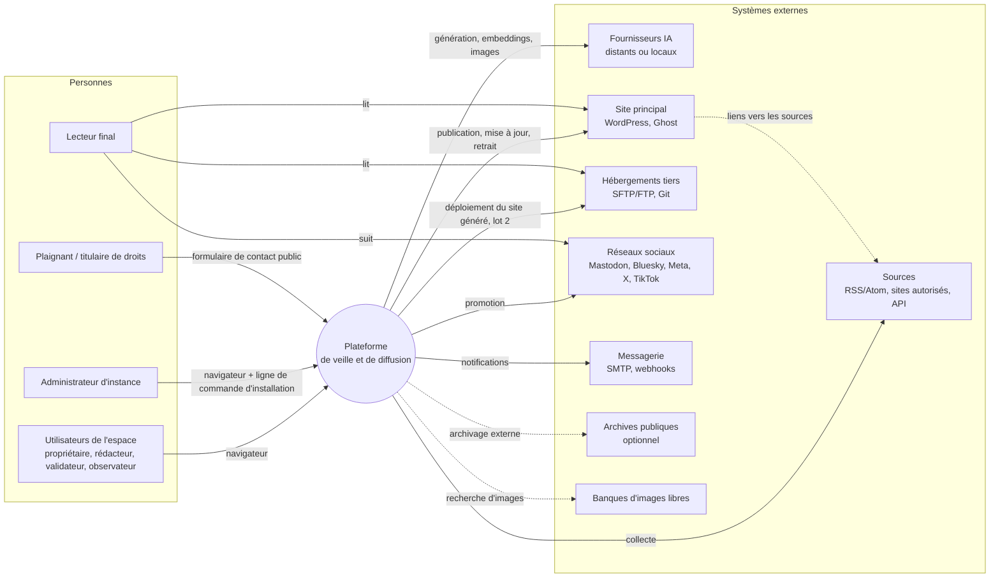

**Frontières de confiance** (détaillées au §19) :

1. **Navigateur ↔ plateforme** : utilisateurs authentifiés, autorisations vérifiées côté serveur.
2. **Plateforme ↔ sources** : tout contenu entrant est non fiable (P3) ; les URL saisies par les utilisateurs sont des vecteurs d'attaque possibles (SSRF).
3. **Plateforme ↔ fournisseurs IA** : les données envoyées sortent du périmètre (RGPD) ; les réponses sont non fiables.
4. **Plateforme ↔ canaux de publication** : action irréversible, protégée par P1.
5. **Cœur ↔ modules d'extension** : un module n'a que les permissions qu'il déclare et que l'administrateur accepte.

---

## 5. Style architectural

### 5.1 Choix : monolithe modulaire, workers séparés, adaptateurs hexagonaux

La plateforme est **une seule base de code applicative**, découpée en **modules métier aux frontières strictes**, déployée sous forme de **quelques processus** issus de cette même base :

- un processus **API** (sert l'API et, selon la technologie retenue, l'interface Web) ;
- un ou plusieurs processus **workers** (exécutent les tâches de fond, par files spécialisées) ;
- un processus **planificateur** (déclenche les tâches périodiques et planifiées ; peut être intégré à un worker dans l'installation solo).

À l'intérieur, chaque module suit une organisation **hexagonale** : le domaine au centre, des **ports** (interfaces) vers l'extérieur, des **adaptateurs** qui les implémentent (un adaptateur par fournisseur IA, par type de canal, par type de source, par type de stockage).

### 5.2 Alternatives écartées

| Alternative | Avantages | Raisons du rejet |
|---|---|---|
| **Microservices** (un service par domaine) | Déploiement et montée en charge indépendants, équipes autonomes | Coût d'exploitation incompatible avec un petit VPS et un installateur non expert (O9, CO-01) ; cohérence transactionnelle difficile entre article, version, publication et audit ; charge de maintenance excessive pour un projet open source porté par peu de mainteneurs (R-O05). Les bénéfices n'apparaissent qu'avec plusieurs équipes, ce qui n'est pas le cas. |
| **Monolithe non structuré** | Démarrage le plus rapide | Les connecteurs et fournisseurs finiraient couplés au cœur ; extensibilité (O10, CT-05) et maintenabilité compromises dès le lot 3. |
| **Architecture sans serveur (fonctions)** | Pas de serveur à gérer | Incompatible avec l'auto-hébergement sur VPS (CT-03) et crée une dépendance à un fournisseur cloud (CT-02). |
| **Plateforme d'automatisation existante en cœur** (moteur de workflows généraliste) | Beaucoup de connecteurs prêts | Le cœur du produit (politiques, garde-fous, traçabilité, marques) serait subordonné à un outil tiers ; la règle P1 deviendrait difficile à garantir. Une intégration **sortante** (webhooks, API) reste possible pour qui veut combiner les deux. |

### 5.3 Chemin d'évolution

Le monolithe modulaire n'interdit pas une extraction ultérieure. Les règles du §7.3 (pas d'accès direct aux données d'un autre module, communication par interfaces et événements) rendent possible, si un besoin réel apparaît (offre hébergée, D1), l'extraction d'un module en service séparé, typiquement : la collecte, la génération de médias ou le générateur de site. Cette extraction n'est **pas** planifiée.

---

## 6. Vue des conteneurs (déployables)

### 6.1 Diagramme

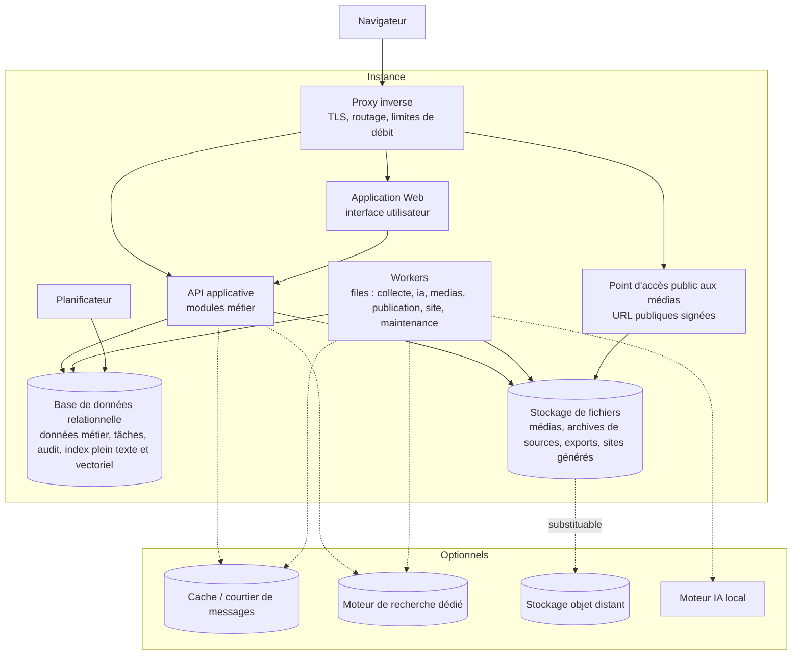

### 6.2 Responsabilités

| Conteneur | Rôle | Obligatoire | Mise à l'échelle |
|---|---|---|---|
| **Proxy inverse** | Terminaison TLS (certificats automatiques), routage, en-têtes de sécurité, limitation de débit grossière | Oui (peut être celui déjà présent sur le serveur) | Unique en général |
| **Application Web** | Interface navigateur (rendu, éditeur, tableaux de bord). Peut être fusionnée avec l'API selon la technologie retenue | Oui | Sans état, réplicable |
| **API applicative** | Authentification, autorisation, logique métier synchrone, API publique, webhooks sortants, événements temps réel vers l'interface | Oui | Sans état, réplicable |
| **Workers** | Exécution des tâches de fond par **files spécialisées** pour qu'une file lente (génération IA, vidéo) ne bloque jamais une file critique (publication) | Oui (un seul processus suffit en solo) | Réplicable par file |
| **Planificateur** | Déclenchement des collectes périodiques, publications planifiées, délais de grâce, rapports, purges ; **une seule instance active** (verrou de leader) | Oui (intégrable au worker en solo) | Actif / passif |
| **Base relationnelle** | Source de vérité : données métier, file de tâches durable, journal d'audit, index plein texte, index vectoriel | Oui | Verticale, puis réplicas de lecture |
| **Stockage de fichiers** | Médias, archives de sources, exports, sites générés ; adressage par empreinte de contenu | Oui (disque local par défaut) | Substituable par stockage objet |
| **Point d'accès public aux médias** | Exposition de médias par URL publique temporaire, exigée par Instagram et TikTok (CT-08) | Seulement si ces canaux sont utilisés | Avec l'API |
| **Cache / courtier** | Accélération (sessions, limites de débit fines, files à haut débit) | Non (P7) | — |
| **Moteur de recherche dédié** | Recherche à grande échelle | Non : la base suffit jusqu'au profil petite rédaction | — |
| **Moteur IA local** | Modèles locaux (mode 100 % local, F-IA-07) ; c'est un **fournisseur IA** comme un autre, souvent sur une machine équipée de GPU | Non | Hors périmètre de l'instance |

### 6.3 Pourquoi la base de données porte aussi la file de tâches et la recherche (installation de base)

- **File de tâches dans la base** : l'écriture d'une tâche dans la même transaction que la donnée métier qui la déclenche (patron « boîte d'envoi transactionnelle ») élimine une classe entière de pertes et de doublons (R-T08), et supprime un composant à installer, sauvegarder et surveiller. Débit suffisant pour les profils solo et petite rédaction (quelques dizaines de tâches par seconde au plus). Au-delà, un courtier dédié peut être branché derrière la même interface interne.
- **Recherche plein texte et vectorielle dans la base** : évite la synchronisation entre deux sources de vérité et une seconde sauvegarde. Un moteur dédié devient utile au-delà de quelques millions d'éléments collectés.

Cette décision impose une **exigence** à la base retenue dans `TECH_CHOICES.md` : transactions fiables, verrouillage de lignes adapté aux files (« prendre la prochaine tâche libre » sans contention), recherche plein texte multilingue, index vectoriel, types semi-structurés (JSON). Elle ne désigne pas de produit.

---

## 7. Découpage en modules

### 7.1 Carte des modules

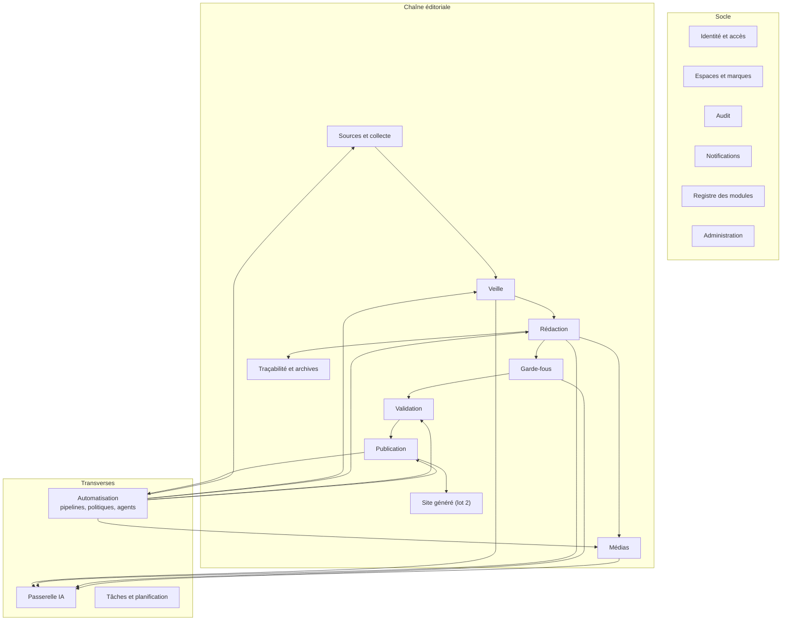

Les flèches indiquent les dépendances d'usage principales ; tous les modules dépendent du socle (non représenté pour la lisibilité).

### 7.2 Responsabilités

| Module | Responsabilités | Entités principales | Ports vers l'extérieur | Lot |
|---|---|---|---|---|
| **Identité et accès** | Comptes, authentification (mot de passe, 2FA, OIDC au lot 4), sessions, jetons d'API, rôles par espace, restriction par marque, vérification d'autorisation | Utilisateur, Session, JetonAPI, Appartenance, Rôle | Fournisseur d'identité externe (OIDC) | 1 (OIDC : 4) |
| **Espaces et marques** | Espaces, marques, ligne éditoriale, identité visuelle, auteurs publics, mentions légales, langues et fuseau ; contexte de marque fourni aux autres modules (RM4) | Espace, Marque, LigneEditoriale, IdentiteVisuelle, Auteur | — | 1 (marques multiples : 2) |
| **Sources et collecte** | Déclaration des sources, contrôle des autorisations (robots.txt, réserve TDM), récupération, extraction, normalisation, santé des sources | Source, Collecte, ElementBrut, EtatSante | Connecteur de source | 1 (sites autorisés : 4) |
| **Veille** | Sujets de veille, dédoublonnage, regroupements, scores explicables, flux de tri, actions de tri, alertes, recherche | Sujet, Element, Score, Regroupement, ActionTri | Index de recherche | 1 (regroupements : 2) |
| **Rédaction** | Briefs, articles, versions, document structuré, déclinaisons, modèles de prompt, opérations d'assistance, métadonnées SEO, calcul de la part d'IA | Brief, Article, Version, Declinaison, ModelePrompt | — | 1 |
| **Garde-fous** | Exécution des contrôles (similarité, citations, cohérence factuelle, mots interdits, nombre de sources, complétude SEO, mention IA, formats) ; rapports de conformité | Controle, RapportControle, Seuil | Algorithmes de similarité, passerelle IA | 1 (factuel : 2) |
| **Médias** | Médiathèque, génération et import, recadrage par format, texte alternatif, provenance, métadonnées d'origine IA | Media, Rendu, Provenance, ModeleImage | Stockage, passerelle IA, banques d'images | 2 (import simple : 1) |
| **Traçabilité et archives** | Références de sources, archives à la date d'usage, empreintes, instantanés publiés, page de traçabilité, détection des sources disparues | ReferenceSource, Archive, Instantane | Archivage externe | 1 |
| **Validation** | Circuits de validation, soumissions, décisions motivées, commentaires ancrés, listes de contrôle, règle quatre yeux | Circuit, Soumission, Decision, Commentaire | — | 2 (auto-validation solo : 1) |
| **Publication** | Canaux, déclinaisons à publier, ordonnancement « site d'abord », planification, envoi, suivi d'état, mise à jour, retrait, URL canonique, liens traçables | Canal, Publication, Envoi, URLCanonique | Connecteur de publication | 1 (CMS) ; 3 (réseaux) |
| **Site généré** | Construction du site statique d'une marque à partir des instantanés publiés, thèmes, fichiers SEO, déploiement | Site, Construction, CibleDeploiement, Theme | Cible de déploiement, thème | 2 |
| **Passerelle IA** | Fournisseurs, modèles, capacités, profils par usage, routage, replis, budgets, comptabilité, journal des appels | Fournisseur, Modele, Profil, Appel, Budget | Adaptateur de fournisseur IA | 1 |
| **Automatisation** | Définitions de pipelines, exécutions, politiques par étape, point de décision des politiques, agents bornés, simulation, arrêt d'urgence, désactivation sur anomalie | Pipeline, Execution, Etape, Politique, Agent | Étape / agent d'extension | 1 (niveaux 1-2) ; 3 (niveaux 3-4) |
| **Tâches et planification** | File durable, exécution, reprises, échéances, verrou de leader, boîte d'envoi transactionnelle | Tache, Echeance | Courtier optionnel | 1 |
| **Audit** | Journal immuable des actions humaines et automatiques, chaînage d'empreintes, consultation, export | EntreeAudit | — | 1 |
| **Notifications** | In-app, e-mail, webhooks ; préférences ; digests | Notification, Abonnement, Webhook | SMTP, webhooks, messageries | 1 (webhooks : 2) |
| **Registre des modules** | Découverte, activation, version de contrat, permissions déclarées et accordées, configuration et secrets des modules | Module, Permission, ConfigModule | Protocole d'extension hors processus | 1 (interne) ; 4 (communautaire) |
| **Administration** | Assistant d'installation, santé, quotas, rétention et purges, sauvegardes, mises à jour, paramètres d'instance | ParametreInstance, Quota, PolitiqueRetention | — | 1 |

### 7.3 Règles de dépendance entre modules

| Règle | Énoncé | Raison |
|---|---|---|
| **MD1** | Un module n'accède jamais directement aux tables d'un autre module ; il passe par son interface publique (services applicatifs) ou réagit à ses événements | Permet de faire évoluer le schéma d'un module sans casser les autres ; rend une extraction future possible |
| **MD2** | Les dépendances suivent le sens de la chaîne éditoriale ; les retours en arrière passent par des **événements de domaine** (ex. `PublicationReussie` consommé par l'automatisation pour lancer la promotion) | Évite les cycles de dépendances |
| **MD3** | Seul le module **Publication** appelle des connecteurs de publication, et uniquement après décision favorable du **point de décision des politiques** (§11.4) | Principe P1 |
| **MD4** | Seule la **Passerelle IA** appelle des fournisseurs IA | Budgets, journal, replis et confidentialité appliqués partout |
| **MD5** | Tout module qui modifie un état significatif écrit une entrée d'**Audit** dans la même transaction | Journal complet et cohérent |
| **MD6** | Le contexte de tenance (espace, marque, acteur) est explicite dans chaque appel de service et chaque tâche ; il n'existe pas de requête « sans espace » hors du module Administration | Isolation (CT-04) |

Ces règles seront **vérifiées automatiquement** (tests d'architecture dans l'intégration continue), pas seulement documentées.

### 7.4 Événements de domaine principaux

| Événement | Émis par | Consommé par (exemples) |
|---|---|---|
| `ElementCollecte` | Sources et collecte | Veille (analyse, score) |
| `ElementRetenu` | Veille | Automatisation (proposition de brief si politique) |
| `VersionEnregistree` | Rédaction | Garde-fous (contrôles), Traçabilité |
| `ControlesTermines` | Garde-fous | Validation, Automatisation |
| `ArticleValide` | Validation | Publication, Automatisation |
| `PublicationReussie` / `PublicationEchouee` | Publication | Automatisation (promotion site d'abord), Notifications, Site |
| `ArticleCorrige` / `ArticleRetire` | Rédaction / Publication | Publication (propagation), Site (reconstruction), Traçabilité |
| `PolitiqueModifiee` | Automatisation | Audit, Notifications (membres de l'espace, UC-13) |
| `ArretUrgenceActive` | Automatisation | Tous les workers (annulation des tâches à effet externe en attente) |
| `BudgetSeuilAtteint` | Passerelle IA | Notifications, Automatisation (mise en pause) |

Les événements sont **persistés** (boîte d'envoi transactionnelle, §12.2) et distribués en interne ; ils sont aussi la base des **webhooks sortants** (F-UX-03) après filtrage des données sensibles.

---

## 8. Données et multi-location

### 8.1 Stratégie de multi-location

**Choix : une base partagée, chaque donnée métier porte l'identifiant de son espace** (et de sa marque quand elle en dépend).

| Option | Isolation | Coût d'exploitation | Verdict |
|---|---|---|---|
| Une base (ou une instance) par espace | Maximale | Élevé : migrations × N, sauvegardes × N | Rejetée pour le cœur ; reste possible au niveau de l'**instance** pour une future offre hébergée (une instance par client) |
| Un schéma par espace | Forte | Moyen : migrations × N | Rejetée : complexité sans bénéfice pour solo et petite rédaction |
| **Base partagée, colonne d'espace** | Logique, à garantir par l'application | Faible | **Retenue**, avec défense en profondeur |

**Défense en profondeur de l'isolation** :

1. **Couche d'accès aux données** : toute requête est construite à partir du contexte de tenance (MD6) ; il est impossible de l'omettre sans passer par une interface d'administration explicite.
2. **Contrôle au niveau de la base** : si la base retenue le permet, des politiques de sécurité au niveau des lignes filtrent par espace, comme seconde barrière en cas d'erreur applicative (exigence transmise à `TECH_CHOICES.md`).
3. **Tests automatiques d'isolation** : jeux de tests systématiques « un utilisateur de l'espace A ne voit rien de l'espace B » sur chaque point d'API.
4. **Fichiers** : chemins et clés de stockage préfixés par espace ; aucune URL de fichier n'est devinable (identifiants aléatoires, accès authentifié ou signé).

### 8.2 Hiérarchie de rattachement

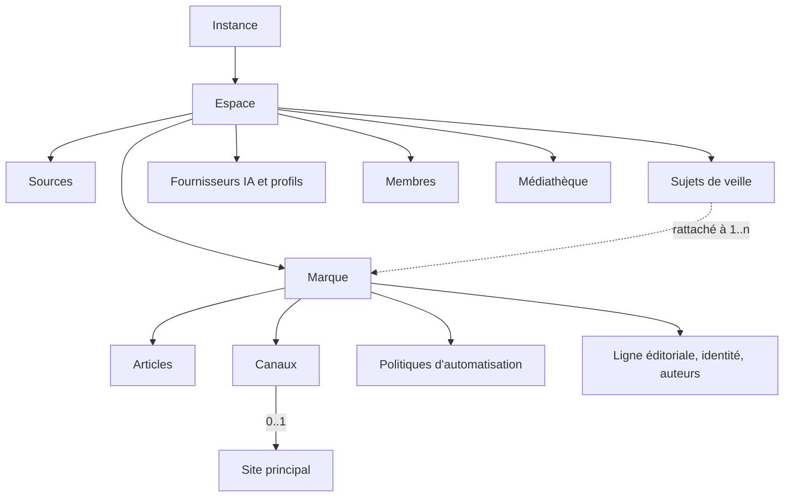

Conformément au §4.4 de l'analyse : les sources, la veille, les fournisseurs IA et le budget appartiennent à l'**espace** ; l'identité, les canaux, les politiques et les articles appartiennent à la **marque**. Les valeurs par défaut se résolvent par **héritage** : instance → espace → marque → sujet / canal (la valeur la plus spécifique l'emporte, sauf pour les règles de sûreté où la plus restrictive l'emporte, §11.3).

### 8.3 Agrégats et invariants

| Agrégat | Contenu | Invariants garantis par le domaine |
|---|---|---|
| **Marque** | Marque, ligne éditoriale, identité, auteurs, canaux associés | Au moins une marque par espace (RM1) ; un canal appartient à une seule marque (RM3) ; au plus un site principal |
| **Source** | Source, réglages, état de santé | Fréquence dans les bornes de l'instance (F-SRC-06) ; autorisation explicite consignée pour un site autorisé (CJ-04) |
| **Élément** | Élément collecté, texte extrait, métadonnées, empreintes, scores | Dédoublonné par empreinte ; jamais modifié après extraction (une nouvelle collecte crée une révision) |
| **Article** | Article, versions, références de sources, médias liés, déclinaisons | Appartient à une seule marque (RM2) ; toute modification d'une version validée crée un brouillon (§4.2 de l'analyse) ; une version publiée est figée |
| **Publication** | Publication d'une déclinaison sur un canal, envois, identifiant distant, URL | Clé d'idempotence unique par (version, canal, action) ; une promotion dépend de la publication réussie sur le site principal (F-SITE-03) |
| **Politique** | Niveaux par étape, garde-fous, plafonds, plages horaires | Les niveaux 3-4 de publication exigent un propriétaire, une confirmation et des garde-fous actifs (R2) ; versionnée |
| **Profil de modèle** | Usage, fournisseur, modèle, paramètres, replis | Le modèle offre les capacités exigées par l'usage (H7) |
| **Entrée d'audit** | Acteur, action, cible, avant/après, empreinte chaînée | Ajout seul ; jamais modifiée ni supprimée hors purge réglementaire tracée |

### 8.4 Nature des stockages

| Donnée | Stockage | Remarques |
|---|---|---|
| Entités métier, états, relations | Base relationnelle | Schéma versionné par migrations |
| Champs variables (paramètres de connecteur, réponses de garde-fous, scores détaillés) | Base relationnelle, champs semi-structurés | Schémas déclarés par les modules, validés à l'écriture |
| Corps des articles | Base relationnelle, **document structuré** (§14.2) | Une ligne par version |
| Texte extrait des éléments collectés | Base relationnelle | Purgé selon la rétention (F-ADM-07), sauf s'il est référencé par une archive |
| Archives de sources (texte, métadonnées, capture optionnelle) | Stockage de fichiers, adressage par empreinte | **Privées**, jamais servies publiquement (§15) |
| Médias et leurs rendus par format | Stockage de fichiers, adressage par empreinte | Public seulement via URL signée ou après publication |
| Index plein texte et vectoriels | Base relationnelle (P7) | Reconstructibles à partir des données |
| File de tâches, événements | Base relationnelle | Purge des tâches terminées après délai |
| Journal d'audit | Base relationnelle, table en ajout seul | Exportable, chaîné |
| Secrets | Base relationnelle, **chiffrés** (§19.4) | Clé maîtresse hors base |
| Sites générés | Stockage de fichiers | Reconstructibles ; dernière version conservée pour déploiement différentiel |

### 8.5 Identifiants, temps et langues

- **Identifiants** : opaques, non séquentiels, triables dans le temps (évite l'énumération et les collisions lors d'exports/imports entre instances).
- **Temps** : tout est stocké en UTC ; le fuseau de la **marque** sert à l'affichage et à la planification ; les planifications récurrentes sont calculées dans le fuseau de la marque (passages à l'heure d'été gérés).
- **Langues** : la langue est un attribut de l'élément collecté (détectée), de l'article (choisie) et de la marque (langues de publication). Les index plein texte sont configurés par langue.

### 8.6 Rétention et suppression

| Donnée | Rétention par défaut (réglable par l'administrateur) |
|---|---|
| Éléments collectés non retenus | 90 jours |
| Éléments retenus ou référencés par un article | Tant que l'article existe |
| Archives de sources référencées | Tant que l'article existe, puis selon la politique de l'espace |
| Journal des appels IA (métadonnées) | 13 mois ; contenu des prompts non conservé par défaut (§10.6) |
| Journal d'audit | Illimité par défaut ; purge seulement par l'administrateur, elle-même tracée |
| Tâches terminées | 30 jours |

La suppression d'un utilisateur (F-CNF-04) anonymise ses entrées d'audit (pseudonyme stable) au lieu de les effacer, pour garder la chaîne de responsabilité sans conserver de donnée personnelle superflue. Ce point est à confirmer par la revue juridique.

---

## 9. Modèle d'extension

### 9.1 Points d'extension

| Point d'extension | Ce qu'il apporte | Exemples | Lot du contrat |
|---|---|---|---|
| **Connecteur de source** | Un nouveau type de source | RSS/Atom, saisie manuelle, OPML, API d'agence, site autorisé, newsletter | 1 |
| **Adaptateur de fournisseur IA** | Un nouveau fournisseur ou protocole | Protocole compatible OpenAI (couvre OpenRouter, Groq, Ollama, OpenAI, Mistral et d'autres), Anthropic natif, générateurs d'images | 1 |
| **Connecteur de publication** | Un nouveau type de canal | WordPress, Ghost, Mastodon, Bluesky, Facebook Pages, Instagram, X, TikTok, LinkedIn, « préparer et copier » | 1 |
| **Garde-fou** | Un nouveau contrôle | Similarité, citations, mots interdits, contrôle factuel, lisibilité | 1 |
| **Étape de pipeline / agent** | Une nouvelle étape ou un agent borné | Tri, proposition de brief, recherche de sources complémentaires, digest | 3 |
| **Cible de déploiement** | Une nouvelle destination pour le site généré | SFTP, FTP, Git, dossier local, stockage objet | 2 |
| **Thème de site** | Une nouvelle apparence pour le site généré | Thème par défaut, thèmes communautaires | 2 |
| **Stockage** | Un autre support pour les fichiers | Disque local, stockage objet compatible S3 | 1 |

### 9.2 Manifeste d'un module

Chaque module (officiel ou communautaire) est décrit par un **manifeste déclaratif** que le registre lit avant toute activation :

| Champ | Rôle |
|---|---|
| Identifiant, nom, version, auteur, licence | Identification ; la licence est affichée (compatibilité AGPL, §9.6) |
| Point(s) d'extension implémenté(s) et **version de contrat** visée | Vérification de compatibilité avec le cœur |
| **Capacités** déclarées | Ce que le module sait faire (ex. pour un canal : brouillon, mise à jour, retrait, liens cliquables, longueur maximale, formats d'image) |
| **Permissions** demandées | Accès réseau (domaines), secrets, stockage, accès en lecture à certaines données ; affichées à l'administrateur et à accorder explicitement (UC-19) |
| **Schéma de configuration** | Champs à saisir dans l'interface (avec types, validations, champs secrets en écriture seule) ; l'interface de configuration est générée à partir de ce schéma, sans code d'interface dans le module |
| Textes traduisibles | Libellés et aides en FR / EN |
| Guide de connexion | Lien vers le guide pas à pas (ex. créer une application Meta, CO-03) |

### 9.3 Contrat du connecteur de publication

C'est le contrat le plus sensible, car il porte les effets irréversibles. Il est décrit ici en termes d'opérations ; sa forme technique sera définie dans la documentation contributeurs.

| Opération | Rôle | Garanties attendues du connecteur |
|---|---|---|
| Valider la configuration | Vérifier les champs avant enregistrement | Sans effet externe |
| Tester la connexion | Vérifier l'authentification et les droits | Sans effet visible pour le public |
| Décrire les contraintes | Longueurs, formats d'image, nombre de médias, liens cliquables ou non, mécanisme d'étiquetage IA natif, quotas | Données utilisées pour l'aperçu (F-PUB-04) et les vérifications pré-envoi |
| Préparer | Transformer une déclinaison rendue en charge utile propre au canal, **sans l'envoyer** | Déterministe ; sert à l'aperçu, à la simulation et au mode « préparer et copier » |
| Publier | Envoyer la charge utile | Reçoit une **clé d'idempotence** ; renvoie l'identifiant et l'URL distants ; distingue erreur temporaire, erreur définitive et **résultat inconnu** |
| Vérifier l'existence | Retrouver une publication distante par identifiant ou par marqueur (clé d'idempotence placée dans un champ caché, une méta ou un tag quand le canal le permet) | Indispensable au rapprochement après panne (§12.4) |
| Mettre à jour | Modifier une publication existante | Optionnelle (capacité déclarée) |
| Retirer | Dépublier ou supprimer | Optionnelle ; sinon procédure guidée (F-PUB-06) |
| Rafraîchir l'authentification | Renouveler un jeton | Optionnelle ; échec → canal « à reconnecter » (CO-05) |
| Lire des statistiques | Vues, interactions | Optionnelle (lot 4) |

Règles transverses :

- Le connecteur **ne décide jamais** de publier ; il exécute un ordre émis par le module Publication après décision des politiques (MD3).
- Le connecteur **ne compose pas** le contenu : il reçoit une déclinaison déjà rendue, avec bloc Sources et mention IA insérés par le moteur de rendu (§14.5). Il peut seulement l'adapter à la syntaxe du canal (HTML, Markdown, texte brut, facettes de liens).
- **Mode « préparer et copier »** : un connecteur générique, disponible pour tout canal, qui exécute « Préparer » puis présente le résultat (texte, image, hashtags) pour une publication manuelle ; l'utilisateur colle ensuite l'URL obtenue pour garder la traçabilité. Il garantit qu'aucun canal ne dépend exclusivement d'une API tierce (H1, R-T01).

### 9.4 Contrat de l'adaptateur de fournisseur IA

| Élément | Contenu |
|---|---|
| Opérations | Génération de texte (avec ou sans sortie structurée), embeddings, génération d'images, analyse d'image (vision), modération, liste des modèles |
| Capacités par modèle | Taille de contexte, sortie maximale, sortie structurée, appel d'outils, vision, génération d'images, langues, coût unitaire (si connu), localisation des traitements (local / UE / hors UE, déclaratif) |
| Erreurs normalisées | Quota, authentification, indisponibilité, contenu refusé, dépassement de contexte, délai ; permettent les replis (F-IA-03) |
| Mesure | Jetons d'entrée et de sortie, durée, coût calculé ou estimé |

Un **adaptateur générique « protocole compatible OpenAI »** couvre une grande partie des fournisseurs (dont Groq, OpenRouter, Ollama et OpenAI) avec une simple URL de base ; des adaptateurs natifs sont ajoutés quand un fournisseur offre des fonctions non couvertes par ce protocole (ex. Anthropic). L'usage éventuel d'une bibliothèque d'abstraction existante est une question de `TECH_CHOICES.md` ; l'architecture impose seulement que le reste du code ne dépende que du contrat interne.

### 9.5 Autres contrats (résumé)

| Contrat | Opérations essentielles |
|---|---|
| Connecteur de source | Valider, tester, découvrir (ex. trouver le flux d'un site), récupérer depuis un curseur (date, ETag), extraire, déclarer ses exigences d'autorisation |
| Garde-fou | Déclarer son nom, ses paramètres, s'il est bloquant par défaut, s'il appelle une IA ; évaluer une version et produire un rapport (résultat, score, passages en cause, explication) |
| Étape / agent | Déclarer entrées, sorties, effets (aucun effet externe pour un agent, §11.5), outils utilisés, coût maximal ; exécuter dans un contexte borné |
| Cible de déploiement | Tester, déployer un arbre de fichiers (de préférence différentiel), retirer un fichier |
| Thème | Gabarits de pages, feuilles de style, paramètres dérivés de l'identité visuelle de la marque |

### 9.6 Modes d'exécution des modules

| Mode | Description | Usage | Isolation |
|---|---|---|---|
| **Intégré** | Module livré comme paquet dans le langage du cœur, chargé dans le processus | Modules officiels (lots 1-3), modules communautaires de confiance | Faible : le module a les droits du processus. Réservé au code revu. |
| **Hors processus** (lot 4) | Module exposé comme un service séparé, appelé par un protocole documenté (requêtes HTTP / JSON signées, indépendant du langage) | Modules communautaires non revus, modules sous licence non compatible AGPL, modules écrits dans un autre langage | Forte : le module ne voit que ce que le cœur lui envoie, ne détient pas les secrets du cœur (il reçoit au plus les siens), peut tourner dans un conteneur à réseau restreint |

**Pourquoi deux modes** : le mode intégré est le plus simple pour démarrer et suffit tant que les modules sont officiels. Il ne permet pas de cloisonner un code non revu. Le mode hors processus apporte ce cloisonnement et, au regard de l'AGPL (D2), une séparation plus nette entre le cœur et un module tiers (à confirmer par la revue juridique). La décision de proposer un protocole standard existant pour les agents et outils (par exemple le Model Context Protocol) est renvoyée au lot 4.

### 9.7 Versionnement des contrats

- Chaque contrat a une **version sémantique** ; un changement incompatible incrémente la version majeure.
- Le cœur supporte **la version majeure courante et la précédente** pendant au moins un cycle de versions majeures du produit.
- Une **suite de tests de conformité** par contrat est fournie aux contributeurs ; un connecteur officiel n'est publié que s'il la passe (NFR Maintenabilité : tests exigés pour les connecteurs).
- Un connecteur peut être **désactivé individuellement** sans affecter le reste (CO-02) ; en cas d'erreurs répétées, il passe en état « dégradé » et ses publications sont suspendues, pas perdues.

---

## 10. Passerelle IA

### 10.1 Rôle

La passerelle est le **seul** point de passage vers les fournisseurs IA (MD4). Elle garantit : indépendance vis-à-vis des fournisseurs (O8), respect des capacités (H7), budgets (F-IA-06), journalisation (F-AUT-07), replis (F-IA-03), confidentialité (CJ-07) et protections contre l'injection de prompt (R-T04).

### 10.2 Résolution d'un appel

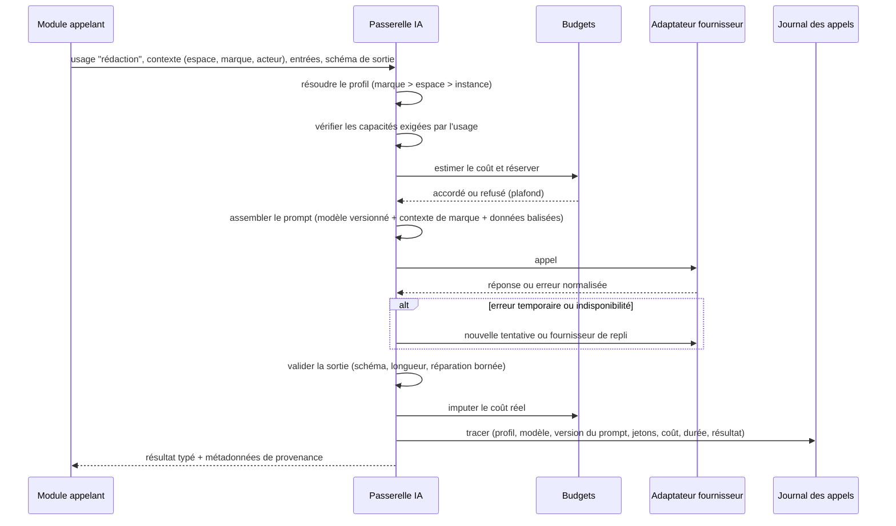

### 10.3 Usages et capacités

Chaque **usage** déclare les capacités dont il a besoin ; la passerelle refuse un profil incompatible au moment de sa configuration (et non au moment de l'appel).

| Usage | Capacités exigées | Remarque |
|---|---|---|
| Tri / classification | Texte, sortie structurée souhaitée | Petit modèle, faible coût |
| Résumé | Texte, contexte suffisant | Découpage automatique si la source dépasse le contexte (UC-07) |
| Rédaction | Texte, contexte large, sortie structurée (références de sources) | Usage le plus coûteux |
| Contrôle factuel | Texte, sortie structurée | De préférence un modèle différent de celui qui a rédigé |
| Embeddings | Embeddings | Le modèle d'embeddings est **figé par espace** : en changer impose un recalcul des index, planifié en tâche de fond |
| Image | Génération d'images | Groq n'en offre pas, par exemple (§9 de l'analyse) |
| Vision | Analyse d'image | Texte alternatif proposé (F-MED-05) |
| Modération | Classification de contenus | Optionnelle |

### 10.4 Prompts

- Les **modèles de prompt** sont des ressources versionnées (F-RED-06), modifiables par espace ; chaque génération enregistre la version du modèle de prompt utilisée.
- Le prompt est **assemblé** par la passerelle à partir de trois couches séparées : instructions système (produit), contexte de marque (ligne éditoriale, interdits, RM4), **données** (éléments collectés, brief). Les données sont toujours **balisées** comme telles et précédées d'une consigne indiquant qu'elles ne contiennent aucune instruction à suivre.
- Les sorties structurées sont **validées contre un schéma** ; une réparation est tentée un nombre borné de fois, puis l'erreur est remontée clairement (R-T05).

### 10.5 Défenses contre l'injection de prompt (R-T04)

Aucune défense n'est parfaite au niveau du modèle ; l'architecture limite donc **ce qu'une injection réussie peut faire** :

1. **Séparation instructions / données** dans le prompt (ci-dessus).
2. **Assainissement** des contenus collectés : suppression du texte invisible (styles masqués, caractères de contrôle, texte de même couleur que le fond quand détectable), normalisation Unicode.
3. **Aucun outil à effet externe** n'est donné à un modèle qui traite des contenus collectés (D6, §11.5).
4. **Sorties non fiables** : la sortie d'un modèle n'est jamais exécutée ; elle est validée, assainie avant affichage, et passe par les garde-fous **déterministes** avant toute publication.
5. **Humain dans la boucle** par défaut (R1) ; les niveaux 3-4 exigent des garde-fous actifs (R2).
6. **Détection** : signalement des éléments collectés contenant des motifs d'instruction typiques, avec un indicateur dans le flux de veille.

### 10.6 Confidentialité

- Chaque fournisseur porte une **localisation déclarée** (local, UE, hors UE) et un lien vers ses conditions ; l'interface l'affiche lors du choix d'un profil (CJ-07, CJ-13).
- Un espace peut être marqué **« local uniquement »** : la passerelle refuse alors tout profil dont le fournisseur n'est pas local (F-IA-07).
- Le **contenu** des prompts et des réponses n'est pas conservé dans le journal des appels par défaut (seulement des empreintes et métadonnées) ; une option de conservation temporaire existe pour le diagnostic. Le texte généré, lui, est conservé dans les versions d'article.

### 10.7 Budgets

- Budgets par espace et par période, sous-plafonds optionnels par marque (§4.4 de l'analyse) et par usage.
- **Réservation avant appel** (estimation à partir de la taille de l'entrée et de la sortie maximale) puis **imputation du coût réel** : évite qu'une rafale de tâches parallèles dépasse le plafond.
- Seuils d'alerte puis blocage ; un blocage met en pause les étapes automatiques concernées et notifie le propriétaire (R-O02).
- Les fournisseurs locaux ont un coût monétaire nul mais peuvent avoir un **quota de débit** pour ne pas saturer la machine.

---

## 11. Pipelines, politiques d'automatisation et agents

### 11.1 Concepts

| Concept | Définition architecturale |
|---|---|
| **Pipeline** | Définition, rattachée à une marque, d'un enchaînement d'étapes (collecte → tri → rédaction → illustration → validation → publication site → promotion). Une **recette** (F-AUT-08) est un pipeline prédéfini. |
| **Exécution** | Instance d'un pipeline appliquée à un objet (un élément, un regroupement, un article) ; possède un identifiant de corrélation repris dans tous les journaux. |
| **Étape** | Unité d'exécution avec entrée, sortie et effet déclarés. Les étapes sont des tâches durables (§12). |
| **Politique** | Niveau d'automatisation (0 à 4, §7.2 de l'analyse), garde-fous, plafonds, plages horaires pour une étape, à un niveau de portée (espace, marque, sujet, canal). |
| **Point de décision des politiques (PDP)** | Composant unique qui répond à « cette action peut-elle être exécutée maintenant, par cet acteur, sur cet objet ? » et explique sa réponse. |
| **Proposition** | Résultat d'une étape au niveau 2 (assisté) : objet en attente d'une décision humaine dans une boîte de travail. |
| **Agent** | Étape particulière dont la logique est décidée par un modèle (choix d'outils, itérations), strictement bornée (§11.5). |

### 11.2 Exécution d'une étape selon son niveau

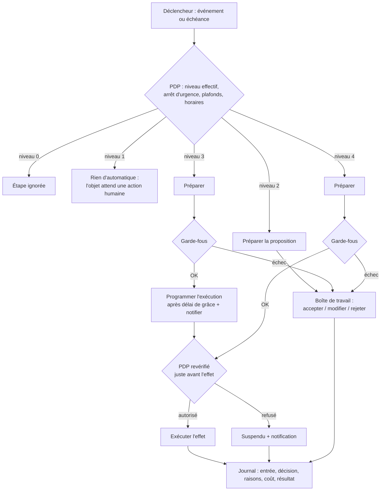

Points clés :

- La **revérification juste avant l'effet** (« dernier moment ») est obligatoire pour toute action externe : un arrêt d'urgence ou un changement de politique survenu pendant le délai de grâce ou pendant la file d'attente est donc respecté (R5).
- Un **échec de garde-fou** ne détruit rien : il rétrograde l'objet en proposition humaine.

### 11.3 Résolution des politiques

- Portées, de la plus générale à la plus précise : instance (bornes absolues), espace, marque, sujet de veille, canal.
- **Règle de sûreté** : pour le niveau d'automatisation de la publication, la valeur effective est la **plus restrictive** de la chaîne (un canal ne peut pas dépasser ce que la marque autorise, qui ne peut pas dépasser ce que l'espace autorise). Pour les paramètres de confort (horaires, formats), la plus précise l'emporte.
- **R2 appliquée par construction** :
  - le passage de la publication aux niveaux 3 ou 4 n'est possible que par une action interactive d'un **propriétaire**, avec **ré-authentification** et confirmation du récapitulatif (UC-13) ;
  - les jetons d'API, les agents, les imports de configuration et les migrations **ne peuvent pas** écrire ces niveaux (refus côté domaine, pas seulement côté interface) ;
  - toute politique est versionnée ; la modification est tracée (R4) et notifiée.
- **R3** : le PDP vérifie, pour une publication automatique, que la version a franchi **tous** les contrôles bloquants et la validation configurée ; il refuse sinon, quel que soit le niveau de l'étape publication.

### 11.4 Le point de décision des politiques (PDP)

| Entrée | Contenu |
|---|---|
| Acteur | Humain (avec rôle) ou automatique (exécution, agent) |
| Action | Ex. `publier`, `mettre_a_jour`, `retirer`, `generer`, `appeler_ia` |
| Objet | Version d'article, canal, marque, espace |
| Contexte | Heure dans le fuseau de la marque, compteurs (publications du jour par canal), budget, état d'arrêt d'urgence, état du canal |

| Sortie | Contenu |
|---|---|
| Décision | Autorisé / refusé / à confirmer par un humain |
| Raisons | Liste lisible des règles appliquées (P10) |
| Obligations | Ex. « insérer la mention IA », « attendre la publication sur le site principal », « délai de grâce de 15 min » |

Le PDP est **pur** (sans effet de bord, à part la lecture d'état) : il est donc testable de manière exhaustive, et ses règles forment un jeu de tests de non-régression sur les promesses de sûreté du produit.

### 11.5 Agents bornés (D6)

Un agent est autorisé seulement si **toutes** les conditions suivantes sont réunies :

| Borne | Règle |
|---|---|
| Effet | **Aucun effet externe** : un agent produit des propositions (tri, brief, liste de sources complémentaires, résumé), jamais une publication ni un envoi |
| Outils | Liste blanche d'outils **en lecture** (rechercher dans la veille, lire un élément, lire la ligne éditoriale) ; aucun outil réseau libre ; la récupération d'une URL passe par le module de collecte et ses contrôles (SSRF, robots.txt) |
| Ressources | Nombre maximal d'itérations, de jetons et de coût par exécution ; dépassement = arrêt propre et proposition partielle |
| Données | Ne voit que les données de l'espace et de la marque de l'exécution |
| Traçabilité | Chaque itération est journalisée (outil appelé, entrée, sortie résumée, coût) |
| Politique | Un agent ne peut ni lire les secrets, ni modifier une politique (UC-13), ni changer son propre niveau |

Les étapes à effet externe (publication, déploiement de site) sont **toujours** des étapes déterministes du module Publication, quel que soit le niveau d'automatisation.

### 11.6 Simulation, arrêt d'urgence, désactivation sur anomalie

- **Simulation** (F-AUT-06) : drapeau propagé dans l'exécution ; les étapes à effet externe appellent l'opération « Préparer » du connecteur au lieu de « Publier » ; le résultat est présenté comme « ce qui aurait été publié ». Les appels IA sont réels (et facturés), ce qui est indiqué avant activation.
- **Arrêt d'urgence** (F-AUT-05, R5) : un indicateur par espace, par marque et pour l'instance, lu par le PDP à chaque décision et à la revérification de dernier moment. Son activation émet `ArretUrgenceActive`, qui fait passer en « suspendu » toutes les tâches à effet externe en attente. Retour au niveau 1 sur toutes les étapes jusqu'à réactivation manuelle.
- **Désactivation sur anomalie** (F-AUT-10) : compteurs d'échecs consécutifs et détecteurs simples (volume horaire supérieur à N fois la moyenne, coût horaire anormal) ; au seuil, l'étape ou l'agent passe au niveau 1 et le propriétaire est notifié.

---

## 12. Traitements asynchrones et fiabilité

### 12.1 Modèle de tâche

| Attribut | Rôle |
|---|---|
| Type et file | Détermine le worker et l'isolement (collecte, ia, medias, publication, site, maintenance) |
| Contexte de tenance | Espace, marque, acteur d'origine (MD6) |
| Identifiant de corrélation | Rattache la tâche à une exécution de pipeline |
| Clé d'idempotence | Unicité de l'effet (obligatoire pour les tâches à effet externe) |
| État | En attente → en cours → réussie / échec temporaire (reprogrammée) / échec définitif / suspendue / annulée |
| Tentatives et prochaine échéance | Reprises avec délai croissant et part aléatoire |
| Bail | Durée de réservation par un worker ; une tâche dont le worker a disparu redevient disponible à l'expiration du bail (reprise après panne, CT-06) |

### 12.2 Boîte d'envoi transactionnelle

Toute décision métier qui doit déclencher un traitement (ex. « article validé, publication planifiée à 9 h ») écrit **dans la même transaction** la donnée métier, l'entrée d'audit et la tâche ou l'événement correspondant. Il n'existe donc pas d'état où l'article est validé sans que sa publication soit enregistrée, ni l'inverse.

### 12.3 Files et priorités

| File | Contenu | Particularités |
|---|---|---|
| `publication` | Envois, mises à jour, retraits | Priorité la plus haute ; concurrence limitée **par canal** pour respecter les quotas des plateformes (F-PUB-10) |
| `collecte` | Récupérations de sources | Politesse par domaine (un nombre limité de requêtes simultanées par domaine) |
| `ia` | Générations, embeddings, contrôles IA | Concurrence limitée par fournisseur (quotas de débit) |
| `medias` | Génération d'images, rendus, vidéo | Tâches longues, isolées pour ne pas bloquer le reste |
| `site` | Construction et déploiement du site généré | Une construction à la fois par marque ; regroupement des demandes rapprochées |
| `maintenance` | Purges, recalcul d'index, sauvegardes, vérification des sources disparues | Basse priorité, plages horaires creuses |

### 12.4 Publication sans perte ni doublon (R-T08)

Les plateformes externes ne garantissent pas toutes l'idempotence. Le module Publication applique donc une machine à états explicite :

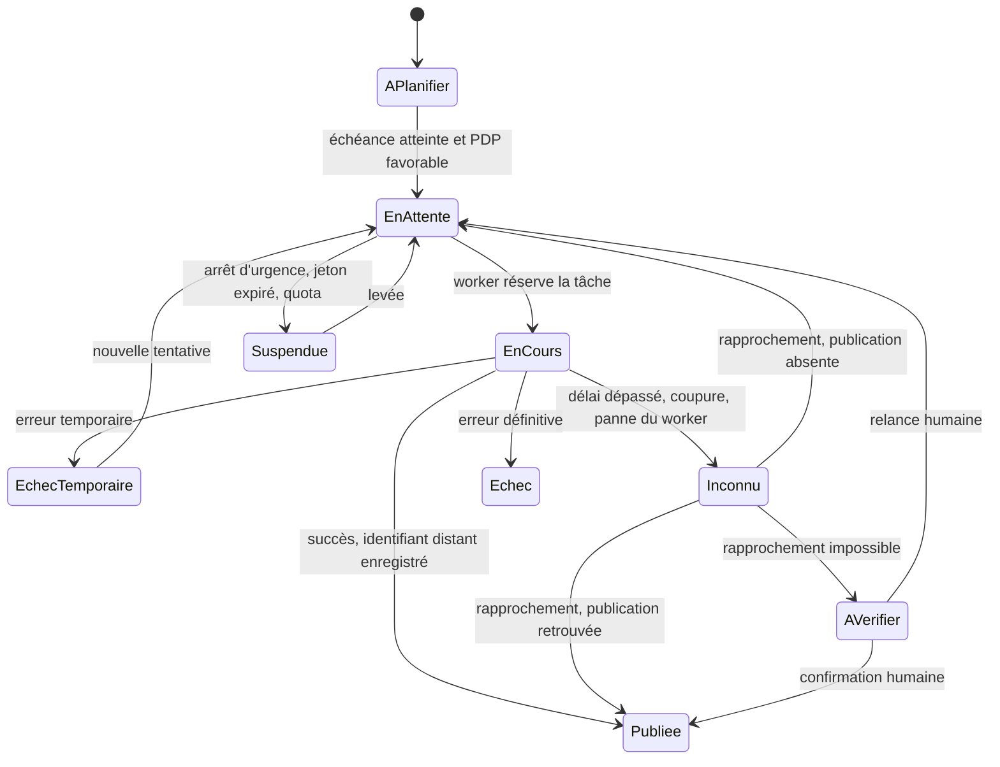

- Avant l'appel externe, l'état passe à « en cours » et la clé d'idempotence est **enregistrée** (validation en base avant l'envoi).
- Un résultat **inconnu** n'est **jamais** relancé à l'aveugle : le système tente d'abord de **retrouver** la publication (« Vérifier l'existence », §9.3). Si le canal ne le permet pas, la décision revient à un humain (état « à vérifier »). Sur les réseaux sociaux, un doublon visible est pire qu'un retard.
- L'identifiant distant et l'URL sont enregistrés dès la réponse (nécessaires aux mises à jour et retraits, §7.5 de l'analyse).

### 12.5 Planificateur

- Échéances persistées en base (collectes périodiques, publications planifiées, fins de délai de grâce, digests, purges).
- **Un seul planificateur actif** grâce à un verrou de leader ; un second planificateur en attente reprend si le premier disparaît (installations répliquées).
- Les échéances manquées pendant un arrêt sont **rattrapées** au redémarrage selon une règle par type : une collecte manquée est exécutée une fois (pas N fois) ; une publication planifiée manquée de plus d'un délai configurable n'est **pas** publiée automatiquement mais remise en proposition (évite une rafale de publications périmées après une panne longue).

---

## 13. Collecte et veille

### 13.1 Chaîne de collecte

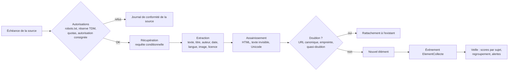

| Étape | Choix d'architecture | Exigences couvertes |
|---|---|---|
| Autorisations | Cache des robots.txt et des réserves de fouille (fichiers et en-têtes du protocole de réservation TDM, métadonnées de page) par domaine, avec durée de vie ; décision consignée dans le journal de conformité de la source | F-CNF-06, CJ-03, CJ-04 |
| Identification | Agent utilisateur explicite et stable, avec URL d'information sur l'instance ; pas de contournement de protections | §1.3 de l'analyse (non-objectifs) |
| Récupération | Requêtes conditionnelles (ETag, date de dernière modification) pour limiter la charge ; délais, tailles maximales, types de contenus autorisés | CO-09, Sécurité |
| Extraction | Extraction générique robuste (algorithme de type « lecture » pour le contenu principal), règles spécifiques optionnelles par site autorisé | R-T03 |
| Assainissement | Suppression de scripts, styles, texte invisible ; normalisation Unicode ; conservation du HTML assaini pour la lecture et du texte brut pour l'IA | P3, R-T04 |
| Dédoublonnage | Trois niveaux : URL normalisée, empreinte exacte du texte, empreinte de similarité (quasi-doublons, reprises de dépêches) | F-VEI-03 |
| Santé | Compteurs de succès / échecs, détection de flux mort ou de changement de structure (chute brutale de la longueur extraite), passage en « dégradé » | F-SRC-09, §7.3 de l'analyse |

### 13.2 Protection contre la falsification de requêtes côté serveur (SSRF)

Les URL de sources sont saisies par les utilisateurs : sans protection, elles permettraient d'interroger le réseau interne du serveur. Toute récupération sortante (collecte, image distante, banque d'images, découverte de flux) passe par un **client HTTP commun** qui :

- refuse les adresses privées, de bouclage, de liaison locale et de métadonnées cloud, **après** résolution DNS et à chaque redirection ;
- limite les protocoles (HTTP et HTTPS seulement), le nombre de redirections, la taille et la durée ;
- peut être configuré par l'administrateur pour passer par un mandataire sortant.

Exception explicite : l'URL d'un **fournisseur IA local** (ex. un moteur sur le réseau local) est déclarée par l'administrateur dans une liste d'autorisations distincte.

### 13.3 Scores explicables (F-VEI-02)

Le score d'un élément pour un sujet est une **combinaison pondérée de composantes**, chacune enregistrée avec sa contribution :

| Composante | Calcul | Disponible sans IA |
|---|---|---|
| Correspondance lexicale | Mots-clés et exclusions, recherche plein texte pondérée | Oui |
| Proximité sémantique | Similarité entre l'embedding de l'élément et celui de la description du sujet et de ses exemples | Non (nécessite un profil d'embeddings, local possible) |
| Confiance de la source | Niveau attribué (F-SRC-07) | Oui |
| Fraîcheur | Décroissance selon l'âge | Oui |
| Corroboration | Nombre de sources distinctes dans le même regroupement | Oui (regroupement lexical) ; meilleur avec embeddings |
| Retour de tri | Proximité avec les éléments retenus / ignorés récemment (F-VEI-06, par exemples, sans entraînement) | Partiellement |

L'interface affiche ces contributions (« remonte parce que : 3 mots-clés, proche de l'exemple X, source de confiance élevée »). Sans fournisseur IA, les composantes sémantiques sont simplement absentes (P9).

### 13.4 Regroupements

Les éléments sont rattachés à un regroupement (« histoire ») par proximité de contenu et de date (fenêtre glissante). Le regroupement est **recalculable** et **corrigible** manuellement (fusionner, séparer) ; les corrections humaines priment sur l'algorithme.

---

## 14. Rédaction, contenu et garde-fous

### 14.1 Flux de génération d'un article sourcé (UC-07)

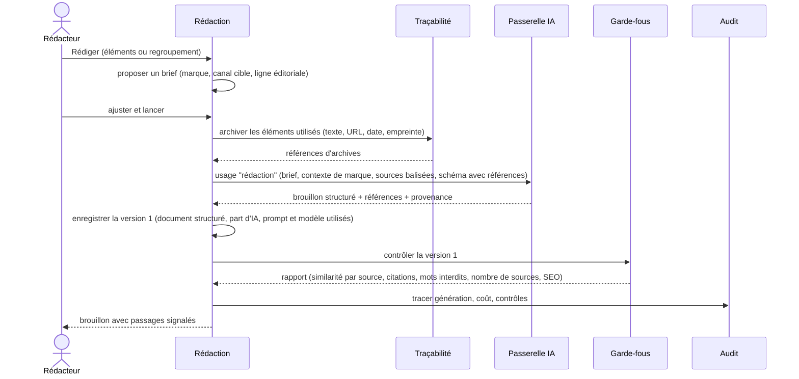

L'archivage a lieu **avant** la génération : la version produite référence exactement le contenu de source que le modèle a reçu (F-TRA-01, F-TRA-02).

### 14.2 Document structuré

Le corps d'un article est stocké dans un **format de document structuré** (arbre de blocs : titres, paragraphes, listes, citations, images, liens, références de sources), et non en HTML libre.

| Raison | Explication |
|---|---|
| Multi-canal | Un même document se rend en HTML (WordPress, site généré), dans le format attendu par Ghost, en Markdown (export), en texte brut avec liens (Mastodon, Bluesky, X) |
| Références de sources | Une affirmation peut porter un lien vers une référence de source précise ; le bloc Sources est généré à partir de ces références, pas saisi à la main |
| Citations vérifiables | Une citation est un bloc typé, rattaché à une source, que le garde-fou peut comparer mot pour mot (F-RED-09) |
| Comparaison de versions | Les différences se calculent bloc par bloc (F-RED-04) |
| Sécurité | Aucun HTML arbitraire stocké ; le rendu produit un HTML maîtrisé (pas d'injection de script) |
| Part d'IA | Chaque bloc conserve son origine (généré, modifié par un humain, écrit par un humain), base du calcul de la part d'IA (D8) |

Le choix concret du format (et de l'éditeur riche associé) est renvoyé à `TECH_CHOICES.md`, avec comme exigences : schéma documenté et ouvert, édition collaborative possible plus tard, conversion fiable vers HTML et Markdown.

### 14.3 Versions et états

- Chaque enregistrement crée une **version immuable** ; l'article pointe vers sa version courante.
- L'état de l'article suit le cycle du §4.2 de l'analyse ; le passage d'une version validée à une modification crée un nouveau brouillon (sauf correction mineure autorisée par la politique, elle aussi tracée).
- Une version **publiée** est associée à un **instantané** (§15.2) ; l'instantané est la seule chose que les connecteurs et le générateur de site lisent.

### 14.4 Garde-fous

| Garde-fou | Méthode | Bloquant par défaut | Lot |
|---|---|---|---|
| **Similarité par source** (F-RED-07) | Combinaison de mesures **lexicales** (recouvrement de séquences de mots, plus longue séquence commune) et **sémantiques** (embeddings par passage) ; passages surlignés ; seuil par espace | Oui | 1 |
| **Citations** (F-RED-09) | Comparaison exacte (après normalisation typographique) du texte entre guillemets avec la source attribuée | Oui | 1 |
| **Mots et sujets interdits** | Listes de la marque, correspondance lexicale ; option sémantique | Oui | 1 |
| **Nombre de sources** (D7) | Compte des sources distinctes référencées | Non (avertissement) | 1 |
| **Mention IA** (D8) | Présence garantie par le rendu ; contrôle de cohérence de la formulation | Oui (non désactivable) | 1 |
| **Complétude SEO** (F-SEO-04) | Champs présents, longueurs, image de partage, texte alternatif | Non (alerte) | 1 |
| **Formats et contraintes canal** | Longueurs, nombre et formats d'images selon les contraintes déclarées par le connecteur | Oui (pour le canal concerné) | 1 |
| **Cohérence factuelle** (F-RED-08) | Extraction des affirmations vérifiables (dates, chiffres, noms) par IA, puis rapprochement avec les sources : exact pour les nombres et dates, IA pour le reste ; résultat **indicatif** | Non (sauf choix explicite) | 2 |
| **Images** (F-MED-07) | Règles dans les prompts d'image de la marque, refus des demandes mentionnant des personnes réelles ou des marques, contrôle par vision optionnel | Oui | 2 |

Principes :

- Les garde-fous **déterministes** (similarité lexicale, citations, mots interdits, formats, mention IA) sont la base des décisions automatiques : ils sont reproductibles et non manipulables par une injection de prompt.
- Les garde-fous **fondés sur l'IA** sont présentés comme des aides ; ils ne peuvent rendre une action automatique **plus permissive**, seulement la bloquer ou alerter.
- Chaque rapport de contrôle est **attaché à la version** contrôlée ; une version modifiée doit être recontrôlée.

### 14.5 Moteur de rendu

Le moteur de rendu transforme un instantané en **déclinaison rendue** pour un canal. C'est lui, et non le connecteur, qui insère :

- le **bloc Sources** au format adapté au canal (liens en fin d'article sur le site ; liste en commentaire ou description quand le canal ne permet pas les liens cliquables) — limité aux titres, éditeurs, dates et liens (CJ-02) ;
- la **mention IA** selon la formulation de la marque, impossible à retirer pour les contenus majoritairement générés (D8) ;
- l'**URL canonique** et les liens traçables (paramètres UTM) pour les déclinaisons de promotion (F-SITE-02, F-SITE-05) ;
- les **métadonnées SEO** (titre SEO, description, image de partage, données structurées) à destination du CMS ou du site généré.

Centraliser ces insertions garantit qu'un connecteur communautaire ne peut pas omettre la mention IA ou les sources.

---

## 15. Traçabilité, archives et audit

### 15.1 Archives de sources

| Propriété | Choix |
|---|---|
| Contenu | Texte extrait assaini, métadonnées (URL, titre, éditeur, auteur, date de publication, date de collecte), empreinte du contenu ; capture HTML optionnelle |
| Adressage | Par empreinte de contenu : deux articles utilisant la même version d'une source partagent la même archive |
| Accès | **Interne uniquement** (preuve, contrôle d'originalité, consultation par les membres de l'espace). Jamais servie publiquement, jamais incluse dans un site généré ni dans une page de traçabilité (CJ-01, CJ-02, UC-16) |
| Archive externe | Option : demander l'archivage de l'URL à un service public d'archivage et conserver le lien obtenu (F-TRA-03) |
| Disparition | Tâche de maintenance qui revérifie les URL des sources d'articles publiés et signale disparitions et modifications (F-TRA-06, lot 4) |

### 15.2 Instantané publié

Au moment de la publication, le système fige un **instantané** de la version :

- document structuré rendu, métadonnées, médias (par empreinte) ;
- références de sources (avec empreintes d'archives) ;
- provenance IA : modèles, fournisseurs, versions de prompts, part d'IA ;
- rapports de garde-fous et décision de validation (qui, quand) ;
- empreinte globale de l'instantané.

Chaque publication sur un canal référence l'instantané envoyé. On peut donc toujours répondre à : *quel texte, quelles images, quelles sources ont été diffusés, où, quand, validés par qui ?* (§4.2 de l'analyse). La page publique de traçabilité (F-TRA-05, lot 4) est générée à partir de l'instantané, sans aucun contenu de source.

### 15.3 Journal d'audit

- Table en **ajout seul** ; chaque entrée contient l'empreinte de l'entrée précédente du même espace (**chaînage**), ce qui rend toute altération détectable lors d'une vérification.
- Contenu : acteur (humain ou exécution / agent), action, cible, résumé avant / après, raisons de décision du PDP le cas échéant, identifiant de corrélation, horodatage.
- Écrit dans la même transaction que l'action (MD5).
- Consultable et exportable par le propriétaire d'espace ; vérification d'intégrité disponible dans l'administration.
- Distinct du **journal des appels IA** (volumineux, purgeable) et des **journaux techniques** (§21).

---

## 16. Publication, site principal et promotion

### 16.1 Modèle

| Concept | Rôle |
|---|---|
| **Canal** | Instance configurée d'un connecteur, rattachée à une marque (RM3) ; porte ses secrets, ses réglages par défaut (brouillon / public, catégorie, hashtags) et son état (actif, à reconnecter, dégradé, désactivé) |
| **Site principal** | Rôle porté par au plus un canal de la marque : CMS externe (lot 1) ou site généré (lot 2) |
| **Plan de publication** | Ensemble des publications prévues pour une version : celle du site principal et les promotions qui en dépendent, avec leurs dates |
| **Publication** | Une déclinaison sur un canal, avec son état (§12.4), son identifiant distant et son URL |
| **URL canonique** | URL de l'article sur le site principal, enregistrée à la réussite de la publication ; propagée aux déclinaisons et aux métadonnées SEO |

### 16.2 Ordonnancement « site d'abord » (F-SITE-03)

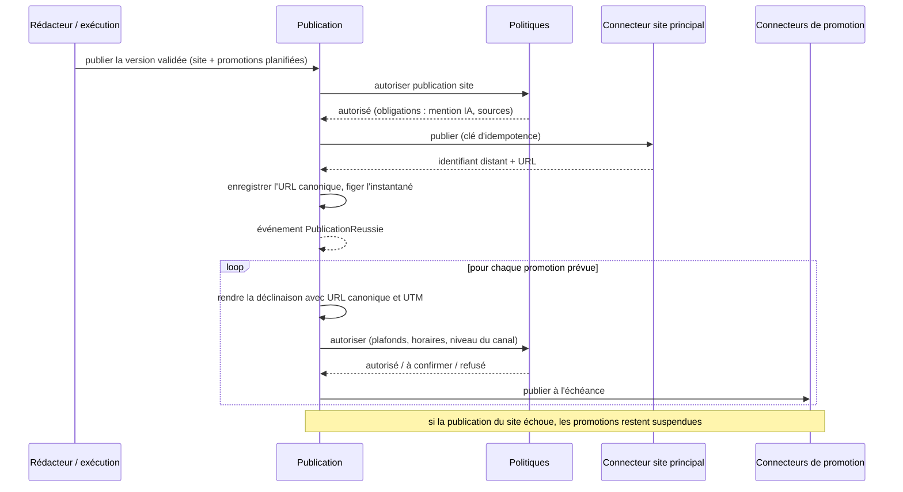

- Une promotion est une **tâche dépendante** : elle ne devient exécutable qu'après `PublicationReussie` sur le site principal.
- Pour un CMS en mode **brouillon** (F-PUB-07), l'article n'est pas en ligne : la promotion attend que la plateforme constate la mise en ligne (vérification périodique de l'état distant ou action « marquer comme publié »), puis récupère l'URL définitive.
- **Marque sans site** (F-SITE-07) : le plan ne contient que des déclinaisons autonomes ; pas d'URL canonique ; le bloc Sources est placé en légende ou en commentaire selon les capacités du canal ; l'interface affiche le mode dégradé.

### 16.3 Connecteurs CMS du lot 1 (D13)

| Connecteur | Authentification | Points d'attention architecturaux |
|---|---|---|
| **WordPress** | API REST, mot de passe d'application | Détection des extensions SEO courantes (Yoast, Rank Math) pour écrire titre SEO, description, canonique et OpenGraph dans leurs champs ; signalement des champs non pris en charge (§5.13 de l'analyse) ; extensions de sécurité pouvant bloquer l'API (message de diagnostic dédié) ; envoi des médias puis de l'article (image à la une) ; catégories et tags créés ou rapprochés ; marqueur d'idempotence dans une métadonnée de l'article |
| **Ghost** | Admin API (clé d'intégration) | Champs SEO et OpenGraph natifs ; envoi du contenu sous forme HTML convertie par Ghost ; tags ; marqueur d'idempotence dans un champ dédié |

Le connecteur CMS est aussi responsable de **lire l'état distant** (brouillon publié par l'utilisateur dans son CMS, article supprimé côté CMS) pour garder le statut à jour.

### 16.4 Réseaux sociaux (lot 3)

| Exigence | Réponse architecturale |
|---|---|
| Médias à URL publique (Instagram, TikTok, CT-08) | Point d'accès public aux médias : URL **signées à durée limitée**, servies par l'instance, ou dépôt du média sur le site principal de la marque quand c'est possible |
| Rappels OAuth en HTTPS public (CT-09) | Point de rappel OAuth générique de l'instance ; si l'instance n'a pas d'URL publique, les canaux concernés sont indisponibles (mode « préparer et copier » proposé) |
| Jetons expirants (CO-05) | Tâche de renouvellement anticipé ; à défaut, canal « à reconnecter », publications suspendues et notification |
| Quotas et plafonds (F-PUB-10, CJ-09) | Compteurs par canal tenus par le module Publication et lus par le PDP |
| Étiquetage IA natif (F-PUB-11) | Capacité déclarée par le connecteur ; activée par le moteur de rendu |
| Applications développeur par instance (CO-03) | Secrets d'application saisis par l'administrateur dans la configuration du module ; guides pas à pas liés au manifeste |

### 16.5 Site généré (lot 2)

| Choix | Justification |
|---|---|
| **Site 100 % statique** | Déposable sur tout hébergement mutualisé (Proximus, OVH, Infomaniak, Hostinger) sans exécution de code (D3) ; rapide, peu coûteux, peu exposé aux attaques ; continue de fonctionner si l'instance est arrêtée (pérennité) |
| **Construit à partir des instantanés** | Le site ne montre que ce qui a été validé et publié ; une correction ou un retrait déclenche une reconstruction |
| **Constructions incrémentales** | Seules les pages touchées (article, listes, flux, sitemaps) sont régénérées ; déploiement différentiel |
| **Fichiers SEO générés** | Sitemap XML et d'images, flux RSS/Atom, robots.txt, données structurées, balises canoniques et OpenGraph (F-SEO-05 à 13) |
| **Redirections et retraits** | Fichiers de redirection adaptés au serveur cible (règles pour serveurs Apache courants en mutualisé, fichiers de redirection pour hébergements statiques modernes, à défaut pages de redirection) ; page « contenu retiré » pour les articles dépubliés (F-SEO-10) |
| **Recherche simple** | Index de recherche statique généré et interrogé dans le navigateur (aucun serveur requis) |
| **Formulaire de contact / signalement** (F-CNF-03) | Un site statique ne peut pas traiter un formulaire : le formulaire envoie vers un point d'accès public de l'instance, ou bien le site affiche une adresse de contact. Choix laissé à la marque. |
| **Page « liens »** (F-SITE-06) | Page statique du site régénérée à chaque publication |

Le choix du moteur de génération (intégré au cœur ou générateur existant) est renvoyé à `TECH_CHOICES.md`.

### 16.6 Correction et retrait (UC-15, F-CNF-02)

- **Corriger** : nouvelle version → contrôles → validation selon la politique → nouvel instantané → mise à jour sur chaque canal qui le permet (capacité déclarée), reconstruction du site ; les canaux qui ne le permettent pas sont listés avec une procédure guidée ; option de re-promotion « article mis à jour » (F-SITE-09).
- **Retirer** : une seule action produit un **plan de retrait** couvrant toutes les publications de l'article ; chaque retrait est une tâche de la file `publication`, avec son état et sa trace ; le site principal est traité en premier.

---

## 17. Médias

| Sujet | Choix d'architecture |
|---|---|
| Stockage | Fichier original + rendus par format (1:1, 4:5, 9:16, 16:9, image de partage 1200×630) générés à la demande puis conservés ; adressage par empreinte |
| Provenance (F-MED-06) | Enregistrement structuré : généré (fournisseur, modèle, prompt, date, marque) ou importé (auteur, licence, URL d'origine, attribution requise) |
| Métadonnées d'origine IA | Écriture de métadonnées IPTC « source numérique : IA » dans les fichiers et, si une bibliothèque mature le permet, de manifestes de provenance C2PA ; à confirmer dans `TECH_CHOICES.md` |
| Génération (lot 2) | Via la passerelle IA (usage « image ») avec le **modèle d'image de la marque** : style non photoréaliste par défaut, prompt de base, interdits visuels (D9) |
| Garde-fous images | Refus des demandes mentionnant des personnes réelles ou des marques ; contrôle par vision optionnel ; marquage systématique |
| Texte alternatif | Proposé par un modèle de vision si disponible, sinon par le texte de l'article ; obligatoire avant publication (F-MED-05) |
| Banques libres | Connecteurs de recherche (ex. Wikimedia Commons) conservant licence et attribution ; l'attribution est insérée par le moteur de rendu (CJ-12) |
| Vidéo (lot 4) | Pipeline séparé dans la file `medias` : diaporama à partir des images, sous-titres, voix de synthèse ; outils de traitement vidéo isolés dans le worker médias |
| Exposition publique | Jamais par défaut ; seulement via URL signées temporaires (réseaux) ou après publication sur le site |

---

## 18. Interface Web et API

### 18.1 Interface Web

| Exigence | Choix d'architecture |
|---|---|
| Navigateur uniquement, responsive (CT-01) | Application Web unique, sans installation ; mise en page adaptative ; pas d'application mobile native |
| Réactivité (< 1 s) | Écrans courants servis par des lectures indexées ; opérations longues toujours asynchrones avec suivi d'avancement |
| Suivi en temps réel | Canal de notifications serveur → navigateur (événements poussés) pour l'état des tâches, des générations et des publications ; repli par interrogation périodique |
| API d'abord (P8) | L'interface n'utilise que l'API publique ; aucune logique métier n'est dupliquée côté navigateur (les autorisations sont toujours vérifiées côté serveur) |
| Internationalisation (D10, F-UX-01) | Textes externalisés, FR et EN dès le lot 1, formats de dates et nombres localisés |
| Accessibilité (WCAG 2.1 AA visé) | Composants d'interface accessibles, tests automatisés d'accessibilité dans l'intégration continue |
| Simplicité solo (RM1, H9) | Éléments d'interface conditionnés : sélecteur de marque masqué s'il n'y en a qu'une, rôles et validation masqués s'il n'y a qu'un membre |
| Configuration des modules | Formulaires générés à partir du schéma de configuration du manifeste (§9.2) |

Le choix entre rendu côté serveur, application monopage ou approche hybride est renvoyé à `TECH_CHOICES.md`, avec comme critères : qualité de l'éditeur riche disponible, accessibilité, internationalisation, simplicité de déploiement (un ou deux processus), compétences de la communauté.

### 18.2 API publique

| Aspect | Choix |
|---|---|
| Style | API HTTP orientée ressources, réponses JSON, **versionnée** dans le chemin ; spécification lisible par machine publiée (de type OpenAPI) et documentation générée |
| Authentification | Session (interface Web) ou **jetons d'API à portée limitée** (espace, marque, permissions en lecture / écriture par domaine) |
| Limites | Débit limité par jeton et par espace ; pagination systématique |
| Opérations longues | Création d'une tâche et renvoi de son identifiant ; suivi par lecture de la tâche ou par webhook |
| Restrictions de sûreté | Un jeton ne peut jamais : activer les niveaux 3-4 de publication (R2), lever un arrêt d'urgence, lire un secret en clair, modifier les permissions d'un module |
| Webhooks sortants | Abonnements par espace aux événements de domaine filtrés ; requêtes **signées** ; reprises en cas d'échec ; journal de livraison |
| Idempotence | En-tête de clé d'idempotence accepté sur les créations (évite les doublons lors des reprises côté client) |

---

## 19. Sécurité

### 19.1 Menaces principales et réponses

| Menace | Exemple | Réponses architecturales | Risques liés |
|---|---|---|---|
| Accès inter-espaces | Un utilisateur lit les articles d'un autre espace | Contexte de tenance obligatoire (MD6), filtrage en base (§8.1), tests d'isolation | CT-04 |
| Élévation de privilèges | Un rédacteur active la publication automatique | Autorisations vérifiées dans le domaine ; R2 appliquée par construction (§11.3) ; ré-authentification pour les actions sensibles | R-O03 |
| Vol de secrets | Lecture des jetons OAuth ou clés d'API | Chiffrement par enveloppe, clé maîtresse hors base, champs en écriture seule, journal des accès (§19.4) | R-T07 |
| Injection de prompt | Instruction cachée dans un article collecté | §10.5 ; agents sans effet externe ; garde-fous déterministes | R-T04 |
| SSRF | URL de source pointant vers le réseau interne | Client HTTP commun filtrant (§13.2) | — |
| XSS | Script dans un contenu collecté ou généré affiché dans l'interface | Assainissement à l'entrée, document structuré, échappement au rendu, politique de sécurité de contenu stricte | — |
| CSRF, détournement de session | Requête forgée depuis un autre site | Cookies de session protégés (HttpOnly, Secure, SameSite), jetons anti-CSRF, durée de session bornée | — |
| Force brute | Essais de mots de passe | Hachage de mots de passe à coût élevé, limitation des tentatives, 2FA (TOTP, clés de sécurité en option) | — |
| Module malveillant | Connecteur communautaire exfiltrant des données | Permissions déclarées et accordées, mode hors processus pour le code non revu (§9.6), revue des modules officiels | — |
| Chaîne d'approvisionnement | Dépendance compromise | Versions verrouillées, analyse des dépendances, nomenclature logicielle (SBOM) publiée, versions signées | — |
| Publication non autorisée | Envoi suite à une erreur ou une attaque | P1, PDP, revérification de dernier moment, arrêt d'urgence, plafonds | R-O03, R-O01 |
| Abus du formulaire public | Spam via le point de contact | Limitation de débit, défi anti-robot respectueux de la vie privée, modération | — |
| Fichiers malveillants | Image piégée importée | Vérification du type réel, retraitement des images, limites de taille | — |

### 19.2 Authentification et sessions

- Comptes locaux avec mot de passe (hachage moderne à coût élevé), réinitialisation par lien à usage unique.
- 2FA par code temporaire (TOTP) au lot 2 (F-USR-02), clés de sécurité (WebAuthn) en option.
- OpenID Connect pour les organisations au lot 4 (F-USR-03).
- **Ré-authentification** exigée pour : activation des niveaux 3-4, levée d'arrêt d'urgence, saisie ou remplacement d'un secret de canal, transfert de propriété d'espace, gestion des modules.

### 19.3 Autorisations

- Contrôle d'accès **à base de rôles par espace** (propriétaire, rédacteur, validateur, observateur), avec **restriction optionnelle par marque** (F-MAR-11) et permissions fines optionnelles par canal (F-USR-06).
- La décision d'autorisation est centralisée dans le module Identité et accès et appelée par chaque service applicatif (jamais seulement dans l'interface).
- Les acteurs automatiques (exécutions, agents) ont une **identité propre** avec des permissions dérivées de la politique, jamais supérieures à celles du propriétaire qui l'a configurée.

### 19.4 Gestion des secrets (CT-07)

- **Chiffrement par enveloppe** : chaque espace a une clé de données, elle-même chiffrée par une **clé maîtresse** fournie à l'instance hors de la base (variable d'environnement, fichier protégé ou gestionnaire de secrets externe).
- Une sauvegarde de la base **sans** la clé maîtresse ne permet pas de lire les secrets ; la documentation de sauvegarde le rappelle (la clé doit être sauvegardée séparément).
- Les secrets sont en **écriture seule** dans l'interface et l'API (affichage masqué, remplacement possible).
- Seuls les adaptateurs qui en ont besoin reçoivent un secret, au moment de l'appel ; les secrets n'apparaissent jamais dans les journaux.
- Rotation de la clé maîtresse documentée (rechiffrement des clés de données).

### 19.5 Sécurité du développement

- Revue de code obligatoire pour le cœur et les modules officiels.
- Analyse statique, analyse des dépendances et tests de sécurité automatisés dans l'intégration continue.
- Politique de divulgation responsable des vulnérabilités publiée avec le projet.
- Version de sécurité corrective possible sans attendre une version fonctionnelle.

---

## 20. Déploiement et exploitation

### 20.1 Topologies cibles

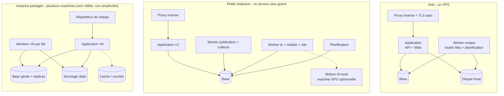

| Topologie | Ressources indicatives | Composants |
|---|---|---|
| Solo | 2 vCPU, 4 Go RAM, 40 Go disque (sans IA locale) | 4 conteneurs : proxy, application, worker, base |
| Petite rédaction | 4 vCPU, 8 à 16 Go RAM | Idem, workers séparés par files, IA locale optionnelle sur une autre machine |
| Instance partagée | Selon charge | Mêmes images, plus d'instances ; base et stockage gérés ; cache optionnel |
| Local sans URL publique | Poste ou serveur domestique | Fonctionne sans les canaux exigeant OAuth public ou médias publics (CT-09) ; CMS et « préparer et copier » disponibles |

Les ressources sont des estimations à vérifier par des tests de charge (`ROADMAP.md`).

### 20.2 Livraison

- **Une seule image applicative** (API, workers et planificateur sont la même base de code lancée avec des rôles différents) : une seule version à suivre, pas de désynchronisation entre composants.
- Livraison sous forme d'**images de conteneurs** et d'un **fichier de composition** prêt à l'emploi pour les topologies solo et petite rédaction ; la conteneurisation (piste Docker) est l'option pressentie, à confirmer dans `TECH_CHOICES.md` avec une alternative d'installation sans conteneurs documentée ou non.
- Les modules officiels sont **inclus dans l'image** et activables ; les modules communautaires intégrés s'installent via une image dérivée ou un répertoire de modules ; les modules hors processus sont des conteneurs séparés.

### 20.3 Installation (O9, CO-01, H11)

1. Une commande d'installation (ou un fichier de composition à télécharger) qui génère la configuration minimale : nom de domaine, adresse e-mail pour les certificats, clé maîtresse générée aléatoirement.
2. Démarrage ; création automatique du schéma.
3. **Assistant Web** (F-ADM-01, §7.7 de l'analyse) : compte administrateur, espace, marque par défaut, fournisseur IA (ou aucun), premières sources, premier sujet, connexion du site principal.

Seuls les **paramètres d'infrastructure** (domaine, base, stockage, clé maîtresse, SMTP) sont dans la configuration de déploiement ; **tout le reste** se règle dans l'interface et est stocké en base.

### 20.4 Mises à jour

- Versionnement sémantique du produit ; notes de version signalant les changements incompatibles (F-ADM-06).
- Migrations de schéma **automatiques** au démarrage, précédées d'une **sauvegarde automatique** ; migrations conçues pour être compatibles avec la version précédente de l'application pendant la transition (permet une mise à jour sans interruption longue en topologie répliquée).
- Notification dans l'interface quand une nouvelle version est disponible (vérification désactivable, pour qui refuse tout appel sortant).

### 20.5 Sauvegarde et restauration (F-ADM-05, CO-06, R-O07)

| Élément | Méthode |
|---|---|
| Base de données | Export cohérent planifié par le planificateur (file `maintenance`), avec rétention configurable |
| Fichiers | Copie des répertoires de stockage (ou réplication du stockage objet) |
| Clé maîtresse | **À sauvegarder séparément** ; rappel dans l'assistant et le tableau de santé |
| Destination | Disque local + destination distante optionnelle (SFTP, stockage objet), chiffrée |
| Restauration | Commande documentée ; **test de restauration** guidé et proposé périodiquement ; l'état de la dernière sauvegarde réussie est affiché dans le tableau de santé |
| Export d'espace | Archive ouverte (JSON + Markdown + médias) d'un espace complet, importable dans une autre instance (UC-18, CT-12) |

---

## 21. Observabilité

| Signal | Contenu | Usage |
|---|---|---|
| Journaux techniques | Structurés, avec identifiant de corrélation (requête, exécution, tâche), espace, module ; sans secret ni contenu de prompt | Diagnostic |
| Métriques | Profondeur et âge des files, durées et échecs des tâches par type, erreurs par connecteur et par fournisseur, coûts IA, temps de réponse de l'API, espace disque | Tableau de santé (F-ADM-02), alertes |
| Contrôles de santé | Points d'accès de vivacité et de disponibilité par processus | Orchestrateur, supervision externe |
| Traces | Instrumentation compatible avec un standard ouvert (de type OpenTelemetry), export **optionnel** | Installations avancées |
| Alertes administrateur | File bloquée, connecteur en erreur, sauvegarde en échec, disque presque plein, certificat proche de l'expiration | Notification in-app et e-mail |
| Journal des actions automatiques | Par exécution : entrée, décision, raisons, coût, résultat (F-AUT-07) | Supervision des agents par le propriétaire (UC-14) |

Aucune télémétrie n'est envoyée au projet sans consentement explicite de l'administrateur.

---

## 22. Performance et montée en charge

| Levier | Moment d'utilisation |
|---|---|
| Index adaptés aux écrans courants (flux de veille, bibliothèque, calendrier) | Dès le lot 1 |
| Pagination et chargement progressif partout | Dès le lot 1 |
| Calculs coûteux en tâche de fond (scores, embeddings, regroupements, contrôles) avec résultats stockés | Dès le lot 1 |
| Workers séparés par file, puis répliqués | Petite rédaction |
| Réplicas de lecture de la base pour les recherches | Instance partagée |
| Stockage objet et réseau de diffusion pour les médias et sites | Instance partagée |
| Cache et courtier de messages | Seulement si les mesures le justifient |
| Moteur de recherche dédié | Au-delà de quelques millions d'éléments |
| Partitionnement des tables volumineuses par date (éléments collectés, journal des appels) | Quand les volumes l'imposent |

Principe : **mesurer avant d'ajouter** un composant (P7). Les objectifs de performance du §11 de l'analyse seront traduits en tests de charge automatisés dans `ROADMAP.md`.

---

## 23. Couverture des exigences

### 23.1 Contraintes techniques

| Contrainte | Réponse architecturale | Sections |
|---|---|---|
| CT-01 Navigateur uniquement | Application Web responsive, API d'abord | §18 |
| CT-02 Open source, pas de dépendance propriétaire | Adaptateurs derrière contrats ; au moins un parcours complet avec modèles locaux ; aucun service cloud requis | §9, §10, §20 |
| CT-03 Auto-hébergeable sur VPS | Monolithe modulaire, infrastructure minimale, composition prête à l'emploi | §5, §6, §20 |
| CT-04 Isolation par espace | Base partagée avec défense en profondeur | §8.1, §19 |
| CT-05 Modularité | Points d'extension, manifestes, contrats versionnés, tests de conformité | §9 |
| CT-06 Tâches longues reprenables | File durable, baux, reprises, boîte d'envoi transactionnelle | §12 |
| CT-07 Secrets chiffrés | Chiffrement par enveloppe, écriture seule | §19.4 |
| CT-08 Médias à URL publique | Point d'accès public, URL signées | §6, §16.4 |
| CT-09 OAuth en HTTPS public | Point de rappel générique ; mode local dégradé | §16.4, §20.1 |
| CT-10 Fonctionnement sans IA / GPU / social | Composantes de score sans IA, création manuelle, publication CMS, P9 | §3, §13.3 |
| CT-11 Modèles hétérogènes | Modèle de capacités, validation des sorties | §10.3, §10.4 |
| CT-12 Formats ouverts | Export complet, document structuré documenté | §8, §20.5 |

### 23.2 Règles d'automatisation et de sûreté

| Règle | Mécanisme | Sections |
|---|---|---|
| R1 Défauts prudents | Politiques par défaut : niveau 2 max, publication niveau 1 | §11.3 |
| R2 Niveaux 3-4 de publication encadrés | Propriétaire + ré-authentification + confirmation ; refus pour jetons, agents, imports | §11.3, §18.2 |
| R3 Pas de contournement amont | PDP vérifie contrôles et validation de la version | §11.3, §11.4 |
| R4 Politiques tracées | Versionnement + audit dans la même transaction | §11.3, §15.3 |
| R5 Arrêt d'urgence | Indicateur lu par le PDP, revérification de dernier moment, suspension des tâches | §11.6 |
| D8 Mention IA | Insérée par le moteur de rendu, garde-fou non désactivable | §14.5 |
| RM3 Canal → une marque | Invariant de l'agrégat Marque | §8.3 |
| RM4 Contexte de marque | Injecté par la passerelle IA dans chaque génération | §10.4 |
| F-SITE-03 Site d'abord | Tâches de promotion dépendantes | §16.2 |

### 23.3 Risques prioritaires (C ≥ 6)

| Risque | Mitigation architecturale |
|---|---|
| R-T02 Hallucinations | Références de sources structurées, contrôle des citations, contrôle factuel indicatif, sources côte à côte, validation humaine par défaut |
| R-T04 Injection de prompt | Séparation instructions / données, assainissement, agents sans effet externe, garde-fous déterministes, P1 |
| R-J01 Contrefaçon | Garde-fou de similarité bloquant (lexical + sémantique), archives privées, extraits limités |
| R-J04 Diffamation | Validation par défaut, contrôle factuel, retrait en une action, instantanés probants |
| R-O03 Publication automatique inappropriée | PDP, R2 par construction, délai de grâce, revérification, plafonds, arrêt d'urgence, simulation |
| R-O01 Suspension de comptes sociaux | Plafonds par canal, étiquetage natif, pas de multi-comptes coordonnés, « préparer et copier » |
| R-T01 / R-O06 Dépendance aux API sociales | Connecteurs isolés et désactivables, contrats versionnés, mode « préparer et copier », site principal pivot |
| R-J08 Offre hébergée | Hors périmètre ; architecture compatible (multi-location, quotas, instances multiples) |
| R-O05 Pérennité du projet | Monolithe modulaire simple, cœur réduit, contrats stables permettant de déléguer les connecteurs, tests de conformité |
| R-T08 Publication en double ou perdue | Machine à états, clés d'idempotence, rapprochement, jamais de relance aveugle |
| R-T10 Contrôles de similarité faibles | Combinaison lexical + sémantique, seuils réglables, passages surlignés pour revue humaine |

---

## 24. Architecture par lot

| Lot | Composants et mécanismes livrés | Ce qui doit déjà exister pour ne pas être refait |
|---|---|---|
| **Lot 1 — Veille, rédaction assistée, site principal CMS** | Socle complet (identité, espaces **et marques** avec marque par défaut masquée, audit chaîné, notifications in-app et e-mail, administration, sauvegardes) ; tâches et planificateur ; sources RSS + saisie manuelle + OPML ; veille (scores explicables, dédoublonnage, recherche) ; passerelle IA (adaptateur compatible OpenAI + au moins un adaptateur natif, profils, capacités, budgets, replis) ; rédaction (document structuré, versions, briefs, modèles de prompt) ; garde-fous déterministes (similarité, citations, mots interdits, SEO, mention IA) ; traçabilité (archives, instantanés) ; publication avec **connecteurs WordPress et Ghost**, URL canonique, « préparer et copier » ; PDP avec niveaux 0 à 2 ; arrêt d'urgence ; API publique v1 | Contexte de marque partout (même si une seule marque) ; contrat de connecteur de publication complet (y compris idempotence, rapprochement) ; PDP comme point unique ; registre de modules interne ; événements de domaine |
| **Lot 2 — Équipe, marques, médias, site généré** | Marques multiples, rôles et restriction par marque, circuits de validation, 2FA ; médias (génération, import, banques libres, rendus, provenance) ; **site généré** (constructions incrémentales, thème, fichiers SEO, redirections) et cibles de déploiement SFTP/FTP/Git ; planification et calendrier ; regroupements ; contrôle factuel ; déclinaisons de promotion ; webhooks | — |
| **Lot 3 — Promotion sociale et automatisation** | Connecteurs Mastodon, Bluesky, puis Facebook Pages, Instagram, X ; point d'accès public aux médias ; rappels OAuth ; renouvellement des jetons ; niveaux 3 et 4 (délai de grâce, revérification, plafonds) ; simulation ; agents bornés (tri, brief) ; désactivation sur anomalie ; liens traçables | Les mécanismes de sûreté (arrêt d'urgence, plafonds, journal) sont livrés **avant ou avec** les niveaux 3-4 (§14 de l'analyse) |
| **Lot 4 — Extensibilité et formats riches** | Protocole d'extension hors processus et modules communautaires ; TikTok et vidéo courte ; sites autorisés (extraction) ; page publique de traçabilité ; détection des sources disparues ; statistiques ; OIDC | — |

---

## 25. Registre des décisions d'architecture (ADR)

Format court : contexte, décision, alternatives, conséquences. Chaque ADR pourra devenir un fichier séparé (`docs/adr/`) lors du passage en dépôt.

### ADR-01 — Monolithe modulaire avec workers

- **Contexte** : cible solo puis petite rédaction (D4), installation par non-expert (O9), peu de mainteneurs (R-O05), forte cohérence nécessaire entre article, publication et audit.
- **Décision** : une base de code, modules aux frontières vérifiées, déployée en processus API / workers / planificateur.
- **Alternatives** : microservices, monolithe non structuré, sans serveur (§5.2).
- **Conséquences** : exploitation simple, transactions locales ; discipline de modularité à faire respecter par des tests d'architecture ; extraction de services possible plus tard.

### ADR-02 — Base relationnelle comme source de vérité, file de tâches et index par défaut

- **Contexte** : P7 (infrastructure minimale), R-T08 (pas de perte ni de doublon).
- **Décision** : la base porte données, file de tâches (boîte d'envoi transactionnelle), recherche plein texte et vectorielle ; composants dédiés optionnels derrière interfaces.
- **Alternatives** : courtier de messages et moteur de recherche dédiés dès le départ.
- **Conséquences** : 4 conteneurs en solo ; exigences fortes sur la base (transactions, verrouillage, plein texte multilingue, vecteurs, JSON) transmises à `TECH_CHOICES.md` ; plafond de débit à surveiller au-delà du profil petite rédaction.

### ADR-03 — Multi-location par colonne d'espace avec défense en profondeur

- **Contexte** : CT-04, D1 (offre hébergée possible plus tard).
- **Décision** : base partagée, contexte de tenance obligatoire, filtrage en base si disponible, tests d'isolation.
- **Alternatives** : base ou schéma par espace (§8.1).
- **Conséquences** : coût faible ; isolation dépendante de la rigueur applicative, compensée par les barrières supplémentaires.

### ADR-04 — Point unique de décision des politiques et chemin unique vers l'extérieur

- **Contexte** : promesse de contrôle (rang 1), R1 à R5, D6.
- **Décision** : toute action externe passe par le module Publication (ou la Passerelle IA pour les appels IA) après décision du PDP, avec revérification de dernier moment.
- **Alternatives** : contrôles répartis dans chaque connecteur ou agent.
- **Conséquences** : promesses de sûreté testables en un seul endroit ; les connecteurs restent simples ; le PDP devient un composant critique à tester exhaustivement.

### ADR-05 — Pipelines déterministes, agents bornés sans effet externe

- **Contexte** : D6, H2, R-T04.
- **Décision** : l'automatisation est un moteur de pipelines à étapes durables ; les agents sont des étapes de proposition, avec outils en lecture et budgets bornés.
- **Alternatives** : agents à décision libre disposant d'outils de publication ; adoption d'un cadre d'agents généraliste comme cœur.
- **Conséquences** : comportement prévisible, rejouable et explicable ; un cadre d'agents existant peut être utilisé **à l'intérieur** d'une étape d'agent si `TECH_CHOICES.md` le justifie, sans en faire la colonne vertébrale.

### ADR-06 — Passerelle IA avec modèle de capacités et adaptateur générique compatible OpenAI

- **Contexte** : O8, H7, CT-11, F-IA.
- **Décision** : passerelle unique ; usages déclarant des capacités ; adaptateur générique pour les API compatibles OpenAI, adaptateurs natifs si nécessaire ; budgets à réservation.
- **Alternatives** : appels directs aux SDK de chaque fournisseur dans les modules ; plus petit dénominateur commun.
- **Conséquences** : changement de fournisseur par configuration ; un mode 100 % local vérifiable ; coût de maintenance des adaptateurs natifs limité aux fournisseurs qui le justifient.

### ADR-07 — Document structuré comme format de référence des articles

- **Contexte** : multi-canal, références de sources, citations vérifiables, part d'IA, sécurité.
- **Décision** : arbre de blocs typés, rendu par canal par un moteur central qui insère sources, mention IA et métadonnées.
- **Alternatives** : HTML libre, Markdown seul.
- **Conséquences** : contrôle fin et sûr ; choix d'un éditeur compatible à faire dans `TECH_CHOICES.md` ; conversions à maintenir.

### ADR-08 — Publication à machine à états avec idempotence et rapprochement

- **Contexte** : R-T08, irréversibilité des publications sociales.
- **Décision** : clé d'idempotence enregistrée avant envoi, état « inconnu » avec rapprochement, jamais de relance aveugle.
- **Alternatives** : reprises simples sur erreur.
- **Conséquences** : opération « Vérifier l'existence » exigée des connecteurs quand le canal le permet ; quelques cas renvoyés à un humain.

### ADR-09 — Site généré statique, construit à partir des instantanés

- **Contexte** : D3 (mutualisés comme cibles), D12 (site pivot), D13 (lot 2), F-SEO.
- **Décision** : site 100 % statique, constructions incrémentales, déploiement différentiel sur cibles standard.
- **Alternatives** : site dynamique servi par l'instance ; CMS embarqué.
- **Conséquences** : compatible avec tout hébergement, robuste et pérenne ; fonctions dynamiques (formulaire, recherche) traitées par des moyens statiques ou par l'instance.

### ADR-10 — Deux modes d'extension : intégré puis hors processus

- **Contexte** : O10, CT-05, D2 (AGPL), sécurité des modules tiers.
- **Décision** : modules officiels intégrés dès le lot 1 ; protocole hors processus documenté au lot 4 pour les modules communautaires non revus.
- **Alternatives** : uniquement intégré (pas de cloisonnement) ; uniquement hors processus dès le départ (coût initial élevé).
- **Conséquences** : démarrage simple, cloisonnement disponible quand l'écosystème apparaît ; deux formes de contrat à maintenir à partir du lot 4.

### ADR-11 — Chiffrement des secrets par enveloppe avec clé maîtresse hors base

- **Contexte** : CT-07, R-T07.
- **Décision** : clés de données par espace chiffrées par une clé maîtresse fournie à l'instance.
- **Alternatives** : chiffrement avec une clé stockée en base ; dépendance obligatoire à un gestionnaire de secrets externe.
- **Conséquences** : une fuite de la base seule ne révèle pas les secrets ; la clé maîtresse doit être sauvegardée séparément (risque de perte à documenter).

---

## 26. Questions transmises à `TECH_CHOICES.md`

Chaque choix sera argumenté selon des critères communs : **maturité et pérennité**, **taille et activité de la communauté**, **compatibilité de licence avec l'AGPL-3.0**, **simplicité d'exploitation sur un petit VPS**, **adéquation aux exigences ci-dessous**, **écosystème** (IA, extraction Web, traitement d'images), **facilité de contribution**.

| Choix | Exigences issues de l'architecture | Pistes déjà évoquées |
|---|---|---|
| Langage et cadre du back-end | Écosystème IA et extraction Web riche ; tâches de fond ; typage pour des contrats d'extension stables ; chargement de modules ; tests d'architecture | Python / FastAPI |
| Interface Web | Éditeur riche de documents structurés, accessibilité, i18n, temps réel, déploiement simple | Next.js |
| Base de données | Transactions, verrouillage adapté aux files, plein texte multilingue, index vectoriel, JSON, sécurité au niveau des lignes, sauvegarde simple | PostgreSQL |
| File de tâches et planificateur | File durable sur la base, baux, reprises, priorités, concurrence par clé (canal, domaine, fournisseur), verrou de leader | — |
| Format de document et éditeur | Schéma ouvert, conversion HTML / Markdown, origine des blocs, collaboration future | — |
| Passerelle IA | Construire sur une bibliothèque d'abstraction existante ou écrire les adaptateurs ; sortie structurée ; comptage des jetons | — |
| Cadre d'agents | Usage limité à l'intérieur d'une étape d'agent (ADR-05) ; outils en lecture ; bornes de coût | « à déterminer » |
| Similarité et dédoublonnage | Mesures lexicales et quasi-doublons performantes ; embeddings locaux possibles | — |
| Extraction de contenu | Extraction générique robuste, détection de langue, robots.txt et réserves TDM | — |
| Générateur de site | Statique, incrémental, thèmes, fichiers SEO ; intégré ou générateur existant | — |
| Stockage de fichiers | Disque local et stockage objet derrière une même interface | — |
| Médias | Traitement d'images, métadonnées IPTC, C2PA, vidéo (lot 4) | — |
| Authentification | Sessions, 2FA, WebAuthn, OIDC | — |
| Conteneurisation et livraison | Image unique multi-rôles, fichier de composition, proxy avec TLS automatique | Docker |
| Observabilité | Journaux structurés, métriques, traces au format ouvert | — |

---

## 27. Points à valider

Les décisions ci-dessous structurent la suite (`TECH_CHOICES.md`, `ROADMAP.md`). Une recommandation est donnée pour chacune.

| ID | Question | Options | Recommandation |
|---|---|---|---|
| DA1 | Style architectural | Monolithe modulaire / microservices | **Monolithe modulaire** avec workers (ADR-01) |
| DA2 | Infrastructure de base | Base seule (file et recherche incluses) / courtier et moteur de recherche dédiés dès le départ | **Base seule**, composants dédiés optionnels (ADR-02) |
| DA3 | Multi-location | Colonne d'espace / schéma ou base par espace | **Colonne d'espace** avec défense en profondeur (ADR-03) |
| DA4 | Format des articles | Document structuré / HTML / Markdown | **Document structuré** (ADR-07) |
| DA5 | Publication manquée après une longue panne | Publier en retard / remettre en proposition | **Remettre en proposition** au-delà d'un délai configurable (§12.5) |
| DA6 | Simulation : appels IA réels ou fictifs | Réels (facturés) / fictifs | **Réels**, avec avertissement de coût (§11.6) |
| DA7 | Conservation du contenu des prompts | Jamais / temporaire pour diagnostic / toujours | **Désactivée par défaut**, temporaire sur option (§10.6) |
| DA8 | Site généré | Statique / dynamique | **Statique** (ADR-09) |
| DA9 | Modules communautaires | Intégrés seulement / intégrés puis hors processus | **Intégrés puis protocole hors processus au lot 4** (ADR-10) |
| DA10 | Anonymisation de l'audit à la suppression d'un utilisateur | Effacement / pseudonymisation | **Pseudonymisation**, sous réserve de revue juridique (§8.6) |

---

*Fin du document. Après validation (ou corrections) de cette architecture et des points DA1 à DA10, l'étape suivante est `TECH_CHOICES.md`.*
