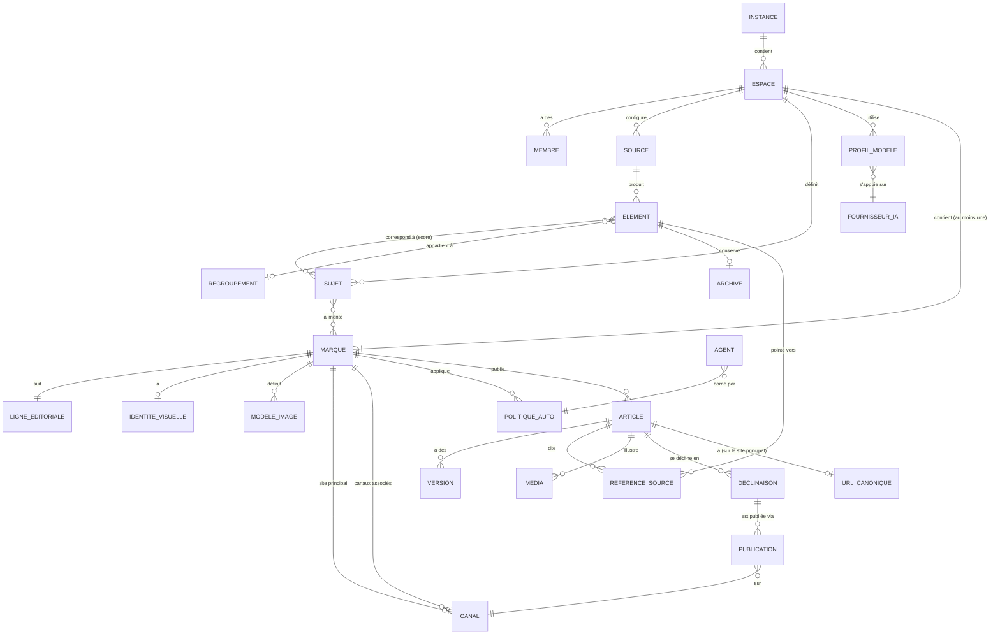
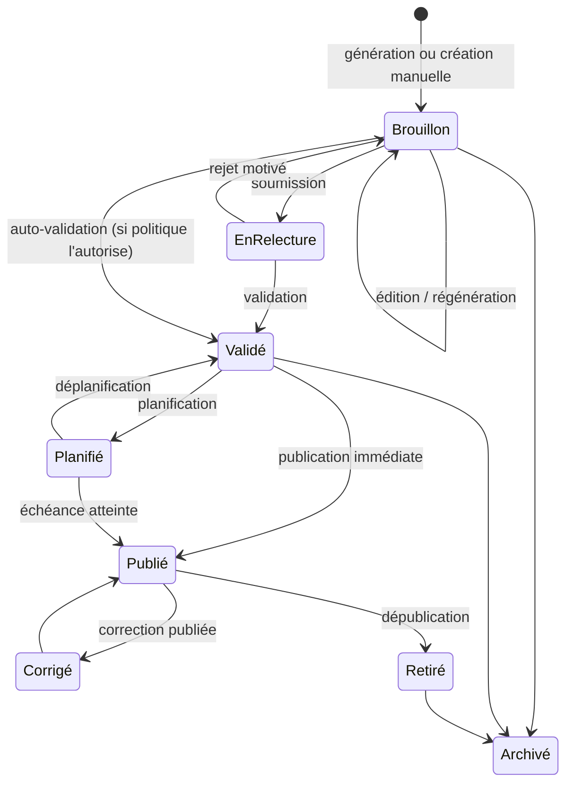
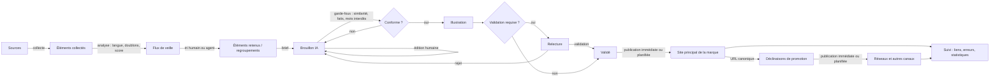

# Analyse fonctionnelle — Plateforme Open Source de Veille et de Diffusion IA

| Champ | Valeur |
|---|---|
| Document | `FUNCTIONAL_ANALYSIS.md` |
| Version | 1.0 |
| Date | 2026-10-11 |
| Statut | **Validé par Joël le 2026-10-11** (analyse validée dans son ensemble : D1 à D10 selon les recommandations, D11 à D13 confirmées explicitement) |
| Phase | Conception — aucun code |
| Documents suivants | `ARCHITECTURE.md`, `RISKS.md` (détaillé), `ROADMAP.md`, `TECH_CHOICES.md` |

**Historique**

| Version | Date | Changements |
|---|---|---|
| 0.1 | 2026-10-11 | Première version |
| 0.2 | 2026-10-11 | Ajout du concept de **Marque** (§4.4, §5.11) ; analyse du **rôle du site Web** et recommandation (§5.12, H12) ; exigences **SEO et découvrabilité** (§5.13) ; lots et décisions mis à jour (§14, §15) |
| 1.0 | 2026-10-11 | Validation par Joël : contenu identique à la v0.2, seul l'en-tête change |

> Ce document décrit **ce que** le produit doit faire, pour **qui**, et sous **quelles contraintes**. Il ne décrit pas **comment** il sera construit : aucune technologie n'est choisie ici. Les pistes techniques évoquées (Next.js, FastAPI, PostgreSQL, Docker) sont volontairement ignorées à ce stade et seront évaluées dans `TECH_CHOICES.md`.

---

## Sommaire

1. [Vision, objectifs et non-objectifs](#1-vision-objectifs-et-non-objectifs)
2. [Glossaire](#2-glossaire)
3. [Acteurs du système](#3-acteurs-du-système)
4. [Modèle du domaine](#4-modèle-du-domaine)
5. [Fonctionnalités principales](#5-fonctionnalités-principales)
6. [Fonctionnalités secondaires](#6-fonctionnalités-secondaires)
7. [Flux métier](#7-flux-métier)
8. [Cas d'utilisation](#8-cas-dutilisation)
9. [Dépendances externes](#9-dépendances-externes)
10. [Contraintes](#10-contraintes)
11. [Exigences non fonctionnelles](#11-exigences-non-fonctionnelles)
12. [Remise en question des hypothèses](#12-remise-en-question-des-hypothèses)
13. [Risques](#13-risques)
14. [Proposition de périmètre par lots](#14-proposition-de-périmètre-par-lots)
15. [Décisions à prendre avant l'architecture](#15-décisions-à-prendre-avant-larchitecture)

---

## 1. Vision, objectifs et non-objectifs

### 1.1 Vision

Une plateforme web open source, auto-hébergeable et multi-utilisateurs qui transforme une **veille d'informations fiable et traçable** en **contenus éditoriaux originaux**, illustrés et publiables sur plusieurs canaux, avec un **contrôle humain total** sur chaque étape et une automatisation **strictement opt-in**.

Le produit se positionne comme un **outil d'assistance éditoriale**, pas comme une ferme de contenus automatique. Cette distinction structure tout le reste du document (voir §12).

### 1.2 Objectifs fonctionnels

| ID | Objectif | Mesure de réussite (indicative) |
|---|---|---|
| O1 | Centraliser la collecte d'informations depuis des sources choisies par l'utilisateur | Une source RSS est ajoutée et produit des éléments en moins de 2 minutes |
| O2 | Filtrer l'information selon des sujets de veille | L'utilisateur ne voit que les éléments pertinents, avec un score explicable |
| O3 | Produire des brouillons originaux assistés par IA à partir d'une ou plusieurs sources | Le brouillon cite ses sources et passe le contrôle de similarité |
| O4 | Illustrer les contenus | Une illustration conforme aux règles (licence, étiquetage IA) est proposée |
| O5 | Garantir la traçabilité des sources | Chaque article publié permet de remonter à chaque source utilisée, même si celle-ci disparaît |
| O6 | Publier sur plusieurs canaux depuis un point unique | Un article est publié sur au moins un CMS et un réseau social depuis la plateforme |
| O7 | Automatiser progressivement, étape par étape | Chaque étape peut être passée de manuelle à automatique indépendamment, et revenir en arrière |
| O8 | Rester indépendant de tout fournisseur | Changer de fournisseur IA ne demande qu'une modification de configuration |
| O9 | Être installable par un utilisateur non expert | Installation documentée sur un VPS en moins d'une heure |
| O10 | Être extensible par la communauté | Un nouveau canal ou fournisseur s'ajoute sans modifier le cœur |

### 1.3 Non-objectifs (proposés)

Ces points sont **explicitement exclus** pour garder le périmètre maîtrisable. Ils peuvent être réintégrés plus tard.

- **Ne pas** être un CMS complet : la plateforme publie *vers* des CMS ou génère des sites simples, elle ne remplace pas WordPress.
- **Ne pas** être un outil de gestion de communauté (réponse aux commentaires, messagerie des réseaux sociaux).
- **Ne pas** contourner les protections techniques des sites (paywalls, CAPTCHA, robots.txt, limites d'API).
- **Ne pas** générer de contenus dont l'objet est de se faire passer pour une source de presse existante.
- **Ne pas** proposer d'application mobile native (contrainte « navigateur uniquement » ; le responsive suffit).
- **Ne pas** entraîner ou affiner de modèles IA dans le cadre du produit.

---

## 2. Glossaire

| Terme | Définition |
|---|---|
| **Instance** | Une installation de la plateforme (auto-hébergée ou hébergée). |
| **Espace de travail** | Unité d'isolation des données, des membres et des coûts à l'intérieur d'une instance (une rédaction, une agence, un client, une personne). Les sources, la veille, les membres, les fournisseurs IA et le budget appartiennent à un espace. |
| **Marque** | Identité éditoriale et visuelle sous laquelle des contenus sont publiés (un blog, un média, un titre). Elle porte la ligne éditoriale, le ton, l'identité visuelle, les modèles d'images, le site principal et les comptes sociaux. Un espace contient une ou plusieurs marques. Voir §4.4. |
| **Site principal** | Le site Web de référence d'une marque (site généré par la plateforme ou CMS externe), sur lequel vit la version complète et canonique des articles. |
| **URL canonique** | L'adresse de référence d'un article sur le site principal, vers laquelle pointent toutes les déclinaisons et les données SEO. |
| **Source** | Origine d'informations configurée : flux RSS/Atom, site autorisé, API, newsletter, saisie manuelle. |
| **Élément collecté** | Une unité d'information récupérée depuis une source (un article de presse, une entrée RSS), avec son contenu brut et ses métadonnées. |
| **Sujet de veille** | Thème défini par l'utilisateur (mots-clés, description, exemples, exclusions) servant à filtrer et classer les éléments. |
| **Regroupement (histoire)** | Ensemble d'éléments collectés traitant du même événement, provenant de sources différentes. |
| **Brief** | Instructions de production d'un article : éléments retenus, angle, ton, longueur, public, canal cible. |
| **Article** | Contenu généré et édité, versionné, avec ses références de sources et ses médias. |
| **Déclinaison** | Version d'un article adaptée à un canal (post court pour X, légende Instagram, script TikTok, article long pour WordPress). |
| **Référence de source** | Lien traçable entre un article et un élément collecté, avec l'archive de ce dernier. |
| **Média** | Image ou vidéo associée à un article, générée ou importée, avec sa provenance et sa licence. |
| **Canal** | Destination de publication configurée (un site WordPress précis, une Page Facebook précise, etc.). |
| **Connecteur** | Module qui implémente l'échange avec un type de service externe (type « WordPress », type « Instagram »). Un canal est une instance configurée d'un connecteur. |
| **Fournisseur IA** | Service exposant des modèles (Groq, OpenRouter, Ollama, Anthropic, OpenAI…). |
| **Profil de modèle** | Association « usage → fournisseur + modèle + paramètres » (ex. « réécriture longue → modèle X chez fournisseur Y »). |
| **Ligne éditoriale** | Ensemble de règles de style, de ton, de vocabulaire et d'interdits appliqué à la génération. Portée par une marque. |
| **Pipeline** | Enchaînement configuré des étapes collecte → tri → rédaction → illustration → validation → publication. |
| **Politique d'automatisation** | Réglage, par étape et par espace (voire par sujet/canal), du niveau d'automatisation autorisé. |
| **Agent** | Composant qui exécute des tâches de manière autonome dans les limites d'une politique d'automatisation. |
| **Garde-fou** | Contrôle bloquant ou alertant exécuté avant une action (similarité, budget, mots interdits, horaires). |
| **Journal d'audit** | Historique immuable des actions humaines et automatiques. |

---

## 3. Acteurs du système

### 3.1 Acteurs humains

| Acteur | Description | Responsabilités principales |
|---|---|---|
| **Administrateur d'instance** | Installe et maintient l'instance. | Installation, mises à jour, sauvegardes, configuration globale (fournisseurs IA partagés, quotas, inscription ouverte ou non), gestion des espaces, modules installés. |
| **Propriétaire d'espace** | Responsable d'un espace de travail. | Membres et rôles, canaux, fournisseurs IA de l'espace, politiques d'automatisation, budget, ligne éditoriale. **Seul rôle autorisé à activer la publication automatique.** |
| **Rédacteur / Éditeur** | Produit les contenus. | Sources, sujets de veille, tri, génération et édition d'articles, médias, soumission à validation, planification (si autorisé). |
| **Relecteur / Validateur** | Contrôle la qualité et la conformité. | Validation ou rejet motivé des articles et médias, vérification des sources. |
| **Observateur** | Accès en lecture. | Consultation de la veille, de la bibliothèque et des statistiques. |
| **Lecteur final** | Public des contenus publiés, hors plateforme. | Lit les contenus et consulte les sources originales via les liens de traçabilité. |
| **Développeur de modules** | Contributeur externe. | Écrit des connecteurs, fournisseurs IA ou agents en respectant les contrats d'extension. |
| **Opérateur d'hébergement** *(seulement si une offre hébergée existe)* | Entité qui héberge des instances pour des tiers. | Exploitation, facturation, support, obligations légales d'hébergeur. Voir §12, hypothèse H3. |
| **Titulaire de droits / plaignant** | Éditeur d'une source, personne citée. | Demande de retrait ou de correction d'un contenu. Le produit doit lui offrir un point de contact (§6.3, F-CNF-03). |

> Un même individu peut cumuler plusieurs rôles. Pour un usage solo, la plateforme doit rester simple : un seul utilisateur propriétaire de son espace, sans circuit de validation imposé.

### 3.2 Acteurs systèmes

| Acteur | Rôle |
|---|---|
| **Planificateur** | Déclenche les tâches périodiques (collecte, publications planifiées, rapports). |
| **Agents IA** | Exécutent des tâches autonomes (tri, rédaction, illustration, publication) dans les limites des politiques. |
| **Sources externes** | Flux RSS, sites web, API d'information. |
| **Fournisseurs IA** | Génération de texte, d'images, de vidéos, d'embeddings, de modération. |
| **Plateformes de publication** | CMS, hébergeurs (FTP/SFTP, Git), réseaux sociaux. |
| **Service de messagerie** | Envoi des notifications et invitations (e-mail, éventuellement webhooks, Matrix, Slack…). |
| **Service d'archivage** | Conservation des copies des sources (local ou Internet Archive). |

---

## 4. Modèle du domaine

### 4.1 Concepts et relations

### 4.2 Cycle de vie d'un article

Points à noter :

- Le statut de **publication** est porté **par canal** : un article peut être publié sur WordPress et en échec sur Instagram.
- Toute modification d'un article validé le **repasse en brouillon** (sauf correction mineure explicitement autorisée par la politique), afin qu'aucune version non validée ne soit publiée.
- Une **version publiée est figée** : on sait toujours exactement quel texte, quelles images et quelles sources ont été diffusés, où et quand.

### 4.3 Cycle de vie d'un élément collecté

`Nouveau → Analysé (score, langue, doublon) → { Ignoré | À traiter | Retenu } → Utilisé dans un article → Archivé`

Un élément peut être **épinglé** manuellement, **masqué** ou **signalé comme non fiable** (ce qui peut dégrader le score de confiance de sa source).

### 4.4 Le concept de Marque

**Question posée** : l'espace de travail suffit-il, ou faut-il un niveau « Marque » / « Publication » portant la ligne éditoriale, l'identité visuelle, le ton, les sites et réseaux associés et les modèles d'images ?

**Réponse : oui, un niveau Marque est nécessaire.** L'espace et la marque répondent à deux questions différentes :

- l'**espace** répond à « *qui travaille ensemble, sur quelles données, avec quel budget ?* » (isolation, membres, coûts) ;
- la **marque** répond à « *sous quelle identité publie-t-on ?* » (voix, apparence, destinations).

Les confondre oblige à choisir entre deux mauvaises options :

| Situation | Sans Marque (1 espace = 1 identité) | Avec Marque |
|---|---|---|
| Une personne tient deux blogs (ex. tech et cuisine) | Deux espaces : sources, veille et clés IA dupliquées, deux budgets, pas de vue d'ensemble | Un espace, deux marques partageant sources et veille |
| Une rédaction publie plusieurs titres | Membres invités N fois, veille dupliquée | Une équipe, plusieurs marques, rôles restreints par marque si besoin |
| Une agence gère des clients | Un espace par client (correct) | Un espace par client, et une ou plusieurs marques par client |
| Un même sujet de veille alimente deux identités | Impossible sans duplication | Le sujet est rattaché aux deux marques |

**Nommage recommandé : « Marque ».** Le terme « Publication » entre en collision avec l'acte de publier (et l'entité `PUBLICATION` du modèle), ce qui créerait des ambiguïtés permanentes dans l'interface et la documentation (« publier une publication »). « Titre » ou « Média » sont des alternatives possibles côté presse ; « Marque » est le plus général.

**Répartition des responsabilités**

| Élément | Instance | Espace | Marque | Remarque |
|---|---|---|---|---|
| Membres et rôles | | ● | ○ | Rôles restreignables à certaines marques (optionnel) |
| Fournisseurs IA et profils de modèle | ○ | ● | ○ | Une marque peut surcharger un profil (ex. modèle d'image) |
| Budget IA | ○ | ● | ○ | Sous-plafonds par marque possibles |
| Sources | ○ | ● | | Partagées entre les marques de l'espace |
| Sujets de veille et flux | | ● | ○ | Un sujet est rattaché à une ou plusieurs marques ; le flux est filtrable par marque |
| Médiathèque | | ● | ○ | Médias rattachés à une marque par défaut, réutilisables |
| Ligne éditoriale, ton, public cible, interdits | | | ● | |
| Identité visuelle (logo, couleurs, typographies, gabarits) | | | ● | |
| Modèles d'images (styles, prompts de base, interdits visuels) | | | ● | |
| Langues de publication, fuseau horaire | | | ● | |
| Site principal (0 ou 1) | | | ● | Voir §5.12 |
| Réseaux sociaux et autres canaux | | | ● | Un canal appartient à une seule marque |
| Auteurs / signatures publiques | | | ● | Utile au SEO (§5.13) |
| Mentions légales, point de contact, formulation de la mention IA | | | ● | |
| Politiques d'automatisation et plafonds | | ○ | ● | Arrêt d'urgence au niveau espace **et** marque |
| Articles | | | ● | Un article appartient à une seule marque |

● = porteur principal, ○ = valeur par défaut ou surcharge possible.

**Règles associées**

- **RM1** — Tout espace contient au moins une marque, créée automatiquement. Tant qu'il n'y en a qu'une, le sélecteur de marque est masqué : l'utilisateur solo ne voit pas ce niveau.
- **RM2** — Un article appartient à une seule marque. Le réutiliser pour une autre marque crée un **article dérivé** (nouvelle rédaction selon la ligne éditoriale de la cible), lié à l'original pour la traçabilité, afin d'éviter le contenu dupliqué entre sites.
- **RM3** — Un canal (site, compte social) appartient à une seule marque, pour éviter qu'une automatisation publie sous la mauvaise identité.
- **RM4** — La génération (texte et image) applique toujours le contexte de la marque de l'article : ligne éditoriale, ton, interdits, modèles d'images.

---

## 5. Fonctionnalités principales

Notation de priorité : **M** = indispensable au premier lot utile, **S** = important, **C** = souhaitable. Le découpage en lots est proposé au §14.

### 5.1 Gestion des sources (F-SRC)

| ID | Fonctionnalité | Prio |
|---|---|---|
| F-SRC-01 | Ajouter une source RSS/Atom par URL, avec détection automatique du flux depuis l'URL d'un site | M |
| F-SRC-02 | Ajouter un site web « autorisé » avec règles d'extraction, sous réserve du respect de robots.txt, des conditions d'utilisation et des réserves de fouille de textes (TDM) | S |
| F-SRC-03 | Ajouter des sources par API (ex. API d'agences, bases ouvertes), via connecteur | C |
| F-SRC-04 | Saisie manuelle : coller une URL ou un texte, importer un fichier | M |
| F-SRC-05 | Import/export OPML | S |
| F-SRC-06 | Fréquence de collecte par source, avec bornes imposées par l'instance | M |
| F-SRC-07 | Niveau de confiance attribué à la source (manuel, ajusté par les signalements) | S |
| F-SRC-08 | Catégorisation (langue, pays, thème, type : presse, institutionnel, blog, scientifique) | S |
| F-SRC-09 | Santé de la source : dernier succès, erreurs, flux mort, changement de structure | M |
| F-SRC-10 | Bibliothèque de sources partagée entre espaces d'une instance (optionnelle) | C |
| F-SRC-11 | Mention de licence de la source (ex. contenus sous Creative Commons) utilisée par les garde-fous | S |

### 5.2 Veille thématique (F-VEI)

| ID | Fonctionnalité | Prio |
|---|---|---|
| F-VEI-01 | Créer un sujet de veille : nom, description en langage naturel, mots-clés, exclusions, langues, sources ciblées | M |
| F-VEI-02 | Calcul d'un score de pertinence par élément et par sujet, **explicable** (pourquoi cet élément remonte) | M |
| F-VEI-03 | Dédoublonnage (même URL, même contenu) et regroupement d'éléments traitant du même événement | S |
| F-VEI-04 | Flux de veille : liste filtrable/triable (sujet, source, date, score, statut) | M |
| F-VEI-05 | Actions de tri : retenir, ignorer, épingler, marquer comme lu, signaler | M |
| F-VEI-06 | Apprentissage par retour : les choix de tri ajustent la pertinence (sans entraînement de modèle, par exemples) | C |
| F-VEI-07 | Résumé automatique d'un élément ou d'un regroupement (pour lecture rapide, non publiable tel quel) | S |
| F-VEI-08 | Alertes : nouveau sujet chaud, seuil de pertinence dépassé | S |
| F-VEI-09 | Recherche plein texte et sémantique dans les éléments collectés | S |
| F-VEI-10 | Digest périodique (quotidien/hebdomadaire) envoyé par e-mail | C |

### 5.3 Rédaction assistée par IA (F-RED)

| ID | Fonctionnalité | Prio |
|---|---|---|
| F-RED-01 | Créer un brief à partir d'un ou plusieurs éléments / d'un regroupement : angle, public, ton, longueur, langue, canal cible | M |
| F-RED-02 | Générer un brouillon à partir du brief, en **citant explicitement** les sources utilisées | M |
| F-RED-03 | Opérations d'assistance : résumer, synthétiser plusieurs sources, réécrire, traduire, raccourcir, développer, changer de ton, proposer des titres | M |
| F-RED-04 | Éditeur riche avec suivi des versions et comparaison entre versions | M |
| F-RED-05 | Ligne éditoriale de la marque appliquée à la génération (style, vocabulaire, interdits, signature) ; modèles réutilisables entre marques | M |
| F-RED-06 | Modèles de prompt éditables et versionnés, par usage | S |
| F-RED-07 | **Contrôle d'originalité** : mesure de similarité entre l'article et chacune de ses sources, avec seuil bloquant configurable et mise en évidence des passages trop proches | M |
| F-RED-08 | **Contrôle de cohérence factuelle** : signaler les affirmations du brouillon qui ne sont étayées par aucune source (dates, chiffres, citations, noms) | S |
| F-RED-09 | Gestion des citations : une citation entre guillemets doit correspondre mot pour mot à la source et être attribuée | S |
| F-RED-10 | Déclinaisons par canal (article long, post court, légende, fil, script vidéo) générées à partir de l'article de référence | S |
| F-RED-11 | Métadonnées de publication : titre, chapô, tags, catégories (les métadonnées SEO sont détaillées au §5.13) | M |
| F-RED-12 | Mention de transparence IA paramétrable, ajoutée automatiquement aux contenus | M |
| F-RED-13 | Création manuelle d'un article sans IA (la plateforme reste utile sans fournisseur IA) | M |

### 5.4 Médias et illustrations (F-MED)

| ID | Fonctionnalité | Prio |
|---|---|---|
| F-MED-01 | Générer des propositions d'illustration à partir de l'article (prompt proposé et éditable) | S |
| F-MED-02 | Styles visuels et modèles d'images définis par marque (§4.4) ; style non photoréaliste proposé par défaut pour l'actualité | S |
| F-MED-03 | Importer ses propres images ; rechercher dans des banques libres (avec licence et attribution conservées) | S |
| F-MED-04 | Recadrage et formats automatiques par canal (1:1, 4:5, 9:16, 16:9) | S |
| F-MED-05 | Texte alternatif (accessibilité) proposé et éditable | M |
| F-MED-06 | Provenance du média : généré (fournisseur, modèle, prompt, date) ou importé (auteur, licence) ; métadonnées d'origine IA intégrées au fichier quand c'est possible (ex. standard C2PA / IPTC) | S |
| F-MED-07 | Garde-fous images : refus de générer des personnes réelles identifiables, logos et marques, scènes pouvant passer pour des photos d'actualité réelles | S |
| F-MED-08 | Génération vidéo courte (diaporama animé, voix de synthèse, sous-titres) | C |
| F-MED-09 | Médiathèque par espace avec recherche et réutilisation | S |

### 5.5 Traçabilité des sources (F-TRA)

| ID | Fonctionnalité | Prio |
|---|---|---|
| F-TRA-01 | Chaque article conserve la liste des éléments sources utilisés, liés à leur version exacte | M |
| F-TRA-02 | Archivage de l'élément source au moment de son utilisation (texte extrait, URL, date, empreinte), pour preuve et consultation interne | M |
| F-TRA-03 | Option d'archivage externe (lien vers une archive publique) pour garder un lien consultable si la source disparaît | C |
| F-TRA-04 | Bloc « Sources » inséré dans les contenus publiés, au format adapté au canal (liens en fin d'article, en commentaire, en description) | M |
| F-TRA-05 | Page publique de traçabilité optionnelle par article : sources, date de génération, part d'IA, historique des corrections | C |
| F-TRA-06 | Détection des sources disparues ou modifiées après publication | C |

> Remarque juridique : l'archive interne d'un article de presse est une **copie** ; elle doit rester à usage interne (preuve, contrôle d'originalité) et ne jamais être republiée. Voir §10.2.

### 5.6 Bibliothèque d'articles (F-BIB)

| ID | Fonctionnalité | Prio |
|---|---|---|
| F-BIB-01 | Liste des articles avec statut, auteur, sujet, canaux, dates | M |
| F-BIB-02 | Recherche plein texte, filtres, tags | M |
| F-BIB-03 | Historique complet des versions et de qui a fait quoi | M |
| F-BIB-04 | Duplication, réutilisation, mise à jour d'un article ancien avec de nouvelles sources | S |
| F-BIB-05 | Vue calendrier des publications passées et planifiées | S |
| F-BIB-06 | Export (Markdown, HTML, JSON) d'un article ou de toute la bibliothèque | M |

### 5.7 Validation éditoriale (F-VAL)

| ID | Fonctionnalité | Prio |
|---|---|---|
| F-VAL-01 | Circuit de validation optionnel, configurable par espace (aucun, une étape, plusieurs étapes) | M |
| F-VAL-02 | Soumission, validation, rejet motivé, commentaires ancrés dans le texte | M |
| F-VAL-03 | Liste de contrôle de validation (sources vérifiées, similarité OK, médias conformes, mention IA présente) | S |
| F-VAL-04 | Notifications aux validateurs et aux auteurs | M |
| F-VAL-05 | Validation séparée pour les médias | C |
| F-VAL-06 | Règle « quatre yeux » optionnelle : l'auteur ne peut pas valider son propre contenu | C |

### 5.8 Publication multi-canaux (F-PUB)

| ID | Fonctionnalité | Prio |
|---|---|---|
| F-PUB-01 | Connecter un canal (authentification OAuth, mot de passe d'application, clé d'API, identifiants SFTP), tester la connexion | M |
| F-PUB-02 | Publier immédiatement une déclinaison validée sur un ou plusieurs canaux | M |
| F-PUB-03 | Planifier une publication (date/heure, fuseau), avec file d'attente visible et annulable | M |
| F-PUB-04 | Aperçu fidèle par canal (longueurs, coupures, formats d'image, hashtags) | S |
| F-PUB-05 | Suivi d'état par canal : en attente, publié (avec lien), échec (avec raison), nouvelle tentative | M |
| F-PUB-06 | Mise à jour et dépublication sur les canaux qui le permettent ; procédure guidée sinon | S |
| F-PUB-07 | Publication en brouillon sur le CMS cible (l'utilisateur finalise dans son CMS) | M |
| F-PUB-08 | Génération d'un site statique (blog) déployable sur un hébergement tiers via SFTP/FTP, Git ou dossier de sortie | S |
| F-PUB-09 | Flux RSS sortant des contenus publiés de la marque (détail en F-SEO-06) | S |
| F-PUB-10 | Respect des quotas et limites de chaque plateforme, avec avertissement avant dépassement | M |
| F-PUB-11 | Étiquetage « contenu généré par IA » utilisant les mécanismes natifs des plateformes quand ils existent | M |
| F-PUB-12 | Statistiques simples remontées des canaux (vues, interactions) quand l'API le permet | C |

Canaux visés et niveau d'intégration attendu (à confirmer en architecture, voir §9 et §12) :

| Canal | Type d'intégration | Remarques fonctionnelles |
|---|---|---|
| WordPress | API REST (mot de passe d'application) | Brouillon ou publication, catégories, tags, image à la une |
| Ghost | Admin API | Brouillon ou publication, tags, image |
| Autres CMS | Connecteurs communautaires | Drupal, Joomla, Strapi, Directus… |
| Site statique | Générateur intégré + SFTP/FTP/Git | Cible privilégiée pour les hébergements mutualisés (Proximus, OVH, Infomaniak, Hostinger) |
| Facebook | API Graph — **Pages uniquement** | La publication sur un profil personnel n'est pas possible par API |
| Instagram | API Graph — **comptes professionnels uniquement** | Image ou vidéo obligatoire ; le média doit être accessible par une URL publique |
| X | API X | Accès en écriture soumis à des offres payantes et changeantes |
| TikTok | Content Posting API | Vidéo/photo uniquement ; application soumise à audit, sinon publications privées seulement |
| Mastodon, Bluesky, LinkedIn | API publiques | Proposés comme canaux complémentaires (Mastodon et Bluesky sont ouverts et simples) |

### 5.9 Automatisation et agents (F-AUT)

| ID | Fonctionnalité | Prio |
|---|---|---|
| F-AUT-01 | Politique d'automatisation par étape (collecte, tri, rédaction, illustration, validation, publication) avec niveaux définis au §7.2 | M |
| F-AUT-02 | Granularité : par espace, puis surchargeable par sujet de veille et par canal | S |
| F-AUT-03 | **Publication automatique désactivée par défaut**, activable seulement par le propriétaire d'espace, canal par canal, avec confirmation explicite et rappel des risques | M |
| F-AUT-04 | Garde-fous configurables avant toute action automatique : seuil de similarité, contrôle factuel, mots/sujets interdits, plages horaires, nombre maximal de publications par jour et par canal, budget IA | M |
| F-AUT-05 | Arrêt d'urgence : un bouton suspend immédiatement toutes les automatisations d'un espace (et de l'instance pour l'administrateur) | M |
| F-AUT-06 | Mode « simulation » : l'agent exécute tout sauf l'action finale et présente ce qu'il aurait fait | S |
| F-AUT-07 | Journal des actions de chaque agent : entrée, décision, raisons, coût, résultat | M |
| F-AUT-08 | Recettes de pipeline (modèles prêts à l'emploi : « digest quotidien », « veille + brouillons à valider ») | S |
| F-AUT-09 | Agents extensibles : nouveaux agents ajoutés par modules, déclarant les permissions dont ils ont besoin | S |
| F-AUT-10 | Désactivation automatique d'un agent après N échecs consécutifs ou anomalie (pic de volume, coût) avec notification | S |

### 5.10 Gestion des fournisseurs IA (F-IA)

| ID | Fonctionnalité | Prio |
|---|---|---|
| F-IA-01 | Déclarer des fournisseurs (clé d'API, URL de base pour les API compatibles et les modèles locaux) au niveau instance ou espace | M |
| F-IA-02 | Profils de modèle par usage (tri, résumé, rédaction, contrôle, image, vidéo, embeddings) | M |
| F-IA-03 | Repli automatique vers un autre fournisseur en cas d'échec ou d'indisponibilité, si configuré | S |
| F-IA-04 | Découverte des capacités du modèle (contexte max, sortie structurée, vision, génération d'images) et blocage des usages incompatibles | S |
| F-IA-05 | Suivi de la consommation (requêtes, jetons, coût estimé) par espace, utilisateur, usage | M |
| F-IA-06 | Budgets et plafonds (alerte, puis blocage) par espace et par période | M |
| F-IA-07 | Mode 100 % local possible (ex. modèles locaux) pour qui refuse tout envoi de données à un tiers | S |
| F-IA-08 | Test d'un profil depuis l'interface (bac à sable) | S |

### 5.11 Marques (F-MAR)

| ID | Fonctionnalité | Prio |
|---|---|---|
| F-MAR-01 | Créer, modifier, archiver une marque (nom, description, logo, langues, fuseau) | M |
| F-MAR-02 | Marque par défaut créée automatiquement ; sélecteur masqué tant qu'il n'y en a qu'une (RM1) | M |
| F-MAR-03 | Ligne éditoriale et ton de la marque : public cible, persona, vocabulaire, interdits, articles de référence servant d'exemples | M |
| F-MAR-04 | Identité visuelle : logo, couleurs, typographies, gabarits (cartes de partage, visuels sociaux) | S |
| F-MAR-05 | Modèles d'images : styles de génération, prompt de base, interdits visuels, formats par défaut | S |
| F-MAR-06 | Association du site principal et des canaux de la marque (RM3) | M |
| F-MAR-07 | Auteurs et signatures publiques de la marque (nom, biographie, photo, liens) | S |
| F-MAR-08 | Mentions légales, point de contact, formulation de la mention IA par marque | S |
| F-MAR-09 | Politiques d'automatisation, plafonds et arrêt d'urgence par marque | S |
| F-MAR-10 | Rattachement des sujets de veille à une ou plusieurs marques ; suggestions d'articles orientées marque | S |
| F-MAR-11 | Restriction des rôles d'un membre à certaines marques | C |
| F-MAR-12 | Dupliquer une marque comme modèle ; créer un article dérivé pour une autre marque (RM2) | C |

### 5.12 Rôle du site Web (F-SITE)

#### Question posée

Le site Web doit-il être **(A)** un canal parmi d'autres, ou **(B)** le canal principal, les réseaux sociaux servant surtout à promouvoir les contenus publiés sur le site ?

#### Conséquences fonctionnelles comparées

| Aspect | A — Canal parmi d'autres | B — Site principal, réseaux en promotion |
|---|---|---|
| **Source de vérité d'un article** | Aucune : chaque canal a sa version | Une version complète et canonique sur le site, les autres en dérivent |
| **URL canonique** | Absente ou arbitraire | Toujours définie ; base du SEO et du partage |
| **Traçabilité des sources** | Dispersée : un post Instagram ou TikTok ne peut pas porter de liens cliquables | Centralisée sur la page article (bloc Sources, page de traçabilité) ; les posts renvoient vers elle |
| **Transparence IA, corrections, retrait** | À répéter sur chaque canal, souvent impossible à modifier après coup | Faite une fois sur le site, qui reste à jour ; les posts pointent vers la version corrigée |
| **SEO et découvrabilité** | Faible : le contenu vit surtout sur des plateformes fermées | Fort : le contenu indexable s'accumule sur un domaine possédé |
| **Propriété de l'audience** | Dépendance aux algorithmes et à la survie des comptes | Audience et archives possédées ; un compte social suspendu n'efface rien |
| **Rédaction des déclinaisons** | Chaque canal reçoit un contenu autonome | Déclinaisons natives (accroche, visuel, résumé) **avec lien** vers l'article |
| **Ordonnancement** | Publications indépendantes | Dépendance : la promotion part après la mise en ligne réussie sur le site (l'URL doit exister) |
| **Instagram et TikTok** | Contenu natif autonome | Liens non cliquables dans les posts : page « liens » de la marque (lien en bio) et mention « lien en bio » |
| **Portée sur les réseaux** | Bonne : contenu natif | Les posts contenant un lien externe ont souvent une portée réduite : les déclinaisons doivent rester utiles en elles-mêmes (lien en fin de post ou en commentaire selon le canal) |
| **Prérequis pour l'utilisateur** | Aucun site requis | Un site requis (généré par la plateforme ou CMS existant) |
| **Mesure d'audience** | Statistiques éparses par plateforme | Liens traçables (paramètres UTM) et statistiques du site |
| **Complexité produit** | Plus simple au départ | Le site devient un élément central à soigner (qualité, SEO, performance) |

#### Recommandation : B, avec un mode sans site toléré

Le **site principal est le pivot** de chaque marque : il porte la version complète, canonique et sourcée de l'article ; les réseaux sociaux reçoivent des **déclinaisons natives qui renvoient au site**. Cette option sert directement trois exigences du projet que A dessert : la **traçabilité des sources** (impossible à garantir sur Instagram ou TikTok), le **contrôle éditorial** (corrections et retraits sur une seule version de référence) et la **pérennité** (contenus et audience possédés, indépendants des réseaux). Elle répond aussi au risque de déréférencement des contenus IA en volume (H10), en concentrant la valeur sur un site de qualité.

Le modèle B ne doit cependant pas être **obligatoire** : une marque sans site reste possible (cas d'un créateur purement social), en mode dégradé et signalé (pas d'URL canonique, sources listées en légende ou en commentaire quand le canal le permet).

| ID | Fonctionnalité | Prio |
|---|---|---|
| F-SITE-01 | Désigner le site principal d'une marque : site généré par la plateforme ou CMS externe (WordPress, Ghost…) | M |
| F-SITE-02 | URL canonique enregistrée pour chaque article publié sur le site principal et utilisée par toutes les déclinaisons | M |
| F-SITE-03 | Ordonnancement « site d'abord » : les déclinaisons de promotion sont planifiées après la mise en ligne réussie sur le site ; en cas d'échec du site, la promotion est suspendue | M |
| F-SITE-04 | Déclinaisons de promotion générées selon le canal : accroche, résumé, visuel, lien, hashtags ; position du lien adaptée au canal | M |
| F-SITE-05 | Liens traçables optionnels (paramètres UTM par canal et campagne) | S |
| F-SITE-06 | Page « liens » de la marque (lien en bio) mise à jour automatiquement avec les derniers articles | S |
| F-SITE-07 | Mode sans site : marque purement sociale, avec avertissement et sources en légende quand c'est possible | S |
| F-SITE-08 | Site généré : accueil, pages article, catégories et tags, pages auteur, à propos, mentions légales, politique éditoriale et IA, page de traçabilité, recherche simple, thème dérivé de l'identité visuelle de la marque | S |
| F-SITE-09 | Mise à jour d'un article sur le site, avec option de re-promotion (« article mis à jour ») | S |
| F-SITE-10 | Re-promotion planifiée d'articles anciens toujours pertinents | C |

### 5.13 SEO et découvrabilité (F-SEO)

#### Ces éléments doivent-ils figurer dans l'analyse fonctionnelle ?

**Oui.** Ce sont des comportements visibles du produit (champs que l'utilisateur renseigne ou valide, contrôles avant publication, fichiers produits sur le site), pas des choix d'implémentation. Ils ont aussi des effets sur le modèle métier (URL canonique, auteurs, marque comme éditeur) et sur le périmètre des connecteurs CMS. L'architecture décidera seulement *comment* les produire.

#### Partage des responsabilités selon le type de site principal

| Type de site principal | Ce que fait la plateforme | Ce que fait le site |
|---|---|---|
| **Site généré par la plateforme** | Tout : balises, OpenGraph, sitemap, RSS, données structurées, robots, redirections | Rien (hébergement statique) |
| **CMS externe (WordPress, Ghost…)** | Produit et envoie les **données** (titre SEO, description, slug, image de partage, canonique, auteur) ; vérifie leur complétude | Le CMS **affiche** ces données et produit sitemap et RSS. Ghost le fait nativement ; WordPress fournit sitemap et RSS mais dépend souvent d'une extension SEO (Yoast, Rank Math…) pour la méta-description et OpenGraph : le connecteur doit gérer les extensions courantes et signaler quand un champ n'est pas pris en charge |

#### Exigences

| ID | Fonctionnalité | Site généré | CMS externe | Lot |
|---|---|---|---|---|
| F-SEO-01 | Titre SEO, méta-description et slug éditables, proposés par l'IA, avec contrôle des longueurs | ● | Envoyés au CMS | 1 |
| F-SEO-02 | URL canonique ; si un article est diffusé sur plusieurs sites, la canonique pointe vers le site principal | ● | Envoyée au CMS | 1 |
| F-SEO-03 | Balises OpenGraph et cartes de partage (titre, description, image, type article, dates, auteur) | ● | Envoyées / via extension | 1 |
| F-SEO-04 | Contrôle de complétude SEO avant publication (champs manquants, longueurs, image de partage, texte alternatif) : alerte non bloquante | ● | ● | 1 |
| F-SEO-05 | Image de partage dédiée (format paysage ~1200×630) générée depuis un gabarit de la marque | ● | ● | 2 |
| F-SEO-06 | Flux RSS/Atom par marque, et optionnellement par catégorie et auteur, avec déclaration automatique dans les pages | ● | Natif CMS | 2 |
| F-SEO-07 | Sitemap XML (avec dates de modification) et sitemap d'images ; sitemap Google News optionnel | ● | Natif CMS | 2 |
| F-SEO-08 | Données structurées schema.org : article (Article / NewsArticle / BlogPosting), auteur, éditeur (la marque, avec logo), dates de publication et de mise à jour, image, fil d'Ariane ; liens vers les sources via les propriétés `citation` / `isBasedOn` | ● | Partiel (selon extension) | 2 |
| F-SEO-09 | Indexation : robots.txt, directives `noindex` pour les pages sans valeur (tags vides, résultats de recherche), notification des moteurs (protocole IndexNow), fichiers de vérification Search Console / Bing | ● | Natif CMS | 2 |
| F-SEO-10 | Redirections permanentes lors d'un changement de slug ; réponse « contenu retiré » lors d'une dépublication | ● | Selon CMS | 2 |
| F-SEO-11 | Aperçus des liens de partage (résultat Google, Facebook, X, LinkedIn, Mastodon) avant publication | ● | ● | 2 |
| F-SEO-12 | Signaux de confiance : pages auteur, page « à propos », politique éditoriale et d'usage de l'IA, date de mise à jour visible, bloc Sources | ● | Recommandés | 2 |
| F-SEO-13 | Performance et accessibilité du site généré (images responsives, chargement différé, bonnes notes Core Web Vitals) | ● | — | 2 |
| F-SEO-14 | Rafraîchissement du cache d'aperçu des réseaux après modification d'un article déjà partagé, quand l'API le permet | ● | ● | 3 |
| F-SEO-15 | Suggestions de maillage interne vers les articles existants de la marque | ● | ● | 3 |
| F-SEO-16 | Balises `hreflang` et versions linguistiques liées pour les marques multilingues | ● | Selon CMS | 4 |

> Limite à garder en tête : ces fonctionnalités rendent un contenu **lisible** par les moteurs et les réseaux, elles ne le rendent pas **utile**. Les moteurs de recherche évaluent d'abord la valeur ajoutée ; un volume élevé de contenus réécrits reste exposé au déréférencement quel que soit le balisage (H10, R-P02).

---

## 6. Fonctionnalités secondaires

### 6.1 Comptes, espaces et droits (F-USR)

| ID | Fonctionnalité | Prio |
|---|---|---|
| F-USR-01 | Création de compte, connexion, réinitialisation de mot de passe | M |
| F-USR-02 | Double authentification | S |
| F-USR-03 | Authentification externe (OpenID Connect / SSO) pour les organisations | C |
| F-USR-04 | Inscription ouverte, sur invitation ou fermée (choix de l'administrateur) | M |
| F-USR-05 | Espaces de travail multiples par utilisateur, rôles par espace (§3.1) | M |
| F-USR-06 | Permissions fines optionnelles (ex. « peut publier sur ce canal seulement ») | C |
| F-USR-07 | Préférences : langue d'interface, fuseau horaire, notifications | M |

### 6.2 Administration d'instance (F-ADM)

| ID | Fonctionnalité | Prio |
|---|---|---|
| F-ADM-01 | Assistant de première installation | M |
| F-ADM-02 | Tableau de santé : tâches en file, échecs, connecteurs en erreur, espace disque | M |
| F-ADM-03 | Quotas par espace (sources, collectes/jour, stockage, budget IA) | S |
| F-ADM-04 | Gestion des modules (installer, activer, désactiver, mettre à jour) | S |
| F-ADM-05 | Sauvegarde et restauration documentées et testables | M |
| F-ADM-06 | Notification des mises à jour disponibles et des changements incompatibles | S |
| F-ADM-07 | Rétention des données : purge des éléments collectés anciens, des archives, des journaux | M |

### 6.3 Conformité et confiance (F-CNF)

| ID | Fonctionnalité | Prio |
|---|---|---|
| F-CNF-01 | Journal d'audit immuable des actions humaines et automatiques | M |
| F-CNF-02 | Procédure de retrait : dépublier un contenu sur tous les canaux en une action, avec trace | M |
| F-CNF-03 | Point de contact public par espace pour signaler un contenu (retrait, droit de réponse, correction) | S |
| F-CNF-04 | Export et suppression des données personnelles d'un utilisateur (RGPD) | M |
| F-CNF-05 | Registre des traitements et mentions légales générables pour les sites publiés | C |
| F-CNF-06 | Respect automatique de robots.txt et des réserves de fouille de textes et de données exprimées par les sites | M |

### 6.4 Confort et productivité (F-UX)

| ID | Fonctionnalité | Prio |
|---|---|---|
| F-UX-01 | Interface multilingue (au minimum français et anglais) | M |
| F-UX-02 | Tableau de bord : veille du jour, articles à valider, publications à venir, échecs, coûts | S |
| F-UX-03 | Notifications in-app, e-mail, webhooks | S |
| F-UX-04 | API publique de la plateforme (pour intégrations et scripts) | S |
| F-UX-05 | Raccourcis clavier, mode sombre, accessibilité (niveau WCAG 2.1 AA visé) | S |
| F-UX-06 | Extension de navigateur ou « bookmarklet » pour envoyer une page dans la veille | C |

---

## 7. Flux métier

### 7.1 Flux principal de bout en bout

Chaque flèche correspond à une **étape** dont le niveau d'automatisation est réglable indépendamment. Le flux représente le modèle recommandé (B, §5.12) ; une marque sans site publie directement ses déclinaisons sur les réseaux. Toutes les étapes s'exécutent dans le contexte de la marque de l'article (RM4).

### 7.2 Niveaux d'automatisation par étape

| Niveau | Nom | Comportement |
|---|---|---|
| 0 | Désactivé | L'étape n'existe pas dans le pipeline (ex. pas d'illustration). |
| 1 | Manuel | L'humain déclenche et réalise l'étape. |
| 2 | Assisté | Le système prépare une proposition ; l'humain l'accepte, la modifie ou la rejette. **Niveau par défaut.** |
| 3 | Automatique supervisé | Le système exécute ; l'humain est notifié et peut annuler pendant un délai de grâce configurable. |
| 4 | Automatique | Le système exécute ; l'humain consulte le journal a posteriori. |

Règles transversales :

- **R1** — Par défaut, toutes les étapes sont au niveau 2 au maximum ; **la publication est au niveau 1**.
- **R2** — Les niveaux 3 et 4 de l'étape *publication* exigent : rôle propriétaire, activation canal par canal, confirmation explicite, et garde-fous actifs (§5.9 F-AUT-04). Ils ne peuvent pas être activés par un agent, par une API sans confirmation, ni par importation de configuration.
- **R3** — Un niveau d'automatisation d'une étape aval ne peut pas « contourner » une étape amont : un article ne peut être publié automatiquement que s'il a franchi tous les garde-fous de rédaction et de validation configurés.
- **R4** — Toute modification d'une politique d'automatisation est tracée dans le journal d'audit.
- **R5** — L'arrêt d'urgence ramène toutes les étapes au niveau 1 jusqu'à réactivation manuelle.

### 7.3 Flux de collecte

1. Le planificateur déclenche la collecte d'une source selon sa fréquence.
2. Le système vérifie les autorisations (robots.txt, réserve TDM, quotas, conditions spécifiques à la source).
3. Il récupère les nouvelles entrées, extrait le texte et les métadonnées (titre, auteur, date, langue, image, licence).
4. Il écarte les doublons, rattache l'élément à un regroupement existant si pertinent.
5. Il calcule les scores de pertinence pour chaque sujet de veille de l'espace.
6. Il notifie selon les règles d'alerte.
7. En cas d'échec répété, la source passe en état « dégradé » et le propriétaire est averti.

### 7.4 Flux de rédaction

1. L'utilisateur (ou un agent) sélectionne un ou plusieurs éléments ou un regroupement.
2. Un brief est créé (manuellement ou proposé par l'IA à partir de la ligne éditoriale et du canal cible).
3. Le système appelle le profil de modèle « rédaction » ; le brouillon est produit **avec ses références de sources**.
4. Les garde-fous s'exécutent : similarité par source, cohérence factuelle, citations, mots interdits, longueur.
5. Le rédacteur édite ; chaque enregistrement crée une version.
6. Les déclinaisons par canal sont générées à partir de la version de référence.

### 7.5 Flux de publication

1. L'article validé est d'abord publié sur le site principal de sa marque ; l'URL canonique est enregistrée. Les déclinaisons de promotion sont ensuite associées à leurs canaux et à leurs dates (F-SITE-03).
2. Avant envoi : vérification des quotas du canal, de la validité du jeton d'accès, des formats médias, de la présence de la mention IA et du bloc sources, et de la complétude SEO (F-SEO-04, alerte non bloquante).
3. Envoi ; en cas d'erreur temporaire, nouvelles tentatives avec délai croissant ; en cas d'erreur définitive, statut « échec » et notification.
4. Enregistrement de l'identifiant et du lien de la publication distante (nécessaire pour mise à jour et retrait).
5. Gel de la version publiée.

### 7.6 Flux de correction et de retrait

1. Un utilisateur ou un signalement externe déclenche une demande.
2. Le propriétaire choisit : corriger (nouvelle version, re-publication ou mise à jour sur les canaux qui le permettent) ou retirer (dépublication partout).
3. Les canaux qui ne permettent pas la modification sont listés avec une procédure guidée.
4. La mention de correction est ajoutée si la politique l'exige ; tout est tracé.

### 7.7 Flux de configuration initiale (installation solo)

`Installation → Compte administrateur → Création de l'espace (et de sa marque par défaut : nom, langue, ton) → Choix du fournisseur IA (ou « aucun ») → Ajout de 3 à 5 sources → Création d'un premier sujet → Premier tri → Premier brouillon → Connexion du site principal (en mode brouillon)`

Objectif : une première valeur perçue (un brouillon sourcé) en moins de 30 minutes.

---

## 8. Cas d'utilisation

### 8.1 Diagramme d'ensemble

```mermaid
flowchart TB
    subgraph Humains
        ADM[Administrateur d'instance]
        PROP[Propriétaire d'espace]
        RED[Rédacteur]
        VAL[Validateur]
        LEC[Lecteur final]
        PLA[Plaignant / titulaire de droits]
    end
    subgraph Plateforme
        UC01[UC-01 Installer et configurer l'instance]
        UC02[UC-02 Gérer un espace et ses membres]
        UC03[UC-03 Configurer les fournisseurs IA]
        UC04[UC-04 Ajouter et surveiller une source]
        UC05[UC-05 Définir un sujet de veille]
        UC06[UC-06 Trier le flux de veille]
        UC07[UC-07 Générer un article sourcé]
        UC08[UC-08 Éditer et contrôler un article]
        UC09[UC-09 Illustrer un article]
        UC10[UC-10 Valider un article]
        UC11[UC-11 Connecter un canal]
        UC12[UC-12 Publier ou planifier]
        UC13[UC-13 Configurer l'automatisation]
        UC14[UC-14 Superviser les agents]
        UC15[UC-15 Corriger ou retirer un contenu]
        UC16[UC-16 Consulter les sources d'un contenu]
        UC17[UC-17 Gérer le budget IA]
        UC18[UC-18 Sauvegarder / exporter]
        UC19[UC-19 Installer un module]
        UC20[UC-20 Arrêt d'urgence]
        UC21[UC-21 Créer et configurer une marque]
        UC22[UC-22 Définir le site principal]
    end
    ADM --> UC01 & UC18 & UC19 & UC20
    PROP --> UC02 & UC03 & UC11 & UC13 & UC14 & UC15 & UC17 & UC20 & UC21 & UC22
    RED --> UC04 & UC05 & UC06 & UC07 & UC08 & UC09 & UC12
    VAL --> UC10
    LEC --> UC16
    PLA --> UC15
```

### 8.2 Fiches détaillées (cas critiques)

#### UC-07 — Générer un article sourcé

| Rubrique | Contenu |
|---|---|
| Acteur principal | Rédacteur (ou agent de rédaction) |
| Préconditions | Au moins un élément retenu ; un profil de modèle « rédaction » configuré et dans le budget |
| Déclencheur | Action « Rédiger » sur un élément, une sélection ou un regroupement |
| Scénario nominal | 1. Le rédacteur sélectionne les éléments. 2. Le système propose un brief (ligne éditoriale, canal cible). 3. Le rédacteur ajuste et lance. 4. Le système génère le brouillon avec références. 5. Les garde-fous s'exécutent et affichent leurs résultats. 6. Le brouillon est enregistré en version 1. |
| Alternatives | 3a. Le rédacteur choisit un autre profil de modèle. 5a. Similarité excessive : passages surlignés, proposition de réécriture ciblée. 5b. Affirmation non étayée : signalement en marge. |
| Exceptions | Fournisseur indisponible → repli si configuré, sinon message clair et brief conservé. Budget atteint → blocage avec indication du plafond. Source trop longue pour le contexte du modèle → découpage ou résumé préalable, signalé. |
| Postconditions | Article en brouillon, références de sources enregistrées, archives des sources créées, coût journalisé |
| Règles | Le brouillon n'est jamais publiable sans passage des garde-fous bloquants. |

#### UC-12 — Publier ou planifier

| Rubrique | Contenu |
|---|---|
| Acteur principal | Rédacteur autorisé, ou agent de publication si niveau ≥ 3 |
| Préconditions | Article validé (ou validation non requise par la politique) ; canal connecté et valide |
| Scénario nominal | 1. Choix des canaux. 2. Le système génère ou réutilise les déclinaisons. 3. Aperçu par canal. 4. Choix « maintenant » ou date. 5. Vérifications pré-envoi. 6. Publication, enregistrement des liens. |
| Alternatives | 4a. Planification : la publication apparaît dans le calendrier, annulable jusqu'à l'échéance. 1a. Publication « en brouillon » sur le CMS. |
| Exceptions | Jeton expiré → notification de reconnexion, publication suspendue. Quota atteint → report proposé. Format refusé par la plateforme → échec explicite. |
| Postconditions | Statut par canal, version gelée, journal d'audit |
| Règles | R1 à R5 (§7.2). Aucune publication sans mention IA lorsque la politique l'exige. |

#### UC-13 — Configurer l'automatisation

| Rubrique | Contenu |
|---|---|
| Acteur principal | Propriétaire d'espace |
| Scénario nominal | 1. Ouverture de la page Automatisation. 2. Pour chaque étape, choix du niveau. 3. Pour la publication en niveau ≥ 3 : choix des canaux, garde-fous, plafonds, plages horaires. 4. Récapitulatif des effets (« jusqu'à N publications par jour sur la Page Facebook X sans relecture humaine »). 5. Confirmation explicite. 6. Proposition d'une période en mode simulation. |
| Postconditions | Politique enregistrée, versionnée et tracée ; notification aux membres de l'espace |
| Règles | Un agent ne peut pas modifier une politique d'automatisation. |

#### UC-15 — Corriger ou retirer un contenu

| Rubrique | Contenu |
|---|---|
| Acteurs | Propriétaire d'espace ; plaignant (via point de contact) |
| Scénario nominal | 1. Réception d'un signalement ou décision interne. 2. Le propriétaire consulte l'article, ses sources et ses publications. 3. Il choisit corriger ou retirer. 4. Le système applique sur tous les canaux compatibles et liste les actions manuelles restantes. 5. Le plaignant reçoit un accusé si un contact a été fourni. |
| Postconditions | Statut « corrigé » ou « retiré », historique complet |

#### UC-16 — Consulter les sources d'un contenu

| Rubrique | Contenu |
|---|---|
| Acteur | Lecteur final |
| Scénario | Depuis le contenu publié, le lecteur suit les liens vers les sources originales, ou vers la page de traçabilité (si activée) qui liste sources, date et part d'IA. |
| Règle | La page de traçabilité ne reproduit jamais le contenu des sources ; elle ne présente que liens, titres, éditeurs et dates. |

### 8.3 Fiches résumées (autres cas)

| UC | Nom | Acteur | Résumé |
|---|---|---|---|
| UC-01 | Installer et configurer l'instance | Admin | Déploiement, assistant initial, réglages globaux, inscription. |
| UC-02 | Gérer un espace et ses membres | Propriétaire | Créer l'espace, inviter, attribuer les rôles, transférer la propriété. |
| UC-21 | Créer et configurer une marque | Propriétaire | Nom, ligne éditoriale, ton, identité visuelle, modèles d'images, auteurs, site principal, canaux associés. |
| UC-22 | Définir le site principal d'une marque | Propriétaire | Générer un site ou connecter un CMS existant ; configurer domaine, pages légales, robots et vérification des moteurs. |
| UC-03 | Configurer les fournisseurs IA | Propriétaire / Admin | Ajouter des clés, créer des profils par usage, tester, définir les replis. |
| UC-04 | Ajouter et surveiller une source | Rédacteur | Ajout par URL/OPML, vérification des autorisations, santé de la source. |
| UC-05 | Définir un sujet de veille | Rédacteur | Description, mots-clés, exclusions, sources ciblées, seuil d'alerte. |
| UC-06 | Trier le flux de veille | Rédacteur / agent | Retenir, ignorer, épingler, signaler ; lecture des résumés. |
| UC-08 | Éditer et contrôler un article | Rédacteur | Édition, versions, opérations IA ciblées, garde-fous, déclinaisons. |
| UC-09 | Illustrer un article | Rédacteur / agent | Génération ou import, formats, texte alternatif, provenance. |
| UC-10 | Valider un article | Validateur | Liste de contrôle, commentaires, validation ou rejet motivé. |
| UC-11 | Connecter un canal | Propriétaire | Authentification, test, réglages par défaut (brouillon/public, catégorie, hashtags). |
| UC-14 | Superviser les agents | Propriétaire | Journal, coûts, décisions, mise en pause, mode simulation. |
| UC-17 | Gérer le budget IA | Propriétaire | Plafonds, alertes, répartition des coûts. |
| UC-18 | Sauvegarder / exporter | Admin / Propriétaire | Sauvegarde instance ; export d'un espace (données + médias). |
| UC-19 | Installer un module | Admin | Ajout d'un connecteur, fournisseur ou agent ; revue des permissions demandées. |
| UC-20 | Arrêt d'urgence | Propriétaire / Admin | Suspension immédiate de toutes les automatisations. |

---

## 9. Dépendances externes

| Catégorie | Dépendance | Nature | Criticité | Points d'attention |
|---|---|---|---|---|
| Sources | Flux RSS/Atom | Formats ouverts | Haute | Flux tronqués (résumé seulement), flux disparus |
| Sources | Sites web | Extraction HTML | Moyenne | robots.txt, réserves TDM, conditions d'utilisation, structure changeante, protections anti-robots |
| Sources | API d'information | Services tiers | Faible | Clés, quotas, licences de réutilisation |
| IA texte | Groq, OpenRouter, Anthropic, OpenAI, Mistral… | API commerciales | Haute (si IA utilisée) | Coûts, quotas, changements de modèles et dépréciations, conditions d'utilisation, localisation des données |
| IA texte | Ollama et autres moteurs locaux | Logiciel local | Moyenne | Matériel nécessaire (GPU/RAM), qualité variable selon le modèle |
| IA images | Fournisseurs d'images (commerciaux ou locaux) | API / local | Moyenne | Groq n'offre pas de génération d'images ; tous les fournisseurs n'ont pas toutes les capacités |
| IA vidéo | Fournisseurs vidéo | API | Faible (lot tardif) | Coût élevé, maturité, conditions d'usage |
| Publication | WordPress, Ghost | API ouvertes | Haute | Versions de CMS, extensions de sécurité bloquant l'API |
| Publication | Meta (Facebook, Instagram) | API propriétaire | Moyenne | Application développeur, revue d'application, Pages et comptes pros uniquement, jetons expirants, médias à URL publique |
| Publication | X | API propriétaire | Moyenne | Accès payant, conditions fréquemment modifiées |
| Publication | TikTok | API propriétaire | Moyenne | Audit d'application obligatoire, vidéo/photo uniquement |
| Publication | Hébergeurs (FTP/SFTP, Git) | Protocoles standards | Moyenne | Hébergements mutualisés sans exécution de conteneurs |
| Infrastructure | Serveur d'hébergement de l'instance | VPS, serveur, cloud | Haute | Ressources, sauvegardes, nom de domaine, TLS |
| Infrastructure | Service d'e-mail (SMTP) | Standard | Moyenne | Délivrabilité |
| Archivage | Internet Archive ou équivalent | Service tiers | Faible | Disponibilité, limites d'usage |
| Banques d'images | Banques libres (Wikimedia Commons, etc.) | API | Faible | Licences et attribution |
| Communauté | Écosystème de modules | Contributions | Moyenne | Qualité, sécurité, maintenance des connecteurs |

**Principe proposé** : aucune dépendance externe n'est obligatoire au fonctionnement de base. Sans aucun fournisseur IA ni canal social, la plateforme reste un agrégateur de veille avec éditeur et publication vers CMS/site statique.

---

## 10. Contraintes

### 10.1 Contraintes techniques

| ID | Contrainte | Origine |
|---|---|---|
| CT-01 | Utilisation exclusivement via navigateur web, responsive | Demande |
| CT-02 | Open source, sans dépendance obligatoire à un fournisseur propriétaire | Demande |
| CT-03 | Auto-hébergeable sur un VPS standard ; déploiement reproductible | Demande |
| CT-04 | Multi-utilisateurs avec isolation des données par espace | Demande |
| CT-05 | Architecture modulaire : connecteurs, fournisseurs IA et agents ajoutables sans modifier le cœur | Demande |
| CT-06 | Traitements longs (collecte, génération, publication) exécutés en tâche de fond, reprenables après panne | Déduite |
| CT-07 | Secrets (clés API, jetons OAuth, mots de passe SFTP) chiffrés au repos et jamais affichés en clair après saisie | Déduite |
| CT-08 | Pour Instagram et TikTok, les médias doivent être accessibles par URL publique : l'instance doit pouvoir exposer (ou déposer) des médias publiquement | Déduite (API tierces) |
| CT-09 | Les rappels OAuth des réseaux sociaux exigent une URL publique en HTTPS : une instance purement locale ne peut pas connecter ces canaux sans exposition | Déduite (API tierces) |
| CT-10 | Fonctionnement dégradé sans fournisseur IA, sans GPU, sans canal social | Proposée |
| CT-11 | Compatibilité avec des modèles de capacités hétérogènes (taille de contexte, sortie structurée) | Déduite |
| CT-12 | Données exportables dans des formats ouverts (réversibilité) | Déduite (pérennité) |

### 10.2 Contraintes juridiques

> Ce chapitre identifie les enjeux ; il ne constitue pas un avis juridique. Une revue par un juriste (droit d'auteur, presse, données personnelles) est recommandée avant toute offre publique. Le contexte retenu est **l'Union européenne et la Belgique** (hébergements cités : Proximus, OVH, Infomaniak).

| ID | Sujet | Enjeu | Conséquence fonctionnelle |
|---|---|---|---|
| CJ-01 | **Droit d'auteur** | Les faits ne sont pas protégés, leur expression l'est. Une réécriture trop proche reste une contrefaçon (œuvre dérivée). | Contrôle de similarité bloquant (F-RED-07) ; citations courtes et attribuées ; pas de republication des sources archivées. |
| CJ-02 | **Droit voisin des éditeurs de presse** (directive UE 2019/790, art. 15) | Protège l'usage en ligne des publications de presse, au-delà des mots isolés et très courts extraits. | Les blocs « Sources » se limitent aux titres et liens ; pas d'extraits longs dans les contenus publiés. |
| CJ-03 | **Fouille de textes et de données (TDM)** (directive 2019/790, art. 4) | Les titulaires peuvent s'opposer à la fouille de leurs contenus par des moyens lisibles par machine. | Respect des réserves (robots.txt, métadonnées TDM) à la collecte (F-CNF-06) ; journal de conformité par source. |
| CJ-04 | **Conditions d'utilisation des sites** | L'extraction automatisée peut être interdite contractuellement même si elle est techniquement possible. | Le type « site autorisé » suppose une autorisation explicite consignée par l'utilisateur. |
| CJ-05 | **Règlement européen sur l'IA (AI Act), art. 50** | Obligations de transparence : marquage des contenus générés de façon détectable ; information du public pour les textes d'intérêt public publiés sans contrôle éditorial humain ; signalement des hypertrucages. Applicables à partir d'août 2026. | Mention IA (F-RED-12), métadonnées d'origine (F-MED-06), étiquetage natif des plateformes (F-PUB-11). La responsabilité éditoriale humaine (validation) est un élément important du dispositif. |
| CJ-06 | **Responsabilité éditoriale et diffamation** | L'éditeur d'un contenu publié en est responsable, qu'il soit écrit par une IA ou non. Les erreurs factuelles (hallucinations) sur des personnes peuvent être diffamatoires. | Contrôle factuel (F-RED-08), validation humaine par défaut, procédure de retrait (F-CNF-02). |
| CJ-07 | **RGPD** | Données des utilisateurs ; données personnelles présentes dans les articles collectés ; envoi de ces données à des fournisseurs IA (transferts hors UE possibles). | Registre, rétention configurable, export/suppression, choix de fournisseurs (dont local), information sur la localisation des traitements. |
| CJ-08 | **Droit à l'image et marques** | Les images générées représentant des personnes réelles ou des marques posent des risques. | Garde-fous images (F-MED-07). |
| CJ-09 | **Conditions des plateformes sociales** | Automatisation, contenus IA, spam et comportement inauthentique encadrés ; risque de suspension de compte. | Plafonds de publication, étiquetage IA natif, pas de publication multi-comptes coordonnée. |
| CJ-10 | **Statut d'hébergeur** (Règlement sur les services numériques, DSA) | S'applique si une offre hébergée accueille des contenus de tiers : mécanisme de notification et d'action, point de contact. | Point de contact (F-CNF-03) ; à approfondir si l'offre hébergée est retenue (H3). |
| CJ-11 | **Licence du logiciel** | Le choix de licence conditionne la possibilité, pour des tiers, d'exploiter commercialement une version hébergée modifiée sans partager leurs modifications. | Décision D2 (§15). |
| CJ-12 | **Licences des médias importés** | Attribution obligatoire pour de nombreuses licences libres. | Provenance et attribution conservées (F-MED-03, F-MED-06). |
| CJ-13 | **Conditions des fournisseurs IA** | Certaines interdisent des usages (désinformation, contenus automatisés trompeurs) ou revendiquent des droits sur les données. | Information de l'utilisateur lors du choix d'un fournisseur. |

### 10.3 Contraintes opérationnelles

| ID | Contrainte | Conséquence |
|---|---|---|
| CO-01 | L'installateur type n'est pas forcément administrateur système | Installation simple, mises à jour guidées, valeurs par défaut sûres |
| CO-02 | Les API tierces changent sans préavis | Connecteurs isolés, versionnés, désactivables individuellement ; supervision des erreurs |
| CO-03 | Chaque instance auto-hébergée doit créer ses propres applications développeur (Meta, X, TikTok) et parfois passer leur revue | Guides pas à pas par plateforme ; ces canaux sont « avancés », pas l'expérience par défaut |
| CO-04 | Coûts IA variables et potentiellement élevés en automatique | Budgets, plafonds, estimation avant action |
| CO-05 | Les jetons OAuth expirent (ex. tous les 60 jours pour certains) | Rappels de reconnexion, suspension propre des publications |
| CO-06 | Sauvegarde et restauration sont de la responsabilité de l'administrateur | Outils et documentation fournis, sauvegarde testable |
| CO-07 | Maintenance d'un projet open source dans la durée | Cœur réduit, contrats d'extension stables, documentation contributeurs |
| CO-08 | Les automatisations s'exécutent hors de la présence de l'utilisateur | Notifications, journal, arrêt d'urgence, désactivation sur anomalie |
| CO-09 | Charge de collecte qui croît avec le nombre de sources et d'espaces | Fréquences bornées, quotas par espace |

---

## 11. Exigences non fonctionnelles

| Domaine | Exigence (cible indicative, à confirmer en architecture) |
|---|---|
| **Sécurité** | Authentification forte disponible ; contrôle d'accès par espace et par rôle vérifié côté serveur ; secrets chiffrés ; protections web usuelles (OWASP Top 10) ; modules tiers déclarant leurs permissions ; isolation des contenus collectés (texte non fiable injecté dans des prompts → risque d'**injection de prompt**, voir R-T04). |
| **Fiabilité** | Aucune publication perdue ni dupliquée lors d'un redémarrage ; tâches idempotentes ; reprise après panne. |
| **Performance** | Interface réactive (< 1 s pour les écrans courants) ; collecte de plusieurs centaines de sources par espace sans dégradation visible. |
| **Évolutivité** | Fonctionne sur un petit VPS pour un usage solo ; montée en charge horizontale possible pour une offre multi-espaces. |
| **Maintenabilité** | Cœur et modules séparés ; contrats d'extension documentés et versionnés ; tests automatisés exigés pour les connecteurs. |
| **Pérennité / réversibilité** | Formats ouverts, export complet, aucune donnée prisonnière d'un fournisseur. |
| **Observabilité** | Journaux, métriques, état des tâches, alertes administrateur. |
| **Accessibilité** | WCAG 2.1 AA visé pour l'interface ; textes alternatifs des médias publiés. |
| **Internationalisation** | Interface traduisible ; contenus multilingues ; fuseaux horaires gérés. |
| **Confidentialité** | Mode local complet possible ; transparence sur les données envoyées à chaque fournisseur. |
| **Transparence** | Toute action automatique est explicable (pourquoi, sur quelle base, à quel coût). |

---

## 12. Remise en question des hypothèses

Chaque hypothèse implicite du cahier des charges est examinée, avec une recommandation. Ces points sont à trancher avec Joël avant l'architecture.

### H1 — « Publication sur Facebook, Instagram, X et TikTok » comme fonctionnalité de base

**Constat.**
- Facebook : publication par API possible **sur des Pages uniquement**, pas sur un profil personnel.
- Instagram : **comptes professionnels uniquement**, une image ou une vidéo est obligatoire, et le média doit être accessible par une URL publique.
- TikTok : **vidéo ou photo uniquement** ; tant que l'application n'a pas passé l'audit de TikTok, les publications sont privées.
- X : l'accès en écriture dépend d'offres payantes dont les conditions ont souvent changé.
- Pour un logiciel auto-hébergé, **chaque installation** doit créer ses propres applications développeur et, pour Meta et TikTok, passer une revue. C'est la principale friction du produit.

**Recommandation.** Faire des **CMS et du site statique** le socle de publication (lots 1-2), traiter les réseaux sociaux comme des **connecteurs avancés** (lot 3) et ajouter **Mastodon et Bluesky**, ouverts et simples, comme premiers réseaux. Prévoir pour chaque réseau un mode **« préparer et copier »** (contenu, image et hashtags prêts, publication manuelle en un clic) qui fonctionne sans aucune API.

### H2 — « Planification et automatisation complète via des agents IA autonomes »

**Constat.** « Agent autonome » recouvre deux réalités : (a) un **pipeline déterministe** dont certaines étapes appellent un modèle IA, (b) un **agent qui décide lui-même** de ses actions et outils. Le second est moins prévisible, plus coûteux, plus difficile à tester et à expliquer, et vulnérable à l'injection de prompt via les contenus collectés.

**Recommandation.** Modéliser l'automatisation comme des **pipelines déterministes à étapes** (prévisibles, rejouables, auditables), où l'IA intervient comme **outil à l'intérieur d'une étape**. Réserver les agents à décision libre à des tâches **sans effet externe** (tri, proposition de brief, recherche de sources complémentaires). Aucun agent ne doit pouvoir publier autrement qu'en passant par l'étape de publication et ses garde-fous. Cela respecte la promesse « automatisation complète » tout en restant contrôlable.

### H3 — « Hébergement principal pouvant être proposé par la plateforme »

**Constat.** Proposer un hébergement transforme un projet logiciel en **service** : opérateur juridique, facturation, support, sécurité multi-clients, statut d'hébergeur (DSA), sous-traitance RGPD, responsabilité vis-à-vis des applications développeur Meta/X/TikTok mutualisées. C'est un autre métier.

**Recommandation.** Séparer clairement **le logiciel** (open source, objet de ce projet) et **une éventuelle offre hébergée** (projet distinct, ultérieur). L'architecture doit simplement **ne pas l'empêcher** (multi-espaces, quotas, isolation). Décision D1.

### H4 — « Hébergements tiers (Proximus, OVH, Infomaniak, Hostinger…) »

**Constat.** Deux sens sont possibles : **héberger la plateforme** chez ces fournisseurs, ou **publier vers** des sites hébergés chez eux. Un hébergement mutualisé classique (PHP, FTP) ne fait en général pas tourner une application avec tâches de fond et conteneurs ; un VPS le peut.

**Recommandation.** La plateforme s'installe sur un **VPS ou serveur** ; les hébergements mutualisés sont des **cibles de publication** (site statique déployé par SFTP/FTP, ou WordPress hébergé). À confirmer : décision D3.

### H5 — « Les contenus générés ne doivent pas reproduire les sources à l'identique »

**Constat.** « Pas à l'identique » est un seuil insuffisant : une paraphrase proche reste juridiquement risquée (CJ-01), et réécrire un seul article revient souvent à le paraphraser.

**Recommandation.** Viser une règle plus forte : **synthèse multi-sources par défaut** (au moins deux sources pour un article d'actualité, configurable), **contrôle de similarité mesuré et bloquant**, et un apport propre (angle, contexte, analyse) encouragé par le brief. La réécriture d'une source unique reste possible mais signalée.

### H6 — « Sources fiables »

**Constat.** La fiabilité n'est pas une propriété technique. Un flux fiable peut publier une erreur ; un site peut être compromis ; un contenu collecté peut contenir des instructions cachées destinées à l'IA.

**Recommandation.** La fiabilité est une **appréciation de l'utilisateur** (niveau de confiance par source) complétée par des signaux (signalements, corroboration entre sources). Le produit ne prétend jamais certifier la véracité. Tous les contenus collectés sont traités comme **non fiables** du point de vue sécurité.

### H7 — « Compatibilité avec tous les fournisseurs IA »

**Constat.** Les fournisseurs n'offrent pas les mêmes capacités (images, vision, sortie structurée, taille de contexte, embeddings). Un plus petit dénominateur commun appauvrirait le produit ; un alignement sur le plus riche créerait une dépendance de fait.

**Recommandation.** Raisonner en **capacités** : chaque usage déclare ce dont il a besoin, chaque profil de modèle déclare ce qu'il offre, l'interface empêche les associations incompatibles. Garantir qu'au moins un parcours complet fonctionne avec des modèles **locaux** (vérifie l'absence de dépendance propriétaire).

### H8 — « Génération d'illustrations et éventuellement de vidéos »

**Constat.** Une image photoréaliste illustrant une actualité réelle peut être prise pour une photo authentique : risque de désinformation, et obligations de transparence (CJ-05). La vidéo est coûteuse et moins mature, et TikTok l'exige.

**Recommandation.** Images : style **illustratif non photoréaliste par défaut**, interdiction des personnes réelles, marquage systématique. Vidéo : lot tardif, en commençant par des formats simples (diaporama + sous-titres + voix de synthèse).

### H9 — « Multi-utilisateurs »

**Constat.** Trois profils très différents : usage **solo**, **petite rédaction** collaborative, **opérateur** multi-clients. Les concevoir tous au même niveau complexifie l'interface pour le cas le plus fréquent (probablement solo).

**Recommandation.** Le concept d'**espace de travail** couvre les trois, mais l'expérience par défaut est optimisée pour le solo (pas de validation imposée, rôles masqués tant qu'il n'y a qu'un membre). Décision D4 sur le public cible prioritaire.

### H10 — Valeur réelle de contenus réécrits en volume

**Constat.** Les moteurs de recherche pénalisent la production de contenus en masse à faible valeur ajoutée (« scaled content abuse » chez Google), quels que soient les outils utilisés. Les réseaux sociaux déclassent le contenu répétitif. Un usage « automatique en volume » risque donc d'être **contre-productif** pour l'utilisateur, en plus des risques juridiques.

**Recommandation.** Positionner le produit sur la **qualité et la curation** (veille + synthèse sourcée + valeur ajoutée humaine) plutôt que sur le volume. Les plafonds de publication par défaut doivent refléter ce positionnement.

### H11 — « Utilisation exclusivement via navigateur »

**Constat.** Compatible avec tout le périmètre. Seule exception : l'installation et l'administration système (serveur, sauvegardes) se font hors navigateur.

**Recommandation.** Tout l'usage et l'essentiel de l'administration fonctionnelle passent par le navigateur ; l'installation initiale reste une étape en ligne de commande, la plus courte possible.

### H12 — Le site Web comme simple canal

**Constat.** Traiter le site comme un canal parmi d'autres (option A) affaiblit la traçabilité, la correction des contenus, le SEO et la pérennité, et rend l'utilisateur dépendant des réseaux sociaux. Analyse complète au §5.12.

**Recommandation.** Option **B** : site principal comme pivot de chaque marque, réseaux en promotion, avec un mode sans site toléré. Décision D12.

---

## 13. Risques

Échelles : Probabilité (P) et Impact (I) de 1 (faible) à 3 (fort). Criticité = P × I. Un registre détaillé et suivi sera produit dans `RISKS.md`.

### 13.1 Risques techniques

| ID | Risque | P | I | C | Mitigation proposée |
|---|---|---|---|---|---|
| R-T01 | Changements ou fermeture d'API des réseaux sociaux cassant les connecteurs | 3 | 2 | 6 | Connecteurs isolés et désactivables, mode « préparer et copier », supervision des erreurs |
| R-T02 | Hallucinations : faits, chiffres ou citations inventés | 3 | 3 | 9 | Contrôle factuel, citations vérifiées, validation humaine par défaut, sources visibles côte à côte |
| R-T03 | Extraction web fragile (structure changeante, protections anti-robots) | 3 | 1 | 3 | Priorité au RSS, extraction générique robuste, santé des sources |
| R-T04 | Injection de prompt via contenus collectés (instructions cachées dans un article) | 2 | 3 | 6 | Contenus collectés traités comme données non fiables ; agents sans effet externe direct ; garde-fous déterministes avant publication |
| R-T05 | Hétérogénéité des fournisseurs IA (qualité, formats de sortie) | 3 | 2 | 6 | Modèle de capacités, tests par profil, validation des sorties structurées |
| R-T06 | Complexité excessive (trop de modules, trop tôt) | 2 | 3 | 6 | Lots progressifs, cœur minimal, extensions ensuite |
| R-T07 | Fuite de secrets (clés API, jetons) | 1 | 3 | 3 | Chiffrement, droits minimaux, rotation, journalisation des accès |
| R-T08 | Publication en double ou perdue en cas de panne | 2 | 2 | 4 | Tâches idempotentes, identifiants distants enregistrés |
| R-T09 | Coûts d'infrastructure élevés pour les modèles locaux (GPU) | 2 | 1 | 2 | Modèles locaux optionnels ; fournisseurs distants à bas coût possibles |
| R-T10 | Faible qualité des contrôles de similarité ou de cohérence | 2 | 3 | 6 | Combiner mesures lexicales et sémantiques ; seuils réglables ; revue humaine des cas limites |

### 13.2 Risques juridiques

| ID | Risque | P | I | C | Mitigation proposée |
|---|---|---|---|---|---|
| R-J01 | Contrefaçon : article trop proche d'une source | 2 | 3 | 6 | Similarité bloquante, synthèse multi-sources, extraits limités |
| R-J02 | Violation du droit voisin de la presse | 2 | 2 | 4 | Titres et liens uniquement dans les blocs Sources |
| R-J03 | Collecte non autorisée (réserve TDM, CGU) | 2 | 2 | 4 | Respect automatique des réserves, autorisation explicite des sites |
| R-J04 | Diffamation ou fausse information publiée | 2 | 3 | 6 | Validation humaine par défaut, contrôle factuel, retrait rapide |
| R-J05 | Non-respect des obligations de transparence IA | 2 | 2 | 4 | Mention IA par défaut, métadonnées, étiquetage natif |
| R-J06 | Non-conformité RGPD (transferts vers fournisseurs IA, rétention) | 2 | 2 | 4 | Choix du fournisseur, mode local, rétention, information |
| R-J07 | Responsabilité du projet open source pour l'usage abusif par des tiers | 1 | 2 | 2 | Valeurs par défaut prudentes, licence et avertissements clairs, documentation des usages responsables |
| R-J08 | Obligations d'hébergeur si offre hébergée | 2 | 3 | 6 | Offre hébergée séparée et différée (H3) |

### 13.3 Risques opérationnels

| ID | Risque | P | I | C | Mitigation proposée |
|---|---|---|---|---|---|
| R-O01 | Suspension des comptes sociaux de l'utilisateur pour automatisation ou spam | 2 | 3 | 6 | Plafonds prudents, étiquetage IA, publication manuelle assistée possible |
| R-O02 | Dérive de coûts IA en mode automatique | 2 | 2 | 4 | Budgets, plafonds, désactivation sur anomalie |
| R-O03 | Automatisation qui publie un contenu inapproprié hors présence humaine | 2 | 3 | 6 | Publication auto désactivée par défaut, délai de grâce, arrêt d'urgence, plafonds |
| R-O04 | Installation et maintenance trop difficiles pour la cible | 2 | 2 | 4 | Installation guidée, mises à jour simples, sauvegarde intégrée |
| R-O05 | Épuisement du ou des mainteneurs ; abandon du projet | 2 | 3 | 6 | Périmètre réduit, gouvernance claire, architecture qui permet de déléguer des connecteurs |
| R-O06 | Friction d'onboarding des API sociales (applications développeur) | 3 | 2 | 6 | Guides, mode « préparer et copier », canaux ouverts d'abord |
| R-O07 | Perte de données (pas de sauvegarde) | 2 | 3 | 6 | Sauvegarde intégrée, rappel administrateur, export |

### 13.4 Risques produit et réputation

| ID | Risque | P | I | C | Mitigation proposée |
|---|---|---|---|---|---|
| R-P01 | Le produit est perçu ou utilisé comme une « usine à contenus » ou à désinformation | 2 | 3 | 6 | Positionnement curation/qualité, traçabilité visible, garde-fous non désactivables pour la mention IA |
| R-P02 | Valeur faible des contenus produits (SEO, engagement) | 2 | 2 | 4 | Encourager l'apport humain, synthèse multi-sources |
| R-P03 | Concurrence d'outils existants (agrégateurs, outils de planification sociale) | 2 | 1 | 2 | Différenciation : open source, traçabilité, contrôle, multi-fournisseurs |
| R-P04 | Dépendance de l'audience aux réseaux sociaux (changement d'algorithme, suspension de compte) | 2 | 3 | 6 | Site principal comme pivot (option B), RSS, audience possédée |
| R-P05 | Complexité perçue par l'utilisateur solo (espace + marque + site) | 2 | 2 | 4 | Marque par défaut masquée, assistant de démarrage, site en mode brouillon dès le départ |

**Risques prioritaires (C ≥ 6)** : hallucinations (R-T02), injection de prompt (R-T04), contrefaçon (R-J01), diffamation (R-J04), publication automatique inappropriée (R-O03), suspension de comptes sociaux (R-O01), dépendance aux API sociales (R-T01, R-O06), offre hébergée (R-J08), pérennité du projet (R-O05).

---

## 14. Proposition de périmètre par lots

Proposition fonctionnelle uniquement ; le calendrier sera dans `ROADMAP.md`.

| Lot | Objectif | Contenu fonctionnel |
|---|---|---|
| **Lot 1 — Veille, rédaction assistée et site principal** | Première valeur pour un utilisateur solo | Comptes, espace unique avec marque par défaut (ligne éditoriale, ton, auteurs), sources RSS + saisie manuelle, sujets de veille, flux de tri, fournisseurs IA multiples avec profils, brouillons sourcés, contrôle de similarité, éditeur versionné, bibliothèque, traçabilité, mention IA, export, **WordPress ou Ghost comme site principal** (brouillon puis publication), URL canonique, **SEO de base** (F-SEO-01 à 04), budgets IA, journal d'audit |
| **Lot 2 — Équipe, marques, médias et site généré** | Petite rédaction, plusieurs marques, site personnel | Espaces et marques multiples, identité visuelle et modèles d'images, rôles, circuit de validation, illustrations (génération + import), **site généré** + déploiement SFTP/FTP/Git, **SEO complet du site** (F-SEO-05 à 13), planification, calendrier, regroupements, contrôle factuel, déclinaisons de promotion, page « liens », RSS sortant |
| **Lot 3 — Promotion sociale et automatisation** | Diffusion et gain de temps | Promotion « site d'abord » sur Mastodon, Bluesky, puis Facebook (Pages), Instagram (pros), X ; mode « préparer et copier » ; liens traçables ; politiques d'automatisation niveaux 3-4 par marque ; mode simulation ; agents de tri et de rédaction ; arrêt d'urgence ; garde-fous de publication |
| **Lot 4 — Extensibilité et formats riches** | Écosystème | Modules communautaires, API publique, TikTok et vidéo courte, sites web autorisés (extraction), page publique de traçabilité, statistiques, SSO |
| **Hors projet (différé)** | Offre hébergée | À traiter comme un projet distinct si D1 le confirme |

> Remarque : les fonctionnalités de sécurité (arrêt d'urgence, plafonds, journal) doivent être **livrées au plus tard avec** les automatisations qu'elles protègent, jamais après.

---

## 15. Décisions à prendre avant l'architecture

| ID | Question | Options | Recommandation |
|---|---|---|---|
| D1 | L'offre hébergée fait-elle partie du projet ? | (a) Oui, dès le départ (b) Non, projet distinct ultérieur, l'architecture ne l'empêche pas | **(b)** |
| D2 | Quelle licence open source ? | AGPL-3.0 (protège contre une exploitation SaaS fermée), GPL-3.0, Apache-2.0 / MIT (adoption maximale) | **AGPL-3.0** si l'on veut que toute version hébergée modifiée reste ouverte ; à arbitrer |
| D3 | Où tourne la plateforme ? | (a) VPS / serveur uniquement (b) Aussi hébergement mutualisé | **(a)** ; les mutualisés sont des cibles de publication |
| D4 | Public cible prioritaire ? | Solo / petite rédaction / opérateur multi-clients | **Solo puis petite rédaction** |
| D5 | Ordre des canaux de publication ? | CMS d'abord ou réseaux sociaux d'abord | **CMS et site statique d'abord**, puis Mastodon/Bluesky, puis Meta/X, TikTok en dernier |
| D6 | Nature des « agents autonomes » | Pipelines déterministes avec IA par étape / agents à décision libre | **Pipelines déterministes**, agents libres limités aux tâches sans effet externe |
| D7 | Article d'actualité mono-source autorisé ? | Autorisé / autorisé avec avertissement / interdit | **Autorisé avec avertissement**, multi-sources par défaut |
| D8 | Mention IA désactivable ? | Oui / non | **Non désactivable** pour les contenus majoritairement générés ; formulation personnalisable |
| D9 | Style des illustrations | Libre / non photoréaliste par défaut | **Non photoréaliste par défaut**, photoréalisme possible avec marquage renforcé, jamais de personnes réelles |
| D10 | Langues de l'interface et des contenus au lancement | FR seul / FR + EN / plus | **FR + EN** pour l'interface ; contenus multilingues |
| D11 | Ajouter un niveau Marque sous l'espace ? Quel nom ? | Non (1 espace = 1 identité) / Oui, « Marque » / Oui, « Publication » ou « Titre » | **Oui, « Marque »**, masquée tant qu'il n'y en a qu'une (§4.4) |
| D12 | Rôle du site Web | (A) Canal parmi d'autres / (B) Site principal, réseaux en promotion | **(B)**, avec un mode sans site toléré (§5.12) |
| D13 | Quel site principal au premier lot ? | CMS externe (WordPress, Ghost) / site généré par la plateforme | **CMS externe au lot 1**, site généré au lot 2 : la plupart des utilisateurs ayant déjà un site utilisent un CMS, et le site généré demande un travail SEO complet |

---

*Fin du document. Après validation (ou corrections) de cette analyse et des décisions D1 à D13, l'étape suivante est `ARCHITECTURE.md`.*
